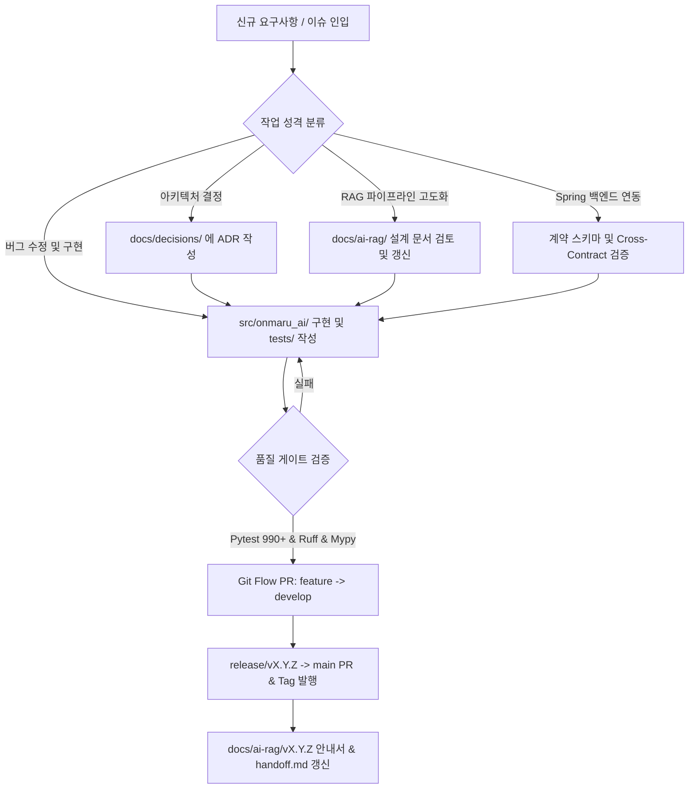

# OnMaru AI Engine 문서 체계 및 거버넌스 가이드 (Documentation Governance)

> 이 문서는 OnMaru AI Engine 저장소 내의 문서 분류, 작업 시 문서 기록/관리 규칙, 의사결정 기록(ADR) 작성 기준 및 향후 태스크별 작업 가이드를 정의하는 통합 가이드라인입니다.

---

## 1. 디렉토리 구조 및 문서 분류 체계 (Documentation Map)

저장소의 `docs/` 디렉토리는 성격과 목적에 따라 다음과 같이 체계적으로 분리 관리됩니다.

```
docs/
├── README.md                                    # (본 문서) 전체 문서 색인 및 작업 거버넌스
├── decisions/                                   # [ADR Toolkit 관리] 아키텍처 의사결정 기록 (MADR)
│   ├── .adr-toolkit.json                        # ADR 도구 설정 (locale: ko)
│   ├── README.md                                # ADR 색인 (자동 생성)
│   ├── adr-template.md                          # ADR 기본 템플릿
│   └── 0001-record-architecture-decisions.md    # ADR-0001: 아키텍처 결정 기록
├── ai-rag/                                      # AI Engine RAG 시스템 설계 및 릴리즈 보고서
│   ├── README.md                                # AI-RAG 종합 설계 진입점
│   ├── prd.md                                   # 제품 요구사항 정의서
│   ├── architecture.md                          # RAG 파이프라인 및 아키텍처 설계
│   ├── module-boundaries-and-pipelines.md       # 모듈 경계 및 3대 파이프라인
│   ├── request-lifecycle.md                     # 요청 생명주기 및 처리 단계
│   ├── spring-backend-integration-and-sse-architecture.md  # Spring 통합 및 SSE 설계
│   ├── v0.1.2-production-wiring-and-spring-integration.md # v0.1.2 프로덕션 릴리즈 및 연동 규격
│   ├── diagrams/                                # 아키텍처 다이어그램 원본 (LikeC4, PlantUML)
│   └── reports/                                 # 설계 브리핑 HTML 및 시각화 보고서
└── superpowers/                                 # AI 개발 보조 도구 및 스킬 가이드
```

---

## 2. 작업별 문서 기록 및 관리 규칙 (어디에 무엇을 어떻게 하는가?)

개발 진행 시 "어떤 작업이나 변경이 발생했을 때 어디에 어떻게 기록할 것인가"에 대한 명확한 규칙입니다.

| 작업 성격 | 작성/수정 위치 | 반영 내용 및 방법 |
| :--- | :--- | :--- |
| **1. 구조적 기술 의사결정**<br/>(프레임워크, 통신 규격, DB/캐시, 라이브러리 교체 등) | `docs/decisions/` | **ADR(Architecture Decision Record)** 작성.<br/>- `adr-toolkit`을 통해 번호 할당 및 인덱싱<br/>- 상태(`accepted`, `deprecated` 등) 및 제약조건 기록 |
| **2. API / 프로토콜 / 데이터 계약 변경**<br/>(Spring ↔ AI Engine 계약, Request/Response 스키마) | `docs/ai-rag/` 및<br/>`docs/ai-rag/contracts-and-data.md` | - 변경된 JSON Schema 및 통신 헤더(`X-Run-Progress-Token` 등) 명시<br/>- Spring 백엔드 연동 관련 사항이면 통합 가이드 갱신 |
| **3. 신규 버전 배포 및 릴리즈**<br/>(Git Flow 릴리즈, 이미지 발행) | `docs/ai-rag/vX.Y.Z-*.md` 및<br/>`README.md` | - 배포된 이미지 태그, Commit SHA, Container Digest 기록<br/>- 변경 사항, 헬스체크 방법, 백엔드 전달용 가이드 작성 |
| **4. 세션별 작업 상태 관리 및 인수인계** | `handoff.md` (루트) | - 현재 진행 중인 세션 작업 상태, 완료/진행중/미해결 태스크 즉시 기록<br/>- 작업 종료 전 항상 동기화 |
| **5. 아이디어 및 기술 부채 기록** | `improvements.md` (루트) | - 구현 중 발견한 개선 아이디어, 추후 리팩토링 항목을 즉시 캡처 |
| **6. GitHub 작업 추적** | GitHub Issue / PR | - 비사소한 작업 시작 전 반드시 관련 Issue 생성/연결<br/>- PR 본문에 관련 Issue 링크 (`closes #...` 또는 `ref #...`) |

---

## 3. ADR (Architecture Decision Record) 작성 거버넌스

본 저장소는 **ADR Toolkit**을 공식 도구로 채택하여 의사결정을 추적합니다.

### 3.1. 언제 ADR을 작성해야 하는가?
- 새로운 외부 시스템 연동 프로토콜을 도입할 때 (예: MCP, SSE, gRPC, WebSocket)
- 상태 관리 및 런타임 수명주기(Lifespan, Connection Pooling) 정책을 결정할 때
- 검색 파이프라인의 핵심 알고리즘이나 모델을 결정/변경할 때 (예: BM25 + Vector RRF 융합 방식)
- 저장소 분리, 보안 토큰 검증 아키텍처 등 아키텍처 경계에 영향을 미치는 결정을 내릴 때

### 3.2. ADR 라이프사이클 및 명령어
- **사전 검사**: `python3 skills/adr-toolkit/scripts/adr.py preflight --json`
- **검증**: `python3 skills/adr-toolkit/scripts/adr.py validate --dir docs/decisions --json`
- **색인 갱신**: `python3 skills/adr-toolkit/scripts/adr.py index --dir docs/decisions --json`
- **의존 관계 그래프 생성**: `python3 skills/adr-toolkit/scripts/adr.py graph --dir docs/decisions --format both --json`

---

## 4. 향후 작업 로드맵 및 영역별 가이드라인

향후 AI Engine 고도화 작업 시 각 도메인별 표준 진행 경로입니다.



### 도메인별 구현 상세 지침:
1. **RAG 파이프라인 (Vector + BM25)**:
   - 관련 위치: `src/onmaru_ai/retrieval/`, `src/onmaru_ai/corpus/`
   - 관련 설계: [`docs/ai-rag/architecture.md`](file:///Users/yangseunghyeon/Development/OnMaru/OnMaru-AI-engine/docs/ai-rag/architecture.md), [`rag-storage-schema.md`](file:///Users/yangseunghyeon/Development/OnMaru/OnMaru-AI-engine/docs/ai-rag/rag-storage-schema.md)
   - 작업 원칙: PostgreSQL `ai` 스키마(pgvector, BM25) 기반 하이브리드 검색 및 RRF 랭킹 적용.

2. **Spring Backend 연동 (Orchestration & Tools)**:
   - 관련 위치: `src/onmaru_ai/orchestration/`, `src/onmaru_ai/adapters/`
   - 관련 설계: [`docs/ai-rag/spring-backend-integration-and-sse-architecture.md`](file:///Users/yangseunghyeon/Development/OnMaru/OnMaru-AI-engine/docs/ai-rag/spring-backend-integration-and-sse-architecture.md)
   - 작업 원칙: `SpringPlaceQueryAdapter`, `CallbackProgressSink`의 단일 정본 계약을 엄격히 유지하고 Spring Issue와 항상 연계하여 작업.

3. **관측성 및 품질 모니터링 (Quality Harness)**:
   - 관련 위치: `src/onmaru_ai/quality_harness/`
   - 관련 설계: [`docs/ai-rag/observability-contract.md`](file:///Users/yangseunghyeon/Development/OnMaru/OnMaru-AI-engine/docs/ai-rag/observability-contract.md), [`operations-and-evaluation.md`](file:///Users/yangseunghyeon/Development/OnMaru/OnMaru-AI-engine/docs/ai-rag/operations-and-evaluation.md)
   - 작업 원칙: 2GB 메모리 제약 환경 내에서 OTel 메트릭 수집 및 오프라인/온라인 품질 검증 파이프라인 유지.
