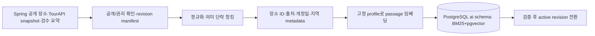

# 홈 여정 AI RAG 설계

> 상태: **구현 전 제품·기술 설계**. 2026-10-19 사용자 결정에 맞춘 새 설계이며, 현재 배포된 API나 인프라를 뜻하지 않는다. 기존 실행 계약과 다른 항목은 구현 시 OpenAPI·migration·FE 계약을 함께 변경한다.

이 README는 `onmaru.site` 홈의 여정 검색을 **이어지는 대화형 RAG 경험**으로 확장하는 문서들의 종합 안내이자 단일 진입점이다. 문서 자체는 **일반 Markdown 파일**이며 심볼릭 링크가 아니다. `docs/README.md`와 `docs/ai/README.md`가 이 파일을 링크한다. 입력 자료인 `docs/specs`의 스냅샷 링크와 달리, 이 설계의 원본은 이 폴더에 직접 둔다.

AI 엔진 저장소는 **`onmaru-ai-engine`**이다. `Engine`은 사용자 요청에 대한 FastAPI 검색·근거 검증·생성을 뜻한다. 그 저장소 안의 **`quality_harness`**는 비동기 품질 관측·실패 분류·재현·실험·승인 자료를 만드는 논리 모듈 이름이다. 별도 상시 서비스나 모든 단계의 LLM agent를 뜻하지 않는다. 이 사본은 2026-10-22 백엔드 작업공간에서 복사한 migration draft다. 백엔드의 미커밋 설계가 reviewable commit으로 고정되고 교차 저장소 링크를 정리하기 전까지는 canonical/public 문서가 아니다. 검토 가능한 이전 절차는 [저장소 분리·관측 운영 결정](repository-split-and-monitoring.md)을 따른다.

이전 완료 후에도 이 저장소에는 Spring이 구현해야 하는 연동 항목을 남긴다. [Spring 통합 설계](https://github.com/YRootLab/OnMaru-backend/blob/develop/docs/ai-rag-spring/README.md), [공유 API·JSON Schema 계약](https://github.com/YRootLab/OnMaru-backend/blob/develop/docs/contracts/README.md), [DB 소유권과 migration 계획](https://github.com/YRootLab/OnMaru-backend/blob/develop/docs/database/schema.md), Spring 구현의 테스트 및 배포 인수 기준이 해당한다. 이전 대상 AI 문서를 여기서 계속 복제·수정하지 않고, 이 진입 문서는 AI 저장소의 고정 링크로 전환한다.

전체 흐름을 한 화면에서 보려면 [AI-RAG 시스템 설계 HTML 보고서](reports/2026-10-21-system-briefing.html)를 연다. 앞부분에는 세 파이프라인과 다섯 query route, 사용자 답변 화면, 합성 질의의 단계별 평가·검토·승격 흐름을 시각화했다. 본문에는 AI 엔진이 소유하는 AI-RAG 문서를 담는다. Spring API·DB 계약·Lightsail 운영 문서는 백엔드 저장소 소유이므로 복사하지 않고 고정 링크로 참조한다. Mermaid는 로컬 SVG로 렌더링하며, 보고서 목차·문서 간 링크는 HTML 내부로 이동한다. 세부 계약의 정본은 아래 Markdown 문서다.

AI 엔진 구조를 빠르게 설명할 때는 보고서의 **「모듈 실행 지도」**를 본다. 서버 경계와 내부 책임을 더 자세히 설명할 때는 보고서의 C4 구조도 4장과 [LikeC4 인터랙티브 구조도](reports/likec4-site/index.html)를 연다. Next.js·Spring Boot·FastAPI·PostgreSQL을 각각 구분하고, Spring의 계획 승인 왕복과 최종 SSE 반환, FastAPI 내부의 query processing·retrieval·generation·corpus·quality harness를 확대해 볼 수 있다. 상세 입출력·실패 규칙은 [모듈 경계 문서](module-boundaries-and-pipelines.md)가 정본이다.

로컬 브라우저에서 보고서를 실행하려면 저장소 루트에서 `python3 -m http.server 18765 --bind 127.0.0.1`을 실행하고 `http://127.0.0.1:18765/docs/ai-rag/reports/2026-10-21-system-briefing.html`을 연다. 별도 빌드나 패키지 설치가 필요 없는 정적 HTML이다.

원본 문서를 수정한 뒤 보고서를 다시 만들 때는 `python3 docs/ai-rag/reports/build_system_briefing.py`를 실행한다. 생성 시에만 Python `markdown`·`beautifulsoup4`와 Mermaid CLI `mmdc`가 필요하며, 생성된 HTML/SVG의 열람에는 필요하지 않다. C4 도식의 정본은 [`diagrams/`](diagrams/README.md)에 있는 LikeC4 모델과 C4-PlantUML 소스다. 이들은 구현 상태도가 아니라 승인된 목표 구조를 표현한다.

`docs/ai/`는 FastAPI provider, 내부 인증, 출력 검증 등 여러 AI 기능에 공통인 계약을 둔다. 현재 배포된 동작은 코드·migration·[Journey OpenAPI](https://github.com/YRootLab/OnMaru-backend/blob/develop/docs/contracts/openapi/journey.openapi.yaml)가 증명한다. 이 폴더와 [ADR-0017](https://github.com/YRootLab/OnMaru-backend/blob/develop/docs/decisions/0017-home-journey-hybrid-rag.md)은 **앞으로 구현할 목표**를 정의한다.

## 한 페이지 설계 요약

| 질문 | 결정 |
|---|---|
| 저장소와 품질 모듈은? | 목표 레포는 `onmaru-ai-engine`; 사용자 답변 엔진과 비동기 `quality_harness`를 한 Python 패키지에서 책임별로 나눈다. Spring·AI 공유 내부 계약은 버전과 양쪽 테스트로 보호한다. |
| 사용자는 무엇을 하나? | 홈에서 자연어로 여정을 찾고 `/c/{threadId}`에서 후속 질문을 한다. 최근 대화는 홈·결과 화면의 접힌 사이드바에서, 찜한 대화는 마이페이지에서 다시 연다. |
| 결과는 무엇인가? | 조건이 충분하면 바로 답하고 모호하면 한 가지만 묻는다. 공개된 장소 최대 5개에 이유·근거 있는 문화 해설·검증된 이미지·출처·후속 질문을 제공한다. 근거가 부족하면 카드와 설명을 줄인다. |
| 응답을 어떻게 보여 주나? | 요청 직후 오목 로딩 → 실제 진행 단계 → 검증·저장된 문장만 선택적으로 점진 표시 → 확정 snapshot. 끊기면 SSE를 재연결하고 확정 상태를 재조회한다. |
| 대화 맥락은 어디에 있나? | Spring이 회원별 원문 턴·확정 답변·명시 조건·짧은 구조화 요약을 회원 삭제·탈퇴 전까지 저장한다. 개인 대화를 임베딩하거나 공개 검색 코퍼스에 넣지 않는다. |
| 어떤 질문에 LLM을 쓰나? | Spring의 인증·비식별화 이후 AI 엔진의 Query Processing Layer가 Query Preprocessing→Query Interpretation→Search Router를 수행하고 Spring이 계획·권한·공개 범위를 승인한다. Spring↔FastAPI plan/execute는 private REST로 시작하고 trace에서 병목이 확인될 때만 gRPC unary를 비교한다. 정형 facts는 Spring `PlaceQueryPort`의 제한된 adapter로 조회한다. MCP는 도구 발견·재사용이 필요한 곳에만 둔다. BM25·Semantic Search·RRF·reranker는 AI Engine 내부에서 실행한다. 첫 출시부터 정형 SQL·Keyword Search 단독·Semantic Search 단독·hybrid·SQL+검색을 모두 활성화하며, route별 실행은 결정적 코드가 한다. |
| 사용량과 안전 경계는? | 회원당 LLM 전송 시도 주 5회·월 15회. 인증·소유권·속도·동시성·입력/출력 검증으로 보호하며 벌점식 abuse 상태는 두지 않는다. |
| 어디에 색인하나? | 공개 승인 자료를 청킹·메타데이터 보강·임베딩해 기존 PostgreSQL의 `ai` 스키마에 적재한다. 2026-10-23 오후 예정인 1GB/$7→2GB/$12 인스턴스 이전 뒤 Spring·DB/PostGIS/pgvector/BM25·Nginx·FastAPI·임베딩·reranker를 한 호스트에 두고 공존을 출시 조건으로 검증한다. 미통과 시 2GB 안에서 조정하고 출시는 보류한다. |
| 어떻게 품질을 관리하나? | 수집·색인과 온라인 검색·생성의 실패/지표를 분리한다. 최소 300문항(개발 200/봉인 100) 평가와 로컬·staging 혼합 부하를 출시 전 실행한다. 정기 자동화는 실패 신호를 최대 3개월 검토 큐에 모으고 주간 Discord·이메일 요약과 Grafana 집계로 알린다. 개별 항목은 기존 `/admin`의 관리자 전용 화면에서 열고, Antigravity CLI 조사·개선 실험은 운영자가 원할 때 직접 시작한다. 설정 승격도 사람이 승인한다. |
| Spring MCP가 어디에 쓰이나? | MCP는 여러 tool client가 발견·재사용할 필요가 있는 Spring 기능에 한정한다. 온라인 정형 장소 조회는 `PlaceQueryPort` 뒤의 private REST를 기본으로 하고, 공통 tool 발견 요구가 생기면 MCP를 선택적으로 둔다. 품질 harness의 Spring 관측 도구는 별도 identity와 좁은 read-only application port로 격리한다. LLM은 online tool을 임의 선택하지 않는다. |

### 데이터 준비: 공개 원천에서 검색 가능한 근거까지

1차 청크 기준은 목표 400토큰·최대 600토큰·겹침 60토큰이며 장소·출처·개정을 섞지 않는다. `multilingual-e5-small` 384차원과 문서 `passage:`/질문 `query:` 접두를 같은 고정 revision으로 사용한다. 공개 철회와 source revision은 인덱스 전환 이전에 확인한다. 세부 스키마·실패 격리는 [아키텍처](architecture.md)와 [공통 동기화 계약](https://github.com/YRootLab/OnMaru-backend/blob/develop/docs/ai/corpus-sync-contract.md)을 따른다.

### 온라인 응답: 질문에서 확정 대화까지

```mermaid
flowchart LR
    U[회원 질문] --> S[Spring admission·확정 대화 상태]
    S --> N[Spring 개인정보 제거·허용 범위]
    N --> P[AI Query Processing Layer: preprocessing·interpretation·Search Router]
    P --> Q{Spring 계획 승인}
    Q -->|SQL_ONLY| C[FastAPI selected private adapter → Spring approved lookup]
    Q -->|SQL_PLUS_RETRIEVAL| C
    Q -->|검색 전용| R[FastAPI 승인 plan 실행·검색 mode]
    C -->|복합 route면| R
    R --> K[필요 시 BM25+vector·RRF·reranker]
    K --> L[근거 최대 12개·LLM 구조화 claim]
    L --> V[FastAPI 형식 검사·Spring 공개/근거 재검증]
    C --> V
    V --> O[확정 답변·출처·장소 snapshot]
    O --> T[대화/요약 저장·검증된 SSE]
```

모호한 지시어나 충돌하는 조건은 확인 질문으로 돌린다. 모델은 장소·출처·URL을 만들어낼 수 없으며 유효한 후보가 부족하면 적은 수를 반환한다. 미검증 모델 문장은 브라우저에 보내지 않는다. 검색·provider 장애는 같은 run의 검증된 기본 탐색으로 종료한다. [요청 생명주기](request-lifecycle.md)에 라우팅 우선순위, 단계별 입출력과 실패별 처리를 고정한다.

### 구현 순서와 완료 증거

1. OpenAPI/SSE schema/DB migration에 thread 목록·응답·북마크·한도와 새 응답 version을 반영하고 FE fixture를 맞춘다.
2. [Lightsail 2GB 인스턴스 마이그레이션](https://github.com/YRootLab/OnMaru-backend/blob/develop/docs/operations/runbooks/lightsail-2gb-migration.md)을 백업·고정 IP·복구 검증과 함께 완료한다. 공개 projection과 철회 규칙을 확정하고 PostGIS+pgvector+BM25 확장 이미지·같은 호스트의 FastAPI 전용 Docker 네트워크/TLS·2GB 모델 포함 혼합 부하를 staging에서 검증한다.
3. 색인 revision 파이프라인, 결정적 SQL/RAG 라우터, 하이브리드 검색·근거 검증·같은 run fallback을 구현한다.
4. 후속 대화·사용량 ledger·SSE·홈/결과/마이페이지 재진입을 연결하고 계약·권한·재연결 시나리오를 통과시킨다.
5. 출시 전 봉인 평가셋에서 Keyword Search(BM25) 단독·Semantic Search(vector) 단독·Hybrid Fusion(RRF)·reranker를 단계별 검증하고 안전·지연 게이트를 통과한다. 출시 뒤 청킹·tokenizer·ranker 개선을 같은 셋에서 비교하고 사람이 승격한다.
6. 사용자 답변 경로의 RAG 단계별 trace·낮은 카디널리티 metric을 기존 OTel/Grafana에 연결하고 개인정보 누출·전송 유실·2GB 계측 부하를 검사한다. 검색 품질 하락이 대시보드에 나타나는지 합성 실패 사례로 확인한다.
7. 결정적 평가/실패 분류 job과 최대 3개월 검토 큐를 만든다. 같은 신호의 중복 묶기·상태 전이·만료·증거 GC를 검증한 뒤, Grafana 집계와 매주 월요일 Discord·이메일 요약의 채널별 전송/재시도를 검증한다. 일반 품질 신호는 개선을 자동 실행하지 않는다.
8. 운영자가 검토 큐의 항목을 선택해 범위·quota/비용을 확인한 경우에만 Antigravity CLI 조사와 격리 실험을 수행한다. 개발셋/봉인셋 비교와 승인 artifact를 확인한 뒤 별도 배포 절차로 승격한다. 철회·권리 사고의 즉시 차단은 이 단계와 관계없이 유지한다.

각 단계의 조건과 지표는 [운영·평가](operations-and-evaluation.md)에, 화면 인수 기준은 [PRD](prd.md)에 있다. FastAPI와 로컬 임베딩·reranker의 실행비는 같은 Lightsail의 CPU/메모리·디스크 사용량에 포함되며, 회원 답변은 별도 Gemini API 무료 tier를 사용한다.

## 읽는 순서

1. [제품 PRD](prd.md): 사용자 경험, 홈·결과·마이페이지 흐름, 대화·찜·한도·SSE와 인수 기준.
   [대화형 큐레이션·프롬프트·UI](conversation-and-prompt-design.md): 확인 질문 기준, 답변 밀도, 작업별 프롬프트, 카드·이미지·출처·후속 질문 화면 계약.
2. [모듈 경계와 세 파이프라인](module-boundaries-and-pipelines.md): 오프라인 Corpus 준비·온라인 응답·비동기 품질 감독의 레이어, 모듈 소유권·입출력 artifact·실패 경계·구현 순서.
   [파이프라인과 검색 설계](architecture.md): 원천 동기화, 청킹·임베딩, SQL/하이브리드 라우팅, 순위 결합, 근거·출처, 대화 메모리.
3. [질문 해석 사전](question-understanding.md): 코드·동의어, 부정·복합 질문, 다턴 해석과 fixture.
   [질문 처리와 검색 계획](query-processing.md): Query Processing Layer(Preprocessing→Interpretation→Search Router), SQL·Keyword·Semantic·Hybrid 경로와 외부 source 승인 경계.
4. [RAG 저장 스키마](rag-storage-schema.md): 문서·청크·벡터·출처·철회와 active revision의 물리 계약.
5. [Corpus 보존·GC](corpus-lifecycle-and-gc.md): 활성·롤백본, 원천 export, 철회 감사, 백업 복원과 384차원 색인 개선 조건.
6. [근거 검증·사람 검수](grounding-and-review.md): 문장별 evidence, 허용/보류, 이중 검수와 오류 환류.
7. [API·저장 모델](contracts-and-data.md): 기존 여정 계약에 추가할 대화 목록·찜·한도·메모리의 정확한 경계.
8. [요청 생명주기](request-lifecycle.md): 라우팅 우선순위, Spring↔FastAPI 입출력, SSE 상태와 실패 결정표.
9. [안전·오남용 정책](security-and-abuse.md): 입력·원천·출력 신뢰 경계, 권한·비용 방어와 회귀 검증.
10. [평가·환경 검증](evaluation-and-environment-tests.md): 최소 300문항 gold set, 단계별 지표, 로컬·staging 부하/장애 실험.
11. [운영·평가 계획](operations-and-evaluation.md): Lightsail 용량 검증, pgvector·비공개 DB 연결, 관측, 1차 출시 게이트와 2차 품질 개선.
12. [후속 ADR](https://github.com/YRootLab/OnMaru-backend/blob/develop/docs/decisions/0017-home-journey-hybrid-rag.md): ADR-0007에서 변경된 장기 구조 결정과 대안.
13. [RAG Quality Engineering 상세 설계](quality-engineering-agent.md): 오프라인 원천 검수·검색 실패 진단, trace, 다섯 책임, 반사실적 실험, 도구 권한·비용·승인, LangGraph/Langfuse와 외부 검색 판단.
14. [운영 준비 검토](production-readiness-gaps.md): 현재 구현과 목표 설계의 차이, 출시 차단 증거, 2GB 검증 순서와 미확정 항목.
15. [OpenTelemetry 관측 계약](observability-contract.md): 기존 Grafana·Prometheus 경로에 추가할 RAG trace·metric·dashboard·alert와 검증 순서.
16. [저장소 분리·관측 운영 결정](repository-split-and-monitoring.md): 문서 정본 소유권, 코드·배포 이전 순서, Grafana Cloud 전송 경로와 검증 게이트.
17. [관측 스키마와 하네스 입력](telemetry-and-harness-schema.md): 단계별 실행 결과·Trace ID·영속 run의 연결, 실패/복귀 코드와 품질 하네스의 자동 판정 경계.
18. [Spring 측 AI-RAG 통합](https://github.com/YRootLab/OnMaru-backend/blob/develop/docs/ai-rag-spring/README.md): Online approved query tool과 quality harness용 read-only tools, 공유 schema, 보안·운영 계약. [ADR-0018](https://github.com/YRootLab/OnMaru-backend/blob/develop/docs/decisions/0018-quality-harness-spring-mcp-tools.md) 및 [ADR-0019](https://github.com/YRootLab/OnMaru-backend/blob/develop/docs/decisions/0019-journey-query-mcp-tools.md)은 구현 전 제안이다.

## 문서 경계

| 구분 | 기준 |
|---|---|
| 제품 범위와 사용자 흐름 | 이 폴더의 PRD |
| 새로운 AI RAG 데이터·온라인 처리 | 이 폴더의 아키텍처 |
| 질문 해석·근거 검증·실험 | 이 폴더의 질문 사전·근거 정책·평가 계약 |
| AI corpus 논리/물리 저장 구조 | 이 폴더의 RAG 저장 스키마와 [AI DBML](https://github.com/YRootLab/OnMaru-backend/blob/develop/docs/database/modules/ai.dbml) |
| Spring/FastAPI 내부 인증·provider adapter | [`docs/ai/`](https://github.com/YRootLab/OnMaru-backend/blob/develop/docs/ai/README.md)의 공통 계약 |
| Spring 소유 online query·quality MCP adapter·인증·접근 범위 | [docs/ai-rag-spring](https://github.com/YRootLab/OnMaru-backend/blob/develop/docs/ai-rag-spring/README.md) |
| 현재 공개 HTTP/SSE wire 형식 | [Journey OpenAPI](https://github.com/YRootLab/OnMaru-backend/blob/develop/docs/contracts/openapi/journey.openapi.yaml), [SSE schema](https://github.com/YRootLab/OnMaru-backend/blob/develop/docs/contracts/schemas/journey-sse-event.schema.json) |
| 현재 DB와 변경 필요 스키마 | [DB 설계](https://github.com/YRootLab/OnMaru-backend/blob/develop/docs/database/README.md)와 실행 migration |
| 과거 baseline-first 결정 | [ADR-0007](https://github.com/YRootLab/OnMaru-backend/blob/develop/docs/decisions/0007-baseline-optional-rag.md), 변경 이력으로 보존 |

이 문서의 `계획`은 아직 코드에 구현되지 않았다. SSE의 단계·문장 delta **schema는 이미 있으나**, 새 대화형 화면·검증 완료 문장 표시·주간/월간 한도·3~5개 장소·같은 호스트 FastAPI의 pgvector 연결은 구현 대상이다.

## 이번 대화의 결정 추적

| 결정 | 기준 문서 |
|---|---|
| 홈 검색에서 이어지는 여정 대화, 최근 대화 목록과 `/c/{threadId}`, 결과 화면·마이페이지의 대화 재진입 | [PRD](prd.md)·[API 계약](contracts-and-data.md) |
| 조건이 충분하면 바로 답하고 모호하면 한 가지만 묻기, 풍부한 문화 설명·검증된 미디어·다양한 작업별 prompt·후속 chip | [PRD](prd.md)·[대화형 큐레이션·프롬프트·UI](conversation-and-prompt-design.md) |
| 대화 전체 찜, 장소 3~5개, SSE 로딩·확정 문장 표시·snapshot | [PRD](prd.md)·[API 계약](contracts-and-data.md) |
| 회원당 주 5회·월 15회, 구조화 대화 메모리와 원문 provider 미전달, 오남용 방어 | [PRD](prd.md)·[API 계약](contracts-and-data.md)·[보안](security-and-abuse.md) |
| 문서 수집→청킹/metadata→임베딩→검색 인덱스와 정규화·질의 계획·라우팅→필요 시 RRF→reranker→LLM·출처 | [질문 처리](query-processing.md)·[아키텍처](architecture.md)·[RAG 저장 스키마](rag-storage-schema.md) |
| 주제 코드·동의어·부정/복합 질문과 claim별 근거/사람 검수 | [질문 해석](question-understanding.md)·[근거 검증](grounding-and-review.md) |
| 2GB Lightsail에서 Spring·PostgreSQL/PostGIS+pgvector+BM25·Nginx·FastAPI·임베딩·reranker 공존 검증, 내부 전용 연결 | [운영·평가](operations-and-evaluation.md)·[ADR-0017](https://github.com/YRootLab/OnMaru-backend/blob/develop/docs/decisions/0017-home-journey-hybrid-rag.md) |
| 수집·검색·생성 실패 분리, 최소 300문항 평가와 환경 시험, 자동 비교·사람 승인 | [평가·환경 검증](evaluation-and-environment-tests.md)·[운영·평가](operations-and-evaluation.md) |
| 기존 Grafana·Prometheus·OpenTelemetry 경로의 RAG trace·metric·경보, Langfuse는 필요성 검증 후보 | [관측 계약](observability-contract.md)·[품질 감독](quality-engineering-agent.md) |
| 단계별 실행 결과의 버전형 schema와 하네스 입력·자동 제어 권한 | [관측 스키마](telemetry-and-harness-schema.md)·[품질 감독](quality-engineering-agent.md) |
| 온라인 결정적 응답과 분리한 오프라인 agent의 검수·평가·운영 진단 | [모듈 경계](module-boundaries-and-pipelines.md)·[품질 감독](quality-engineering-agent.md) |
| 활성 corpus 1개·롤백 최대 2개, export/감사 보존과 철회 우선 삭제, revision GC·384차원 색인 실측 | [Corpus 보존·GC](corpus-lifecycle-and-gc.md) |

위 항목이 이번 기획의 현재 결정 목록이다. 새 요구가 생기면 이 표와 해당 원본 문서를 함께 갱신한다.
