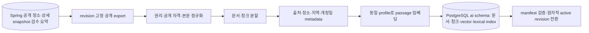
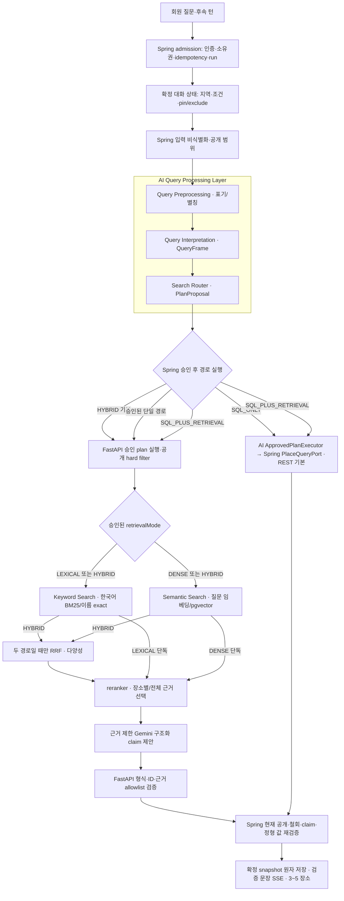

# 홈 여정 RAG 데이터·응답 아키텍처

> 상태: 구현 전 설계. [제품 PRD](prd.md)의 사용자 요구를 Spring·FastAPI·PostgreSQL 경계로 옮긴다.

요청당 판정 순서·내부 envelope·SSE 상태 전이는 [요청 생명주기](request-lifecycle.md)에 정의한다.
질의별 정규화·계획·라우팅과 단일 검색 경로의 활성화 조건은 [질문 처리 계약](query-processing.md)을 따른다.
질문 code/동의어는 [질문 해석 사전](question-understanding.md), corpus 키·인덱스·전환은 [RAG 저장 스키마](rag-storage-schema.md), 문장별 근거 검증은 [근거 정책](grounding-and-review.md)이 기준이다.
세 파이프라인의 **레이어·모듈 소유권·입출력 artifact·실패 경계**를 구현 관점에서 읽으려면 [모듈 경계와 세 파이프라인](module-boundaries-and-pipelines.md)을 먼저 본다. 아래 그림은 그중 온라인 경로의 핵심 실행 순서를 보여 준다.

## 현재 기준과 변경점

현재 Spring은 회원·여정 run·공개 카탈로그를 소유하고, FastAPI는 AI proposal 경계를 가진다. PostgreSQL은 운영 Lightsail에서 Spring/PostGIS/Nginx와 자원을 공유한다. 기존 `ai` DBML은 임베딩을 모델링하지만 운영 pgvector 이미지와 색인 경로는 아직 검증되지 않았다. 이번 설계는 **하이브리드 RAG를 첫 AI 응답의 기본 경로**로 정한다. 데이터·provider 장애 시 검증된 SQL 기본 탐색이 같은 run을 마무리한다.

## 오프라인 데이터 준비

Spring은 공개 가능한 canonical projection과 불변 manifest를 제공한다. FastAPI는 전용 계정으로 `ai` 스키마만 읽고 쓰며, Spring 업무 스키마에 직접 접근하지 않는다. manifest에는 `revisionId`, 문서 ID·해시, 게시 시각, upsert/tombstone, 출처 이용 조건을 둔다. 중복 pull은 멱등으로 처리하고 전체 문서 수·해시·embedding profile 검증 전에는 active pointer를 바꾸지 않는다. 철회 항목은 새 revision 활성화 전에 검색 대상에서 빠져야 한다. 이전 revision으로 되돌려 철회를 무효화하지 않는다.

긴급 철회는 전체 재색인 완료를 기다리지 않는다. Spring의 현재 공개 자격 조회가 우선이며 새 run의 후보 ID와 최종 snapshot 저장 직전에 철회 여부를 검사한다. FastAPI는 별도 `revoked_source_id`/`revoked_place_id` 차단 집합을 검색 시 적용하고 tombstone 이벤트를 멱등으로 수신한다. 동기화가 지연·실패해 차단 집합의 신선도를 확인할 수 없으면 해당 revision의 RAG 경로를 닫고 Spring 기본 탐색으로 전환한다. 일반 수정은 manifest 배치에 포함하고, 공개 철회·권리 취소는 즉시 차단 이벤트와 재색인을 병행한다. 허용 지연·검증 방법은 [운영 게이트](operations-and-evaluation.md)에 둔다.

| 원천 | 1차 포함 조건 | 제외 |
|---|---|---|
| TourAPI 상세 개요 | 최신 `OK` snapshot이며 현재 공개 자격·재이용 조건을 확인한 장소 | 실패 snapshot, HTML 명령, 이미지 URL 자체 |
| 장소 canonical 정보 | 공개된 이름·검수 별칭·지역·분류·방문 포인트 | 비공개·철회·미검수 항목 |
| K-Contents | 공개 관계와 `VERIFIED` 요약·작품명 | `REVIEW_REQUIRED`, 원문 발췌의 이용 조건 미확인 부분 |
| 회원 데이터 | 없음 | 질의·대화·찜·개인 위치는 절대 검색 코퍼스에 넣지 않음 |

기본 청킹은 의미 단락을 우선하고 목표 400토큰, 최대 600토큰, overlap 60토큰으로 시작한다. 서로 다른 장소·출처·개정을 한 청크에 섞지 않는다. 각 청크는 `documentId`, `chunkId`, `placeId`, `sourceType`, `sourceId`, `sourceRevision`, `publishedAt`, `collectedAt`, `license`, `region`, `category`, `contentHash`, `chunkerVersion`, `embeddingProfile`, 원천 문서의 `startOffset`/`endOffset`을 갖는다. offset은 출처 내 주장 위치를 추적하는 용도이며 공개 화면에 원문을 무단 재게시하는 근거가 아니다. 단락이 짧으면 억지로 중복 청크를 만들지 않는다. 청크 크기와 overlap은 2차 offline 실험에서 변경한다.

첫 구현의 임베딩 profile은 [`intfloat/multilingual-e5-small`](https://huggingface.co/intfloat/multilingual-e5-small)의 **384차원**으로 정한다. 문서에는 `passage: `, 질문에는 `query: ` 접두를 붙이고 같은 모델 revision·정규화·cosine 척도를 사용한다. 배포 이미지에는 모델 commit과 라이선스 검토 결과를 고정한다. 한국어 고유명사·별칭 품질은 출시 평가셋으로 확인하고 실패하면 profile을 교체해 전체 재색인한다. profile이 다른 벡터를 같은 인덱스에서 섞지 않는다. **FastAPI·질문 임베딩·reranker와 오프라인 문서 임베딩은 2GB/$12 Lightsail에서 실행**한다. 문서 임베딩·대량 재색인은 온라인 부하와 겹치지 않게 직렬화하고, 모델의 동시 상주·적재/해제·양자화 후보를 cold/warm 지연·최대 RSS·품질로 비교해 실행 방식을 고정한다. 작은 공개 코퍼스는 pgvector의 exact cosine 검색으로 시작하고, 필터가 적용된 실제 p95가 예산을 넘을 때만 HNSW를 별도 비교한다. [모델 연구 저장소](https://github.com/microsoft/unilm/blob/master/e5/README.md), [pgvector 검색 특성](https://github.com/pgvector/pgvector).

## 온라인 요청·검색·생성

그림의 BM25·Semantic Search 병렬 경로와 RRF는 **HYBRID 계획**을 나타낸다. 내부 route enum `LEXICAL_ONLY`는 vector·RRF을, `DENSE_ONLY`는 BM25·RRF를 실행하지 않는다. `SQL_ONLY`도 FastAPI의 Query Processing Layer 호출을 거치지만 execute·검색·LLM은 거치지 않는다. 두 단일 검색 계획도 첫 출시부터 질문 유형별로 활성화한다. 계획 선택의 정확한 조건, 외부 source 제외 경계, 단계별 artifact는 [질문 처리](query-processing.md)와 [모듈 경계](module-boundaries-and-pipelines.md)를 따른다.

1. Spring이 인증·회원/대화 소유권·입력 길이·idempotency·주/월 한도·동시 run을 검사한다. 원문은 Spring에만 보존하고 LLM 입력에는 전달하지 않는다.
2. Spring은 최근 확정 구조화 상태에서 지역·테마·동행 조건·고정·제외 장소를 재구성하고 질문의 개인정보를 제거한 `safeQuery`를 AI 엔진에 보낸다. AI 엔진은 질문의 검색 의미를 버전형 주제 사전 code와 canonical 대상 ID, 긍정·부정 `retrievalExpression`, 비식별 `semanticQuery`에 함께 보존한다. `semanticQuery`는 `safeQuery`의 허용된 표현의 수식·어순·부정 범위를 살려 로컬 BM25/embedding/reranker에 쓰되 외부 LLM에는 보내지 않는다. 새 턴의 명시 조건이 이전 요약보다 우선한다. 핵심 의미를 안전하게 보존할 수 없거나 조건이 충돌하면 한 가지 확인 질문을 반환한다.
3. AI 엔진의 `Query Processing Layer`는 `Query Preprocessing`으로 표기·별칭을 정리하고, `Query Interpretation`으로 의도·대상·조건·부정·대화 맥락을 `QueryFrame`에 구조화한다. 그다음 `Search Router`가 정형 사실과 공개 본문 사실을 분리하고 `SQL_ONLY`, `LEXICAL_ONLY`, `DENSE_ONLY`, `HYBRID`, `SQL_PLUS_RETRIEVAL`, 확인 질문 중 하나를 제안한다. Spring은 제안 경로의 필드·필터·권한을 승인하거나 거부한다. 첫 출시부터 모든 경로를 활성화하되 이름·별칭/정확한 용어 단독은 Keyword Search(BM25), 고유명사·부정 없는 단일 의미 주제는 Semantic Search, 설명·비교·추천의 복합 조건은 `ai` 활성 revision의 hybrid 검색으로 보낸다. 라우팅은 모델의 임의 tool 선택이 아니라 서버의 결정적 규칙이다.
4. 공개 자격·지역·분류·제외·revision을 두 검색 경로 모두에 hard filter로 적용한다. 키워드 경로는 장소명·검수 별칭의 exact/prefix 식별 신호와 한국어 토큰화 BM25로 공개 제목·본문을 찾는다. 문맥 경로는 같은 범위의 청크를 384차원 exact cosine으로 찾는다. `pg_trgm`/기본 FTS 점수를 BM25로 대체 표기하지 않는다.
5. 두 경로를 병렬 실행해 필터 통과 청크 각 최대 20개를 받고 ID로 중복 제거한다. `RRF = 1/(60 + bm25Rank) + 1/(60 + vectorRank)`로 합친다. 추천·교체는 각 경로에서 장소당 3개·동일 source revision당 2개로 제한하고, fusion 후 장소당 3개를 유지하면서 가능한 서로 다른 장소 5곳을 확보한 뒤 최대 30개를 다음 단계로 넘긴다. 설명·비교는 명시 대상별 후보를 보존한다. 한 경로가 비면 남은 경로 순위를 사용하고 `degradedReason`을 기록한다. 후보 다양성 규칙은 [요청 계약](request-lifecycle.md)에서 고정한다.
6. 첫 RAG 릴리스부터 reranker가 RRF 상위 최대 30개의 **비식별 semanticQuery·청크 본문** 관련도를 다시 채점한다. 입력 쌍은 `semanticQuery`와 `title + sourceLabel + chunkText`로 만든다. 600토큰 이하 청크를 모두 읽을 수 있는 모델/입력 설정을 우선 선택하고, 불가능하면 겹치는 window로 나눠 청크의 최고 점수를 취하며 절단으로 근거가 빠진 비율을 기록한다. 출처 label은 신뢰 신호나 점수 가산점으로 사용하지 않는다. 출력은 각 기존 청크 ID의 유한 실수 점수이며 동점은 RRF 순위→청크 ID 순서로 정한다. 모델 ID·revision·토크나이저·최대 입력 길이·batch 크기를 `rankerVersion`에 고정한다. 사전 지정한 latency 목표는 두지 않는다. 동일 평가셋에서 후보 수·batch·모델별 근거 품질 향상과 warm/cold latency 분포·최대 RSS·fallback률을 측정하고, 기준선과 운영 자원·사용자 경험을 함께 검토해 timeout과 성능 개선 순서를 정한다. 이후 운영 trace의 tail latency·RRF 복귀율을 기준으로 조정한다. reranker는 새로운 장소·문서·URL을 생성하거나 hard filter를 완화하지 못한다. timeout·오류·버전 불일치·NaN 점수 시 동일 후보의 RRF 순서로 복귀하고 degraded 상태를 기록한다. 이후 장소별 청크 최대 2개와 전체 근거 최대 12개를 선택한다. 카드의 3~5 장소는 서로 다른 canonical ID여야 한다. 다양성 적용 전후의 관련도를 함께 기록한다.
7. FastAPI는 질문 주제 code·공개 표시명과 후보 ID·허용 근거·출처만 모델에 전달한다. 모델은 장소·URL·출처를 새로 만들거나 필터를 완화하지 못한다. 출력은 구조화된 장소 ID, claim별 근거 ID, 짧은 설명이며 FastAPI와 Spring이 각각 검증한다. 근거가 부족한 주장이나 장소는 버리고, 유효한 수가 3 미만이면 부족 상태를 명시한다. 미검증 생성 텍스트는 SSE로 보내지 않는다.
8. generation 실패, timeout, 색인 revision 불일치, DB 장애 시 같은 run에서 검증된 canonical lookup 기본 결과를 사용한다. 정형 조회는 Spring `PlaceQueryPort` 뒤의 승인된 private REST adapter를 기본으로 실행하며, MCP는 tool discovery·재사용 요구가 있을 때만 선택한다. 검색 실패 시 검증된 정형 값만 남길 수 있다. 철회된 과거 문서를 근거로 대체하지 않으며, 확인할 수 없는 사실은 답변하지 않는다. fallback 여부와 원인은 사용자에게 이해 가능한 상태로 표시하되 내부 오류 세부 정보는 노출하지 않는다.

### BM25·reranker 출시 게이트

| 단계 | 1차 계약 | 후속 후보와 승격 조건 |
|---|---|---|
| 키워드 | 이름·별칭 exact/prefix + 한국어 BM25. `pg_search`를 1차 설치 후보로 고정한다 | PostgreSQL 17·PostGIS·pgvector 동시 설치, 한국어 tokenizer의 조사·띄어쓰기·별칭 품질, 라이선스·메모리·색인 크기를 출시 전에 검증한다. 실패하면 `pg_trgm`을 BM25라고 부르며 출하하지 않고 다른 BM25 구현/용량을 재결정한다 |
| 문맥·fusion | 같은 hard filter의 vector 상위 20개와 BM25 상위 20개를 청크 ID로 합쳐 RRF 상위 최대 30개 | 후보 recall@20·union recall@30·서로 다른 장소 수와 hard filter 위반 0건을 검증한다. 이름 exact hit는 별도 식별 신호이며 RRF 점수에 임의 가중치를 더하지 않는다 |
| 재정렬 | 첫 출시부터 경량 reranker가 최대 30개를 재채점하고 최종 근거 12개를 고른다 | FastAPI와 모델을 같은 2GB 호스트에 두고 모델/버전·입력 길이·독립 timeout·동시 실행 수를 고정한다. 300문항 품질·cold/warm 검색 p95·최대 RSS·기존 API 퇴행을 검증한다. 미통과면 모델·실행 방식을 재설계하고 출시를 보류한다 |

출시 전 단계별 회귀를 위해 `BM25 단독 → vector 단독 → RRF → reranker`를 같은 고정 corpus에서 측정한다. 후보 집합의 gold 근거가 빠진 경우는 검색/필터 문제이고, 후보에 있으나 최종 top-k에서 사라진 경우는 fusion/rerank 문제로 분리한다. 모든 실험은 같은 질문 사전·embedding profile을 고정하고 철회·권리 필터 위반 0건을 요구한다.

### SQL과 RAG 라우팅 규칙

| 입력에서 필요한 정보 | 경로 | 예시·처리 |
|---|---|---|
| 이름·주소·지역·분류·현재 공개 여부 같은 단일 canonical 필드 | 승인된 Spring `PlaceQueryPort` → Spring 고정 query | `이 장소 주소가 뭐야?`는 현재 공개 장소를 확인한 뒤 필드만 반환. LLM dispatch 없음 |
| 역사·문화적 의미·방문 포인트·장소 비교·추천 이유 | 하이브리드 RAG + LLM | `이곳의 이야기를 더 알려줘`, `아이와 함께 조용히 볼 곳`은 공개 본문 근거를 검색 |
| 새 여정 또는 장소 교체 | Spring hard filter + 하이브리드 RAG + LLM | 명시 지역·카테고리·고정·제외를 먼저 적용하고 새 근거를 검색 |
| 식별 장소가 없거나 지역·조건이 충돌 | 확인 질문 | 모델 호출 없이 한 가지 누락 조건을 질문. 전국 인기 장소로 임의 대체하지 않음 |
| 공개 자료에 없는 실시간 정보 또는 범위 밖 주제 | 범위·근거 부족 안내 | 영업·날씨·혼잡을 추측하지 않음 |

라우터는 등록된 canonical 필드 질의와 구조화 intent에 한해서 SQL 단독을 선택한다. 해석 신뢰도가 낮으면 RAG로 임의 확대하지 않고 확인 질문을 만든다. 후속 질문의 지시어(`여기`, `두 번째`)는 직전 **확정** 카드 ID에만 결합한다.

## 대화 상태·보안 경계

Spring은 `thread → turns → runs → validated snapshots`와 회원별 한도 ledger, 찜을 소유한다. 각 턴마다 `intentSnapshot`, 명시 조건, pin/exclude ID, 마지막 공개 revision, 짧은 요약을 버전형으로 저장한다. 오래된 원문을 반복해서 provider에 보내거나 회원별 벡터 메모리를 만들지 않는다. 요약은 재구성 편의를 위한 파생 데이터이므로 원본 턴과 충돌하면 다시 만든다. FastAPI는 run 범위의 공개 근거만 처리하고 대화를 영구 저장하지 않는다.

요약은 **확정 snapshot이 저장된 뒤** 같은 상태 버전으로 갱신한다. 생성 중·검증 실패·취소된 미검증 narration은 요약에 넣지 않는다. 다음 턴은 현재 명시 조건과 마지막 6개 확정 턴의 구조화 intent/선택 ID를 우선 사용하고, 오래된 맥락은 최대 1,000토큰 상당의 구조화 요약으로 압축한다. 요약의 ID가 현재 비공개·철회 상태면 삭제하고 공개 상태를 다시 조회한다. 구조화 상태가 부족하면 임의 추측 대신 확인 질문을 한다. 이 한도는 provider에 전달되는 컨텍스트의 상한이며 UI의 과거 대화 열람 기간을 제한하지 않는다.

공개 자료도 프롬프트 주입 가능성이 있으므로 정규화 단계에서 명령형·역할 위장 문장을 격리하고, 검색 근거를 `untrusted source data`로 구분한다. 출력의 후보·근거 allowlist, 고유명사, HTML/URL, 현재 공개 여부를 검증한다. 탐지가 모든 공격을 잡는다고 가정하지 않고 구조·권한·출력 검증을 우선한다. 악의적인 반복 요청은 계정/IP rate limit과 비용 한도로 다루며 위반 카운터·쿨다운은 제품 정책에 넣지 않는다.

## 기존 계약과 필요한 변경

현재 [Journey OpenAPI](https://github.com/YRootLab/OnMaru-backend/blob/develop/docs/contracts/openapi/journey.openapi.yaml)는 `explorations`, `turns`, `runs`, SSE, `saved-journeys`를 정의하고, [SSE schema](https://github.com/YRootLab/OnMaru-backend/blob/develop/docs/contracts/schemas/journey-sse-event.schema.json)는 `run.stage`와 `run.text.delta`도 정의한다. 구현 단계에서 [계약·데이터 설계](contracts-and-data.md)의 대화 목록·삭제·북마크·한도와 3~5개 장소를 **버전·fixture와 함께** 확장한다. 기존 `proposal-validation.md`의 최대 3개 및 `journey-guardrails.md`의 일일 게스트/회원 한도는 현행 구현 설명으로 남기고, 새 계약이 배포되기 전까지는 현재 코드의 제한이 적용된다.
