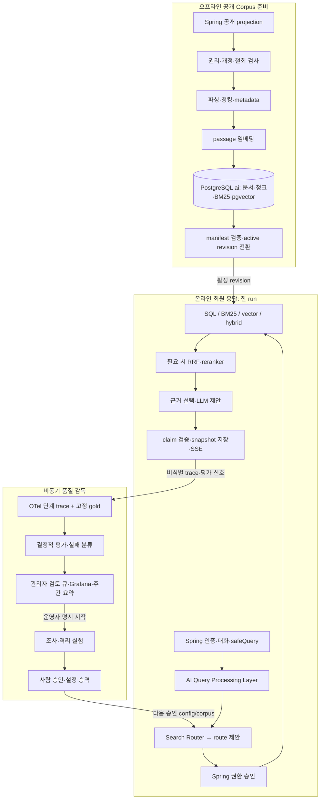
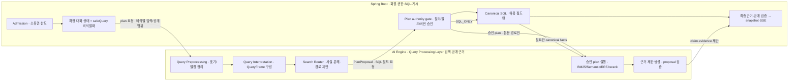
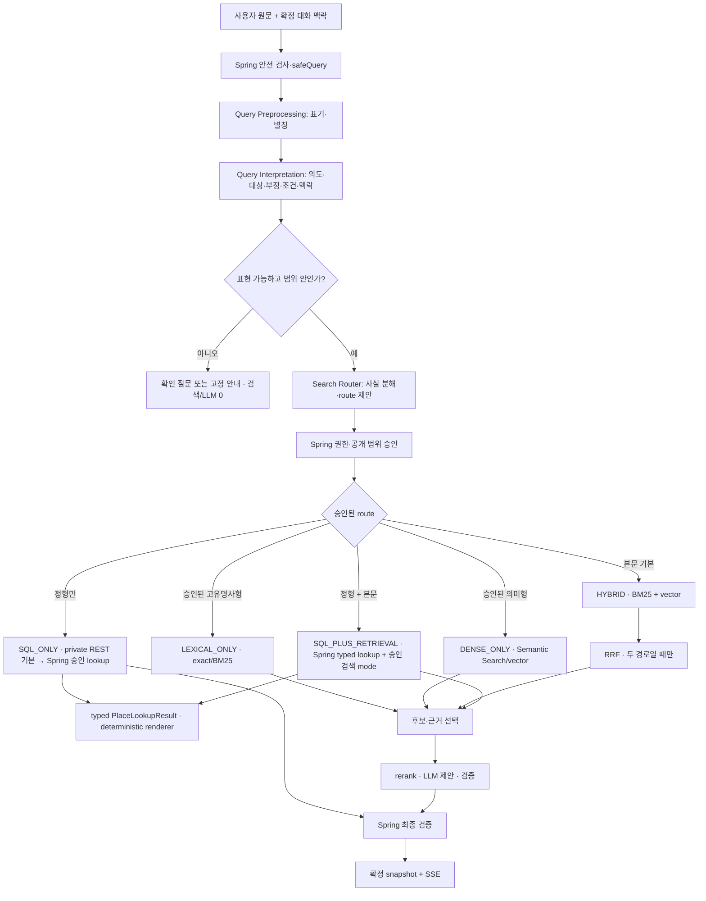
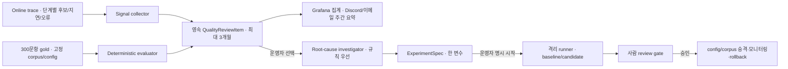

# AI RAG 모듈 경계와 세 파이프라인

> 상태: 구현 전 상세 설계. 이 문서는 [제품 PRD](prd.md), [질문 처리](query-processing.md), [요청 생명주기](request-lifecycle.md), [Corpus 저장·GC](rag-storage-schema.md), [품질 감독](quality-engineering-agent.md)을 한 실행 구조로 묶는다. 현재 코드에 이미 존재한다는 뜻이 아니다. 각 모듈의 책임과 artifact 경계를 바꾸면 관련 계약·평가 fixture·HTML 보고서를 함께 갱신한다.

## 1. 시스템 경계: 세 파이프라인은 연결되지만 실행 주기가 다르다



- **오프라인 준비**는 새 공개 자료와 철회 이벤트를 처리한다. 회원 요청을 기다리게 하지 않는다. 다만 철회 차단은 새 색인 완료보다 먼저 온라인에 적용한다.
- **온라인 응답**은 run 접수 때 고정한 corpus/config/질문 사전 version으로 실행한다. agent나 LLM이 단계 사이에서 계획을 임의 변경하지 않는다.
- **비동기 감독**은 관측·평가·사람이 선택한 실험으로 다음 version을 만든다. 현재 run의 검색 전략·근거·응답을 뒤늦게 수정하지 않는다.

## 2. 온라인 레이어와 소유 모듈




이 그림은 서버 경계 안의 **계층과 모듈 책임**을 구분한다. Query Processing Layer는 Query Preprocessing·Query Interpretation·Search Router 단계로 구성된다. 첫 구현에서 Spring 내부 모듈은 별도 마이크로서비스가 아니고, FastAPI의 검색·순위·생성도 하나의 비공개 AI 프로세스 안에서 분리한다. PostgreSQL `ai` 스키마와 업무 스키마는 계정·권한으로 분리한다. 외부 Gemini만 생성 provider이며, 질문 임베딩·reranker는 2GB 목표 호스트의 로컬 실행 후보이다.

| 레이어·소유자 | 입력 | 단일 책임 | 출력·다음 경계 | 실패 시 원칙 |
|---|---|---|---|---|
| `Admission` · Spring | 세션, thread ID, `clientTurnId`, `baseVersion`, 질문 원문 | 인증·소유권·CSRF·idempotency·입력 길이·동시 run·속도 제한 | `AcceptedRun` 또는 오류 | 거부 시 run/LLM dispatch 없음. 재전송은 같은 run 반환 |
| `ConversationState` · Spring | 최근 확정 턴·구조화 요약·현재 공개 카드 | 새 턴의 명시 조건을 우선해 region/theme/pin/exclude를 재구성 | `ContextState` | 삭제·철회 장소는 맥락에서 제거. 추측 대신 확인 질문 |
| `InputPrivacyGate` · Spring | 원문, 확정 `ContextState` | 개인정보·비밀·자유 URL 제거와 공개 범위·입력 안전 검증 | 비식별 `safeQuery`, 확정 상태, 허용 필터 | 핵심 뜻을 안전하게 보존할 수 없으면 확인 질문; AI 전송 없음 |
| `Query Processing Layer` · AI Engine | `safeQuery`, 확정 상태, 사전 version | Query Preprocessing → Query Interpretation → Search Router의 순서로 질문을 `QueryFrame`으로 해석하고 검색 계획을 제안 | `QueryFrame`과 불변 `PlanProposal`, 또는 `Clarification` | 불확실하면 의미를 지우지 않고 확인 질문 제안 |
| `PlanAuthorityGate` · Spring | `PlanProposal`, 회원/공개/철회 상태 | 필드·ID·filter 부분집합·version·권한 검증, 계획 승인 및 필요한 opaque query grant 발행 | `ApprovedQueryPlan` 또는 거부 | 범위 확대·미승인 필드·구버전은 실행하지 않음 |
| `ApprovedPlanExecutor` · FastAPI | Spring이 승인한 route·plan hash·opaque query grant | 정형 경로에서만 Spring `PlaceQueryPort` private REST adapter(기본; MCP 선택 가능)를 최대 1회 호출; retrieval은 로컬 typed component를 호출 | `PlaceLookupResult` + 검색 artifact | LLM의 임의 tool 선택·SQL 입력 금지; grant 없는 호출 거부 |
| `PlaceQueryInboundAdapter` · Spring inbound adapter (REST 기본, MCP 선택) | opaque grant·온라인 전용 service scope | `PlaceQueryPort` 호출만 수행 | 허용된 정형 projection 최대 5건 | 범용 SQL·Repository 직접 접근·회원 조회·자유 필터 금지 |
| Spring↔FastAPI gRPC unary · 후속 성능 실험 | 동일한 plan/execute request contract | Spring과 FastAPI 사이 고정 업무 요청을 unary RPC로 전달 | 기존 plan/execute response contract | REST hop 병목이 trace로 확인된 뒤에만 실험; bidi가 아님; proto/codegen 및 auth/trace 검증 필요 |
| `GrpcPlaceQueryAdapter` · 별도 실험 후보 | 동일한 opaque grant와 요청 DTO | 같은 `PlaceQueryPort`에 unary RPC로 위임 | 같은 `PlaceLookupResult` | 온라인 orchestration 실험과 분리; benchmark 전 운영 route에 노출하지 않음 |
| `PlaceQueryPort` / `ApprovedJourneyLookupService` · Spring application | 검증 전 grant reference | 제한된 공개 장소 lookup use case, grant·공개/철회·field·상한 검증 | 승인된 projection | MCP/REST transport와 무관한 application 경계; SQL은 고정 query adapter 아래에만 존재 |
| `PlanValidator` · FastAPI | Spring이 승인한 execute envelope | 승인 plan hash, service auth, config/corpus/철회 sequence 검사 | `ExecutablePlan` | 승인 범위와 다르면 거부 |
| `RetrievalExecutor` · FastAPI | `ExecutablePlan`, 승인 표시문, hard filter | exact 별칭 식별 및 Keyword Search(BM25)/Semantic Search(vector)/HYBRID 중 요청된 경로만 수행 | 단계별 `CandidateSet` | 사용하지 않는 모델은 호출하지 않음. 두 경로 중 하나만 실패한 hybrid는 degraded 기록 |
| `Fusion` · FastAPI | 두 경로의 청크 ID·rank | hybrid일 때만 RRF와 중복·장소/source 다양성 처리 | `FusedCandidates` 최대 30개 | 단일 경로 계획에서 RRF 생략. cap 탈락 사유 기록 |
| `Ranker` · FastAPI | 후보와 승인 질문 표시문 | 첫 RAG 릴리스의 경량 reranker로 재채점, 장소당 2개·전체 12개 근거 선택 | `EvidenceSet` | timeout/NaN/버전 오류는 같은 후보 RRF 또는 단일 경로 순서로 복귀 |
| `GroundedGenerator` · FastAPI | 주제 code, 후보 ID, 공개 근거 span·source revision | Gemini에 구조화 claim 제안 1회 요청 | `Proposal` | 근거 0개면 dispatch 없음. 429/timeout 후 자동 재호출 없음 |
| `ProposalValidator` · FastAPI | `Proposal`, run allowlist | 닫힌 schema·길이·중복 ID·HTML/URL·근거 연결 확인 | `ValidatedProposal` | 형식 오류는 제안 폐기 |
| `FinalValidator` · Spring | `ValidatedProposal`, MCP 조회 결과 reference, 현재 DB 공개/철회 상태 | 현재 자격·조건·claim별 근거·정형 값·출처 재검사 및 서버 citation 렌더링 | 확정 `AnswerSnapshot` | 근거 불충분 claim/장소 제거; 필요 시 기본 탐색·명시 실패 |
| `RunPersistence/SSE` · Spring | 확정 snapshot, 상태 version, 재연결 ID | 턴·답변·요약·사용량 원자 저장, 저장된 이벤트/확정 텍스트 전달 | `/c/{threadId}` 결과·3~5 장소 | 미검증 토큰 미전송. 재연결은 같은 run replay/GET snapshot |

### 모듈 의존 규칙

1. AI `Query Processing Layer`는 Spring 업무 DB의 전체 본문을 읽지 않는다. 비식별 `safeQuery`, 승인된 alias/공개 ID와 구조화 대화 상태만 사용한다.
2. `Search Router`는 검색 점수로 route를 사후 변경하지 않는다. 현재 run의 `QueryPlan`은 immutable이며, 실패 시 허용된 **축소·기본 탐색**만 실행한다. 후속 재질의나 계획 교체가 필요하면 새 run과 새 사용량 판정을 요구한다.
3. FastAPI는 회원 ID·쿠키·회원 원문 전체·대화 전체를 받지 않으며 Spring 업무 스키마를 직접 읽지 않는다. `safeQuery`는 요청 메모리에서만 처리한다. AI의 계획 제안은 Spring의 공개·회원 범위를 넓힐 수 없고, 승인 계획의 필터를 느슨하게 하거나 외부 API를 임의 호출할 수 없다.
4. LLM은 장소·근거·URL의 authority가 아니다. `EvidenceSet` 밖의 새 ID나 문장을 주장해도 `ProposalValidator`와 `FinalValidator`가 버린다.
5. 확정 답변 저장 이전에는 사실 문장 SSE를 보내지 않는다. 생성 중 단계 안내는 고정 문구이며 저장 후 검증된 텍스트만 delta로 표시한다.

## 3. 질의 계획과 실행 분기



`LEXICAL_ONLY`와 `DENSE_ONLY`도 첫 출시부터 **활성 route**다. 이름·별칭/정확한 용어 단독, 고유명사·부정 없는 단일 의미 주제, 복합 설명·추천의 `HYBRID`를 결정적 순서로 구분한다. 각 route별 gold 평가에서 recall·최종 장소 품질·claim 지지율·지연·메모리와 오라우팅을 검증해야 출시할 수 있다. `SQL_PLUS_RETRIEVAL`은 주연산 하나와 부수 정형 사실 하나만 허용한다. 외부 Wiki/API는 첫 출시 온라인 route가 아니며 승인된 source adapter 또는 오프라인 corpus 수집 경로의 후속 설계 대상이다. 자세한 조건은 [질문 처리 계약](query-processing.md)의 결정표가 정본이다.

### 계획 경계의 최소 artifact

| Artifact | 필수 내용 | 생성자 → 소비자 | 불변식 |
|---|---|---|---|
| `QueryFrame` | operation, focus/topic code, canonical target/region, positive/negative concept, 명시 조건, 사전 version, 해석 상태 | Query Processing Layer → Search Router | AI 요청 메모리 한정. 핵심 의미 손실 시 `CLARIFY` |
| `PlanProposal`/`ApprovedQueryPlan` | plan version, route, retrieval mode, reason code, 정형 필드 요청, hard filters, corpus/config/revocation version, 상한·fallback·plan hash | Search Router → Spring authority gate → AI execute/trace | 한 run에 하나. Spring 승인 전 실행 금지, 실행 중 수정 금지 |
| `RetrievalRequest` | 인증된 run ID, 승인 계획 hash·본문 검색 부분, 허용 code/ID·상한·필요한 정형 결과 | Spring authority gate → FastAPI execute validator | 회원 원문 전체·임의 URL 없음. 로컬 `semanticQuery`만 사용하고 filter 확대 금지 |
| `CandidateSet` | stage, chunk/place/source ID, rank/score, 제외 사유, version, 지연 | 검색 adapter → fusion/ranker/trace | 공개·철회 hard filter 위반 0 |
| `EvidenceSet` | 최종 청크·원문 offset/span·source revision·허용 장소 ID | ranker → generator/validator | 최대 12개, 같은 활성 revision, 카드당 최대 2개 청크 |
| `ValidatedProposal` | 장소별 원자적 claim과 evidence ID, summary claim, 생성/검색 status | FastAPI → Spring | 제안일 뿐 게시 권한 없음 |
| `AnswerSnapshot` | 확정 text, 카드·citation, route/degraded 상태, stateVersion | Spring validator → persistence/SSE | 저장된 것만 SSE 재생. 현재 공개·권리 재확인 |

## 4. 저장소와 패키지 경계

[AI 저장소](https://github.com/YRootLab/onmaru-ai-engine)는 2026-10-22에 공개 빈 저장소로 생성했다. 현재 FastAPI 소스·테스트·평가 자료는 이 백엔드 저장소의 `ai/`에 있으며 **아직 이전하지 않았다**. `onmaru-ai-engine`은 배포 가능한 사용자 응답 엔진을 포함하는 저장소 이름이고, `quality_harness`는 그 안의 비동기 품질 개선 **논리 모듈** 이름이다. 기존 `ai/src/onmaru_ai/evals/`는 현행 오프라인 평가 코드이며, 아래 목표 구조가 이미 구현됐다는 뜻이 아니다.

```text
onmaru-ai-engine/                 # 목표 별도 저장소의 루트
  pyproject.toml · uv.lock
  src/onmaru_ai/
    api/                          # 비공개 FastAPI 진입점·내부 인증
    corpus/                       # 수집·revision·색인
    retrieval/                    # query plan 검증·검색·결합·재정렬
    generation/                   # 근거 제한 생성·출력 검증
    quality_harness/              # 비동기 평가·실패 분류·격리 실험
  tests/ · evals/                 # 계약·단위·고정 평가 자료
```

이 폴더명은 책임 이름이며 즉시 코드 이동이나 별도 worker 상주를 요구하지 않는다. Spring은 회원·대화·정형 SQL·공개 자격·최종 검증·SSE를 계속 소유한다. AI 저장소는 FastAPI와 필요한 배치/수동 실행 코드를 소유하며 Spring 업무 테이블을 직접 수정하지 않는다. 이전 후 제품·서비스 간 목표 설계는 BE `docs/ai-rag/`에, AI 내부 구현 설계는 AI 저장소에 둔다. 내부 OpenAPI/JSON Schema·예제 fixture의 정본은 BE `docs/contracts/`에 두고 버전 고정·양쪽 계약 테스트로 확인한다. 문서별 소유권과 이전 순서, 관측 경로는 [저장소 분리·관측 운영 결정](repository-split-and-monitoring.md)을 따른다. 저장소 분리 전에 새 AI 이미지의 독립 CI, 기존 BE의 `ai/` 경로를 참조하는 CI·Docker·배포 변경, 호환 배포 순서, 동일 trace context 전파를 검증한다. 이를 완료하기 전에는 BE의 현재 `ai/`를 제거하지 않는다.

## 5. 오프라인 Corpus 준비 모듈

| 모듈 | 입력 → 출력 | 관측·실패 분리 |
|---|---|---|
| `PublicProjection` · Spring | 공개 장소·TourAPI 최신 `OK` snapshot·검수 K-Contents → 불변 export manifest | 원천 수/누락·권리 제외·tombstone sequence. export 실패는 온라인 검색 장애와 별도 집계 |
| `SourcePolicy` · Spring/FastAPI 검증 | source ID·license·개정·공개 자격 → 허용/차단 | 이용권 미확정이면 색인 금지. 철회 이벤트는 active/rollback/staging에 즉시 차단 |
| `ParserNormalizer` · FastAPI 배치 | 허용 본문 → HTML/명령 격리·정규화 텍스트·원문 offset | 파싱 오류·명령 주입·원문 길이·hash 변경 |
| `ChunkerEnricher` · FastAPI 배치 | 정규화 문서 → 의미 단락 청크와 장소/출처/개정/시점 metadata | 400 목표/600 최대/60 겹침의 초기값; 타 장소/출처/개정 혼합 0 |
| `EmbeddingIndexer` · FastAPI 배치 | `passage:` 청크 → 384차원 e5-small 벡터, 한국어 BM25 색인 | 모델 commit·profile 일치, 실패 청크 수, 색인 크기·CPU/RSS. 온라인 피크와 직렬화 |
| `RevisionPublisher` · FastAPI + 승인 절차 | 문서/청크/hash/철회 검증 → active pointer | 전체 검증 전 전환 금지. 철회 반영 전 구 revision rollback 금지 |
| `CorpusGC` · 배치 | 비활성 revision/hold/참조 → 작은 배치 삭제·감사 | 활성 1개·롤백 최대 2개, 철회 우선, 삭제/백업 복원 재적용 확인 |

Spring canonical 원본을 RAG가 소유하지 않는다. `ai` 스키마의 문서·청크·벡터는 공개 projection의 **검색 파생물**이며 출처 revision과 content hash로 재현한다. 수집, 색인, 철회, GC의 상태·로그·지표는 온라인 검색/생성 지표와 분리한다.

## 6. 비동기 품질 감독 모듈



| 책임 | 실행 방법과 artifact | 승인 경계 |
|---|---|---|
| 평가 분석 | Python이 gold와 단계별 top-k를 비교해 `FailureCase`를 만든다. 운영 trace는 정답이 아니라 `SUSPECTED` 신호다 | 자동 검토 큐 생성까지만 |
| 원인 조사 | corpus 누락·해석 손실·filter 오류·BM25/vector miss·RRF/rerank 탈락·grounding 거부를 증거 ID로 분류한다 | 운영자가 항목을 고른 뒤 시작. 복합 사례의 Antigravity CLI는 본인 계정에서 수동 사용 |
| 실험 계획 | 승인 변수 하나만 바꾼 `ExperimentSpec`과 기대 지표·stop 조건을 만든다 | 제안만으로 실행하지 않음 |
| 결정적 runner | 운영 외 격리 snapshot에서 기준선/후보를 비교하고 hash·자원·비용을 기록한다 | 운영자가 범위·예산을 보고 명시적으로 시작 |
| review/승격 | 봉인셋 안전·품질·지연·비용·rollback target을 보고 승인/거절한다 | 사람 승인 뒤 별도 배포. agent는 운영 DB/config를 직접 변경하지 못함 |

정기 자동화의 LLM/CLI 호출은 **0회**다. 검토 큐는 관리자 `/admin/ai-quality`에서 개별 확인하고, Grafana는 집계, Discord·이메일은 월요일 주간 요약을 담당한다. Langfuse와 LangGraph는 필요성·자원/비용을 실측한 뒤에만 도입할 후보이다.

## 7. 수평 계약: 버전, 안전, 장애, 관측

- **버전 묶음**: run 시작 때 `corpusRevision`, `configHash`, `questionDictionaryVersion`, `bm25TokenizerVersion`, `embeddingProfile`, `rankerVersion`, `promptVersion`, `providerModelVersion`, `sourceRevocationSequence`를 고정한다. FastAPI 응답이 묶음과 다르면 제안을 폐기한다.
- **사용량**: 회원당 LLM dispatch 시도 주 5회·월 15회. SQL/확인 질문은 0회; dispatch 시작 후 timeout도 1회. 같은 run에 두 번째 LLM 호출을 하지 않는다. 무료 Gemini quota·유료 전환 차단은 별도 검증한다.
- **개인정보**: 원문 턴·답변·짧은 구조화 요약은 Spring 회원 소유 DB에 회원 삭제·탈퇴 전까지 보관한다. provider/trace에는 회원 원문·식별자를 보내지 않는다. FastAPI에는 plan 단계의 비식별 `safeQuery`와 execute 단계의 `semanticQuery`만 일시 전달하고 회원 원문 전체·식별자는 보내지 않는다. 대화 삭제·탈퇴와 백업 복원 시 삭제 재적용을 검증한다.
- **실패 분류**: `REQUEST/INTERPRETATION/PLANNING/ROUTING/RETRIEVAL/FUSION/RERANK/GENERATION/VALIDATION/PERSISTENCE/DELIVERY/CORPUS_SYNC/REVOCATION`을 별도 stage로 기록한다. 한 경로만 실패한 hybrid는 degraded, 전체 검색·provider 실패는 같은 run의 검증된 기본 탐색/명시 실패로 처리한다. 철회 불확실성은 RAG를 닫는다.
- **관측**: Spring root `journey.run` 아래 실제 실행된 단계만 OTel span으로 연결한다. `SQL_ONLY`에는 AI plan span만 있고 vector·BM25·execute span이 없으며, 단일 검색 route에는 RRF span이 없다. 낮은 카디널리티 집계는 Prometheus/Grafana로, 후보 ID·rank는 접근 제한 trace/artifact로 보낸다.
- **SSE**: `ACCEPTED → INTERPRETING → RETRIEVING → VALIDATING/PERSISTING → COMPLETED|FAILED`를 실제 실행 단계에 맞춰 표시한다. SQL 경로는 `RETRIEVING`을 생략할 수 있다. 저장·검증 전에는 모델 토큰을 내보내지 않는다. `Last-Event-ID` replay와 GET snapshot이 최종 상태 복구 수단이다.

## 8. 구현 순서와 각 단계의 완료 증거

1. **계약 고정**: `SafeQueryRequest`, `PlanProposal`, `ApprovedQueryPlan`, `CandidateSet`, `EvidenceSet`, `ValidatedProposal`, `AnswerSnapshot`의 JSON schema/version과 Spring·FastAPI fixture를 만든다. SQL 단독·hybrid·복합·확인 질문·철회·재접속이 같은 계약으로 표현되어야 한다.
2. **환경 선행**: 2GB/$12 Lightsail 이전·백업 복원, PostGIS+pgvector+한국어 BM25 이미지/라이선스, 비공개 AI 네트워크/TLS·최소 권한, 로컬 모델 포함 혼합 부하를 검증한다. 미통과 시 RAG 출시 보류.
3. **Corpus 파이프라인**: 공개 manifest→청킹/metadata→384차원 embedding/BM25→active revision, 긴급 철회·GC·복원 재적용을 구현한다. 공개/권리 위반과 고아 행 0건을 확인한다.
4. **온라인 결정적 경계**: normalization/planning/routing과 SQL/BM25 단독/vector 단독/hybrid/SQL+검색 실행, reranker 복귀, claim 검증, 같은 run fallback, 원자 snapshot/SSE를 연결한다. 첫 출시 전에 각 route의 fixture·오라우팅·부하를 함께 검증한다.
5. **제품 연결**: `/c/{threadId}`, 홈/결과 최근 대화, 마이페이지 찜, 3~5개 카드, 주·월 ledger, 회원 선택 삭제·탈퇴 정리와 과거 회원 탐색 재개를 FE/BE 계약과 함께 검증한다.
6. **출시 평가**: 300문항 개발/봉인셋에서 질문 해석·plan 선택·BM25/vector/RRF/rerank·claim 지지·안전·지연·2GB 자원을 단계별 측정한다. 조건 미달이면 해당 모듈을 수정하고 재시험한다.
7. **감독 단계 제공**: OTel trace→결정적 replay·검토 큐→Grafana/주간 양 채널→운영자 선택형 조사·격리 runner→사람 승인 승격을 순서대로 연다. 자동 개선·자동 CLI 호출은 두지 않는다.

이 문서의 단계별 계약이 구현 완료를 의미하지 않는다. 현재 구현과 목표 사이의 차이는 [운영 준비 검토](production-readiness-gaps.md)에 기록한다.
