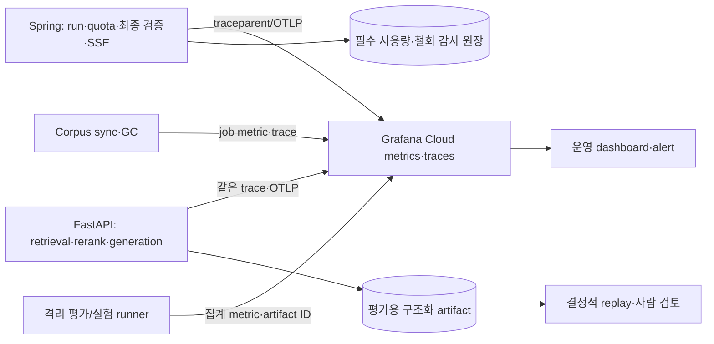

# AI RAG OpenTelemetry 관측 계약

> 상태: 구현 전 **RAG 전용** 목표 계약. 사용자 확인에 따라 기존 Grafana·Prometheus 계열 metrics·OpenTelemetry 경로를 재사용한다. [저장소 분리·관측 운영 결정](repository-split-and-monitoring.md)은 Grafana Cloud를 통합 조회·경보 백엔드로 정하고 metrics 전송 경로는 현행 scrape 검증 뒤 한 가지만 택하도록 한다. 이 문서의 RAG 계측·대시보드가 배포됐다는 뜻은 아니다.

FastAPI 단계명·결과/복귀 코드와 하네스가 읽는 비식별 영속 artifact는 [관측 스키마와 품질 하네스 입력 계약](telemetry-and-harness-schema.md)에서 버전 관리한다.

## 현재 구현과 수집 경계

Spring은 Actuator·Micrometer Tracing/OTel·OTLP exporter 의존성이 있고 `traceparent` 상관관계를 사용한다. 운영 Compose의 `ONMARU_OTLP_METRICS_ENABLED`는 현재 `false`다. FastAPI에는 OTel trace exporter와 HTTP 상관관계가 있으나 RAG 단계별 span과 OTel metrics 계측은 아직 없다. 사용자 확인대로 Grafana·Prometheus·OpenTelemetry를 사용 중이지만 기존 대시보드/알림 export와 CI 관측 증거만으로 **운영 RAG 신호까지 전송 중이라고 간주하지 않는다.** 배포 환경별 OTLP 인증·전송·Grafana의 Prometheus 호환 metrics 조회와 trace 조회를 각각 검증한다. 운영 2GB 호스트에 새 Prometheus/Tempo/Langfuse 서버를 상주시켜 수집하지 않는다.

OTLP는 부가 관측 경로다. exporter 지연·Grafana 장애로 온라인 답변을 막지 않는다. 사용량 ledger, 권리·철회 감사, 승인 결과는 원래의 영속 저장소가 정본이며 metric이나 trace를 정본으로 삼지 않는다. 기존 Grafana/Prometheus 계열은 운영 대시보드·경보의 기준이고, 재현 가능한 gold·실험 결과는 별도 artifact의 hash로 보존한다.

## Trace 계약

질문 처리 모듈은 원문 없이 `planVersion`, `retrievalMode`, 제한된 `reasonCode`, 사전/config hash와 계획 선택 결과를 기록한다. 검색을 수행하지 않은 `SQL_ONLY`·확인 질문은 임베딩/검색 span이 없어야 하며, `SQL_ONLY`에는 승인된 execute와 정형 lookup span만 있어야 한다. lookup transport는 기본 REST이며 MCP가 선택된 경우에만 MCP tool span을 기록한다. `LEXICAL_ONLY`·`DENSE_ONLY`에서는 미사용 경로 span과 RRF span이 없어야 하며, `HYBRID`에서만 두 경로·RRF의 후보 수와 지연을 비교한다. 계획 실패는 검색 실패와 구별해 집계한다. 세부 계약은 [질문 처리](query-processing.md)를 따른다.

Spring의 `journey.run`을 root 업무 span으로 두고 `admission`, `context_state`, `input_privacy`, `ai.plan_request`, `plan_authorization`, 실제 수행된 `place_query.lookup`(REST 기본, MCP 선택 시 tool span 포함), `canonical.sql`, `ai.execute_request`, `final_validation`, `persist`, `sse.terminal`을 자식으로 둔다. Spring↔FastAPI plan/execute는 현재 설계 기준선인 private HTTP에서 W3C `traceparent`를 전파한다. 이후 unary gRPC를 실험하면 같은 trace의 client/server RPC span으로 연결한다. 첫 호출에는 Query Processing Layer 단계인 `query.preprocessing`·`query.interpretation`·`search.route`·`plan_proposal`, 승인 실행 호출에는 `approved_plan_validation`·선택된 Spring adapter 호출·실제로 쓰는 `bm25`/`semantic_search`/`rrf`/`rerank`·`evidence_select`·`generation`·`proposal_validation`을 기록한다. `SQL_ONLY`도 계획·승인 실행·정형 lookup span을 가지지만 검색·생성 span은 없다. 검색 전용 route에는 정형 lookup span이 없고 단일 검색 route에는 미사용 검색 경로·`rrf` span이 없다. 오프라인에는 별도 root인 `corpus.sync`와 `quality.experiment`를 두고 서로 다른 요청을 같은 trace로 묶지 않는다. 품질 artifact에서만 `runId`·`traceId`를 연결한다.

### Trace ID 연결과 조사 경로

`traceId`는 관측 요청의 식별자이고 `runId`는 Spring이 영속 관리하는 AI 실행 식별자다. 재시도·SSE 재접속·비동기 품질 조사에서 두 ID를 같은 것으로 취급하지 않는다. Spring→FastAPI HTTP는 활성 span을 기준으로 W3C context를 주입하고 AI server span이 이를 parent로 추출해야 한다. 요청·응답 헤더에 문자열만 복사한 상태는 합격이 아니다. Spring과 FastAPI가 각각 `service.name`, 배포 환경, image SHA를 resource attribute로 내보내고 동일 Grafana Cloud stack에서 parent 관계를 검증한다.

| 상황 | Trace/로그/영속 기록의 연결 |
|---|---|
| 정상 온라인 run | Spring root → HTTP client → FastAPI server/실행 단계 → Spring 검증. 허용 로그에 `traceId`·`spanId`·`runId`를 남기고, DB run에는 trace reference와 선택된 plan/config/corpus version을 기록한다. |
| provider 재시도·fallback | `generation`의 각 실제 시도를 별도 자식 span으로 기록한다. 마지막 사용자 응답과 실패 원인은 Spring run 상태에 기록한다. |
| SSE 재접속 | 새 HTTP trace가 시작될 수 있다. 원본 run은 `runId`로 조회하고 새 trace를 원래 trace의 자식이라고 가장하지 않는다. |
| corpus sync·품질 평가 | 각각 새 root trace. online run과의 관련성은 검토 artifact의 제한된 reference로 연결한다. |
| trace 표본 제외·전송 실패·보존 만료 | metric과 영속 run/품질 artifact로 상태를 조사한다. trace가 없다는 이유만으로 해당 run이 없었다고 판정하지 않는다. |

Grafana에서는 실패·지연 metric의 집계 panel에서 허용된 구조화 로그 또는 지원되는 exemplar의 `traceId`로 trace 화면에 이동하고, 필요하면 관리자 검토 화면에서 `runId`로 해당 품질 항목을 연다. `traceId`·`runId`를 Prometheus label로 만들지 않는다. exporter 오류·유실률·두 서비스의 trace parent 연결률과 로그 상관관계 누락률을 합성 요청으로 확인한다. [저장소 분리·관측 운영 결정](repository-split-and-monitoring.md)의 외부 사례는 계측 범위를 고르는 참고 자료다.

span 속성 allowlist는 `deployment.environment`, `service.name`, `run.engine`, `route`, `failureStage`, `degradedReason`, `configHash`, `corpusRevision`, `dictionaryVersion`, `embeddingProfile`, `rankerVersion`, `promptVersion`, `providerModelVersion`, `candidateCount`, `uniquePlaceCount`, `evidenceCount`, `claimAcceptedCount`, `claimHeldCount`, `tokenInput`, `tokenOutput`, `costEstimateMicros`다. `runId`·후보/청크 ID는 필요한 **trace 또는 접근 제한 artifact**에만 두고 metric label에 넣지 않는다. 원문 질의, 회원 ID, 대화 요약, prompt·LLM 출력·청크 본문, 주소/정밀 위치, access token은 내보내지 않는다. 일반 자동 계측의 request/response body 포착도 꺼 두고 합성 개인정보 fixture로 누출 여부를 검사한다.

각 단계는 시작/끝 시각·상태를 가지며 오류는 정규화된 코드로 기록한다. BM25와 vector는 형제 span으로 병렬 실행한다. 한 경로 실패와 reranker timeout은 전체 trace 오류로 덮지 않고 해당 span의 실패 및 root의 `degradedReason`으로 남긴다. trace가 표본에서 빠져도 아래 집계 metric은 수집해야 한다. 임의 sampling 정책으로 실패 trace 보존을 보장할 수 없다면 실패 원인의 영속 artifact를 별도로 남기고 trace 누락률을 표시한다.

## Metric 계약

이름은 `onmaru.ai.*` prefix의 **논리 이름**이다. 구현 시 Micrometer→OTLP 정규화 이름·단위와 Grafana 실제 query를 fixture로 고정한다. histogram의 bucket은 실측 분포에 맞춰 정하고 p95는 원시 span 평균이 아닌 histogram 또는 backend 계산으로 구한다.

| 측정 | 형식 | 허용 label | 목적 |
|---|---|---|---|
| `onmaru.ai.run.total` | counter | `environment`, `route`, `outcome`, `failureStage` | SQL/RAG/확인·기본 탐색과 성공/실패 분모 |
| `onmaru.ai.run.duration` | histogram, seconds | `environment`, `route`, `outcome` | 접수→확정 snapshot 완료 p50/p95/p99 |
| `onmaru.ai.stage.duration` | histogram, seconds | `environment`, `stage`, `outcome` | BM25/vector/RRF/rerank/검증/저장 병목 |
| `onmaru.ai.retrieval.candidates` | histogram, count | `environment`, `stage` | 단계별 후보·고유 장소 수 분포 |
| `onmaru.ai.rerank.degraded.total` | counter | `environment`, `reason` | RRF 복귀율·모델/timeout 문제 |
| `onmaru.ai.claim.total` | counter | `environment`, `kind`, `decision`, `reason` | 게시/보류·근거 불일치 비율 |
| `onmaru.ai.provider.calls.total` | counter | `environment`, `outcome`, `modelClass` | 호출·429/timeout·fallback 분모 |
| `onmaru.ai.provider.tokens` | counter | `environment`, `direction`, `modelClass` | 입력/출력 token 추세 |
| `onmaru.ai.provider.cost_estimate` | counter, currency base unit | `environment`, `modelClass` | 추정 비용; provider 청구액과 일별 대조 |
| `onmaru.ai.corpus.sync.total` / `.lag` | counter / histogram | `environment`, `outcome`, `sourceType` | 수집 실패·active revision 지연 |
| `onmaru.ai.revocation.lag` | histogram, seconds | `environment`, `outcome` | 철회 차단 집합·검색 제외 전파 |
| `onmaru.ai.trace.export.total` / `.dropped.total` | counter | `environment`, `reason` | 수집률·유실률·exporter 장애 |
| `onmaru.ai.quality.job.total` / `.duration` | counter / histogram | `environment`, `type`, `outcome` | 평가/실험 실패·예산 중단·대기 |

metric label에는 `runId`, `traceId`, `memberId`, `placeId`, `chunkId`, source ID/revision, prompt/model 전체 commit, 자유 오류 문구를 넣지 않는다. version별 비교는 접근 제한 trace·artifact에서 수행한다. label 값은 열거형으로 제한하고 알 수 없는 값은 `other`로 합친다. 비용은 추정과 실제 청구를 구분한다. 일/월 사용량 hard cap은 관측 경보와 별도로 provider dispatch 경계에서 강제한다.

## Dashboard·경보와 판정

1. **온라인 경험:** route별 run 수, 완료 p95/p99, RAG fallback, SSE 접속·재연결, quota 차단, 기존 Spring API p95를 같은 시간축에 둔다.
2. **검색 품질 신호:** 단계별 후보·장소 수, 빈 근거, BM25/vector 한쪽 실패, reranker 복귀, claim 보류 이유를 본다. 운영 신호는 gold가 아니므로 자동 품질 점수라고 표시하지 않는다.
3. **원천·용량:** sync/철회 지연, active revision, PostgreSQL RSS·연결·WAL/디스크, 호스트 `MemAvailable`·swap·OOM, FastAPI RSS/CPU와 기존 API 퇴행을 본다.
4. **감독·비용:** 평가/실험 성공·예산 중단·사람 검토 대기, trace drop, provider token·비용 추정과 실제 청구 차이를 본다.

경보의 **초기 조건은 절대값을 임의로 확정하지 않는다.** 출시 전 혼합 부하와 첫 운영 기준선에서 5~15분 창·최소 요청 수·허용 퇴행폭을 정한다. 다만 철회/권리·회원 접근 위반은 1건 즉시 incident, exporter 장애는 답변 경로와 분리된 warning, 비용 hard cap 도달은 새 유료 dispatch 차단이라는 동작은 고정한다. 각 경보에는 Grafana panel·관련 runbook·담당자를 연결하고 staging에서 발생/해소 통지를 시험한다. 일반 RAG 품질 저하 후보는 [품질 검토 큐](quality-engineering-agent.md)에 쌓아 Grafana 집계 대시보드와 **주간 Discord·이메일 요약**으로 전달한다. 품질 신호만으로 CLI 조사·실험·설정 변경을 자동 시작하지 않는다.

## 활성화 순서와 완료 증거

1. 현재 Spring/FastAPI의 OTLP 설정과 기존 Prometheus metrics 수집 경로를 staging에서 확인한다. Spring의 OTLP metrics 전송은 Compose에서 꺼져 있으므로 **기존 `/actuator/prometheus` scrape가 실제 운영 수집 경로인지 먼저 확인**한다. 동일 metric을 scrape와 OTLP 양쪽으로 중복 수집하지 않도록 한 경로를 선택하고, 합성 run의 trace·metric이 Grafana에서 검색되는지 확인한다.
2. Spring↔FastAPI parent-child trace, 병렬 BM25/vector span, 실패·fallback·SSE 재연결, corpus sync를 fixture로 검증한다. `runId`를 metric label에 쓰지 않는지 확인한다.
3. exporter 차단·429·부분 수락·프로세스 종료 시험에서 사용자 응답 불변, trace 유실 계수 증가, 필수 감사 원장 보존을 확인한다. 백엔드에서 trace를 조회할 수 없는데 전송 ACK만 있는 상태는 합격이 아니다.
4. 2GB 혼합 부하에서 계측 전후 CPU/RSS/지연과 Grafana 사용량·예상 비용을 비교한다. 수집률·유실률·보존 기간과 비용 상한이 승인되면 선택한 운영 metrics/trace 경로에 RAG 계측을 단계적으로 연결한다.

Grafana Cloud는 [OTLP metrics·traces 수집](https://grafana.com/docs/grafana-cloud/send-data/otlp/send-data-otlp/)을 지원한다. Collector/Alloy는 신뢰성·필터·표본화에 유리하지만 2GB 호스트의 상시 메모리 비용을 먼저 측정해야 하므로 필수 구성으로 단정하지 않는다. 앱의 직접 OTLP 전송으로 시작할 경우 재시도·버퍼 한계와 유실 지표를 명시하고, 문제가 확인되면 별도 수집 계층을 검토한다.
