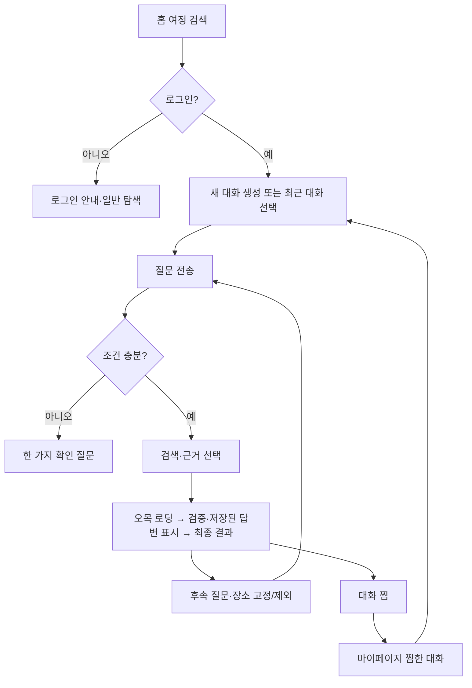

# 홈 여정 대화형 AI RAG 제품 PRD

> 상태: 구현 전 제안. 기존 `explorations`/SSE 계약을 확장하는 목표 설계다. 상위 구조 결정은 [ADR-0017](https://github.com/YRootLab/OnMaru-backend/blob/develop/docs/decisions/0017-home-journey-hybrid-rag.md), 기술 흐름은 [아키텍처](architecture.md)를 따른다.

구현 시 라우팅 우선순위와 SSE·fallback 상태 결정은 [요청 생명주기](request-lifecycle.md)를 따른다.
AI 엔진의 Query Processing Layer가 제안하고 Spring이 승인하는 질문별 SQL·Keyword Search(BM25)·Semantic Search(Vector)·hybrid 계획과 외부 자료의 도입 경계는 [질문 처리 설계](query-processing.md)를 따른다. 첫 출시부터 정형 SQL·BM25 단독·Semantic Search 단독·hybrid·SQL+검색 복합 경로를 모두 사용하며, route별 gold 평가와 2GB 부하 검증을 출시 게이트로 둔다.

## 목적과 성공 조건

홈 검색에서 사용자가 지역·취향·동행 조건을 자연어로 말하면, 온마루가 **공개 근거가 있는 장소 3~5곳**과 이유·출처를 친근한 한국어로 안내한다. 사용자는 같은 대화에서 조건을 바꾸고, 이전 대화를 다시 열고, 마음에 든 대화를 찜할 수 있다. 장소가 적으면 억지로 다섯 곳을 채우지 않는다.

조건이 충분하면 즉시 답한다. 취향·대상·부정 범위가 결과를 바꾸는데 모호할 때만 한 가지를 짧게 묻고, 사용자가 답하면 같은 대화에서 이어간다. 답변은 한 줄 요약과 장소별 추천 이유·검증된 문화 해설을 기본으로 하며, 상세 설명·출처·후속 질문을 사용자가 펼치거나 선택할 수 있게 한다. 대화 분기, 템플릿, 카드·이미지·SSE 화면 계약은 [대화형 큐레이션·프롬프트 설계](conversation-and-prompt-design.md)에 고정한다.

성공 여부는 (1) 유효한 장소·출처만 노출되고 문장의 핵심 사실이 그 근거로 지지되는지, (2) 후속 질문에서 명시한 지역·제외·고정 조건이 유지되는지, (3) 저장·재개·SSE 재접속이 중복 생성 없이 동작하는지, (4) 현재 API 지연과 운영 안정성을 해치지 않는지로 판단한다. 청킹·reranker의 수치 최적화는 후속 실험으로 이어가지만 출시 전 [300문항 평가·환경 검증](evaluation-and-environment-tests.md)의 안전·정합성 게이트는 필수다. 근거가 불확실하면 확인된 내용만 짧게 답하고 나머지는 보류한다.

## 대상과 범위

- 회원이 로그인 후 홈 여정 검색과 저장된 대화를 사용한다. 비회원은 일반 장소 탐색과 로그인 안내를 볼 수 있지만 LLM 대화를 시작하지 않는다.
- 답변은 전통문화 장소·여정 추천, 추천 장소의 역사·문화·방문 포인트 설명, 이미 제안된 여정의 조건 변경에 한정한다. 무관한 일반 Q&A, 실시간 영업·날씨·혼잡 보장, 외부 웹 검색과 모델 주도 도구 호출은 제공하지 않는다.
- 공개 자격과 출처 이용 조건을 통과한 장소·TourAPI 상세 개요·검수된 K-Contents 요약만 근거로 쓴다. 사용자 작성글과 개인 대화는 검색 코퍼스에 넣지 않는다.

## 사용자 흐름

### 화면과 탐색

- 홈과 여정 결과 화면에는 같은 최근 대화 목록을 작은 사이드바로 둔다. 데스크톱에서는 접힌 상태로 시작하고 hover **또는 키보드 focus**에서 펼친다. 모바일에서는 탭으로 여는 서랍을 쓴다. 목록의 제목·최근 수정 시각·찜 여부만 먼저 보여 주고, 선택하면 해당 대화를 연다. 펼친 상태는 키보드 Escape와 닫기 버튼으로 종료할 수 있다.
- 새 대화는 `/`에서 시작한다. 대화 상세 URL은 `/c/{threadId}`로 한다. 서버의 `threadId`는 회원 소유권을 확인하며, URL만 아는 다른 회원에게는 내용을 보여 주지 않는다.
- 결과 화면은 대화 본문과 3~5개 장소 카드를 함께 보여 준다. 각 카드에는 장소명, 조건에 맞는 이유, 근거 있는 문화·역사·건축 해설, 출처·개정 시각(있는 경우), 정보 부족 표시를 둔다. 검증된 기존 이미지가 있으면 표시하고, 더 알아보기에서 출처 상세와 추가 근거를 연다. 답변 뒤에는 조건 변경·장소 제외 같은 후속 질문 chip을 제공한다. 이어서 묻기와 고정·제외 조작은 같은 대화에 새 턴으로 남긴다.
- 마이페이지에는 찜한 대화 목록을 두고 선택 시 `/c/{threadId}`로 이동한다. 찜은 **대화 전체에 대한 표시**이며, 이후 턴이 추가돼도 같은 대화로 유지된다. 기존 `saved-journeys`의 읽기 전용 시점 스냅샷과는 별도다. 회원은 찜 해제와 대화 삭제를 할 수 있다.
- 이전 대화 목록은 최신 수정 순으로 페이지네이션한다. 대화를 삭제하면 목록·찜·턴·요약 메모리가 함께 삭제되고 진행 중 run은 취소한다. 회원 탈퇴 시에도 동일하게 정리한다.
- 출시 이전에 저장된 회원 탐색도 남아 있다면 목록에서 다시 연다. 저장된 사용자 질문과 마지막 여정 결과를 보여 주고, 당시 AI 답변·출처가 저장되지 않은 경우에는 그 사실을 표시한다. 현재 공개가 철회된 장소는 이용 불가로 보이며 새 후속 질문의 근거로 재사용하지 않는다. 이 기록에 첫 후속 질문을 보내면 현재 공개 데이터로 다시 검색한다.
- 회원 대화와 찜은 **회원이 직접 삭제하거나 탈퇴할 때까지** 유지한다. 오래 사용하지 않았다는 이유로 자동 만료시키지 않는다. 백업 보존은 최대 30일을 초기 제안값으로 두고 삭제·탈퇴 기록을 복원 후 재적용한다. 목록과 상세에 삭제 동작을 제공하며, 출시 전 개인정보 고지와 삭제·복원 동작을 검증한다. 오래된 답변의 당시 텍스트와 현재 장소·출처의 이용 가능 상태를 구분하고, 철회 근거에 의존한 claim·citation은 재열람 때 가리거나 이용 불가로 표시한다. 후속 질문은 현재 공개 corpus로 새로 검색한다.
- 결과 화면에서 새 질문을 보내면 현재 thread에 추가한다. `새 여정 시작`을 선택할 때만 새 thread를 만든다. 로딩·재접속 중에는 전송을 잠그고, 완료 또는 실패 뒤 다시 입력할 수 있다. 한도가 끝나도 저장된 대화·장소는 열람할 수 있고, 새 질문은 무료 기본 탐색으로 이어진다.

### SSE에서 사용자에게 보이는 상태

| 단계 | FE 표시 | 서버 기준 |
|---|---|---|
| 요청 접수 | 입력을 즉시 대화에 표시, 전송 버튼 잠금 | idempotency key로 턴/run 하나 생성 |
| 검색·근거 준비 | 오목 로딩과 `여정에 맞는 장소를 찾고 있어요` | 아직 답변 확정 전 |
| 생성 중 | 오목 로딩·고정 진행 문구; 사실 문장은 아직 표시하지 않음 | 모델의 미검증 출력은 서버 내부에만 둠 |
| 최종 검증 성공 | 검증된 문장을 점진적으로 표시하거나 즉시 확정 답변·카드·출처를 표시 | Spring이 소유권·공개 상태·근거를 다시 확인하고 저장한 snapshot이 정답 |
| 생성 실패·연결 끊김 | 재접속 중 표시, 이후 확정된 기본 탐색 결과 또는 실패 안내 | SSE 단절은 새 LLM 호출이 아님 |

기존 `REST command + SSE notification + GET snapshot`을 유지한다. 현재 SSE schema에 이미 있는 `run.stage`로 진행 상태를 알린다. `run.text.delta`는 **검증·저장 완료된 답변의 표시용 스트림**에만 사용한다. `Last-Event-ID`로 재연결하고 유실 시 `GET snapshot`을 다시 읽는다. 미검증 모델 토큰은 브라우저에 보내지 않으며 HTML/Markdown 실행·링크 자동 열기도 금지한다. delta를 사용하지 않는 구현은 stage 로딩 뒤 확정 snapshot을 즉시 표시한다.

## 대화와 사용량 정책

- 회원당 **LLM 전송 시도 최대 주 5회 및 월 15회**를 동시에 적용한다. 주간 창은 월요일 00:00 KST, 월간 창은 매월 1일 00:00 KST에 시작한다. 한도 화면은 두 창의 잔여 횟수와 다음 초기화 시각을 표시한다.
- 동일 idempotency key 재전송, SSE 재연결, 저장된 대화 열람, 장소 카드 조작 중 모델 호출이 없는 요청은 횟수를 더하지 않는다. 전송 직전 영속화한 `DISPATCH_COMMITTED`부터 한 번으로 세고, 이후 실패해도 유지한다. 외부 수신 여부가 불명확한 사고에는 자동 재호출·자동 환불을 하지 않는다. 자세한 복구 규칙은 [계약·데이터 설계](contracts-and-data.md)를 따른다.
- Spring이 회원별 턴, 명시 조건, 선택·고정·제외 장소, 이전 답변의 확정 ID와 짧은 **구조화 요약**을 보관한다. 다음 턴은 이 상태를 재구성해 질의를 해석한다. 같은 thread의 맥락은 보관 기간 동안 유지하지만, provider에 보내는 상태는 길이를 제한한다. 회원 전체를 임베딩하거나 개인 대화를 RAG 코퍼스에 넣지 않는다.
- provider에는 사용자 원문·전체 대화 이력·회원 식별자를 보내지 않는다. 검증된 구조화 의도, 제한된 공개 후보·근거, 필요한 직전 턴의 구조화 상태만 보낸다. 원문은 대화 화면·재개를 위해 Spring에 저장하되 로그에는 남기지 않는다.
- 회원 답변 생성 provider는 Google AI Studio에서 발급·관리하는 **Gemini API 무료 tier**다. 정확한 모델 ID·무료 할당량·지역별 제공 조건은 운영 전 확인해 고정한다. 무료 할당량 소진·429 시 유료 tier나 Antigravity CLI로 자동 전환하지 않고 검증된 기본 탐색으로 마친다. Antigravity CLI는 운영 회원 요청 경로에 포함하지 않는다.
- 범위 밖 질문은 범위를 짧게 안내하고 대화를 이어갈 수 있게 한다. 악의적 문구에 대한 위반 누적·쿨다운을 도입하지 않는다. 별도로 인증·IP·계정 단위 요청 속도, 동시 run, 입력 길이, 토큰·비용 상한, idempotency, 프롬프트 주입·출력 검증을 적용한다. 긴급한 안전 신호는 일반 범위 거절과 분리해 안내한다.

## 공개 계약 변경안

기존 `/api/v1/explorations`, `/{explorationId}/turns`, `/{explorationId}/runs/{runId}/events`, `/saved-journeys`를 유지한다. 회원용 `/api/v1/journey-threads` 목록·상세·삭제·북마크와 `/api/v1/me/ai-quota` 조회를 추가한다. 첫 구현에서는 `threadId = explorationId`로 정의해 기존 탐색의 이어지는 턴을 하나의 대화로 사용한다. FE `/c/{threadId}`는 이 상세 API를 읽는다. 기존 `saved-journeys`는 시점 스냅샷 기능으로 유지하고 대화 찜과 혼합하지 않는다. [계약·데이터 설계](contracts-and-data.md)에 정확한 경로와 상태를 정의한다.

새 필드·오류 코드와 저장 모델은 [계약·데이터 설계](contracts-and-data.md)를 따른다. 구현 시 기존 [OpenAPI](https://github.com/YRootLab/OnMaru-backend/blob/develop/docs/contracts/openapi/journey.openapi.yaml)와 [SSE schema](https://github.com/YRootLab/OnMaru-backend/blob/develop/docs/contracts/schemas/journey-sse-event.schema.json), fixture를 같은 변경에서 갱신한다. 기존 클라이언트는 미지원 응답 필드를 무시하고 새 클라이언트는 snapshot을 최종 진실로 사용하도록 버전 전환을 설계한다.

## 인수 기준

1. 회원은 홈과 결과 화면에서 이전 대화를 열고 같은 맥락으로 후속 질문을 보낼 수 있다. 찜한 대화는 마이페이지에 나타난다.
2. 근거가 있는 장소만 최대 5개 제안하고 지역·공개·제외·고정 조건 위반은 0건이다. 충분한 장소가 없으면 적은 수와 이유를 보인다.
3. 주·월 한도 및 dispatch 과금은 동시 요청·재연결·중복 전송에서도 정확히 한 번 적용된다.
4. 미검증 모델 문장은 SSE로 노출되지 않고 검증·저장된 답변만 표시된다. 출처 ID만 일치하는 문장도 충분한 근거로 간주하지 않는다. 원천 span의 시간·대상·관계가 뒷받침하지 못하는 주장은 축소하거나 보류하며, 봉인셋에서 사람 2명이 사실·해석·취향 claim의 지지 여부를 판정한다. 검증 실패·provider 장애 시 검증된 기본 탐색 또는 명시적 실패로 종료한다.
5. 다른 회원의 URL·찜·턴·요약은 조회·재개할 수 없고, 대화 삭제·탈퇴 시 개인 대화 데이터가 정리된다.
6. 운영자는 기존 Grafana·Prometheus·OpenTelemetry 경로에서 run의 수집→검색→재정렬→생성→확정 단계와 실패 원인, 유실률, 비용을 구분해 볼 수 있다. 회원 원문·대화 요약·근거 본문은 일반 trace/metric에 나타나지 않는다.
7. 조건이 충분한 질문에는 불필요한 확인 질문이 없고, 필수 조건이 모호하면 한 턴에 한 가지만 묻는다. 근거가 풍부한 답변은 장소별 설명·검증된 이미지·출처 상세·후속 질문을 제공하되 부족한 근거를 문장으로 채우지 않는다. 원문에서 허용된 수식·부정 의미가 검색 전에 소실되거나 provider로 원문이 넘어가지 않는다.
8. 품질 조사 도구는 AI 내부 평가자료와 Spring 소유 실행/공개 상태를 소유 경계별로 읽는다. AI는 Spring 업무 DB에 직접 접속하지 않고, Spring MCP가 채택되면 허용된 비식별 run observation 및 원천 공개/철회 조회만 private authenticated endpoint에서 제공한다. 모든 Spring MCP 도구는 read-only이며 품질 도구 장애가 사용자 요청·SSE를 차단하지 않는다. tool schema·scope·실행 제한은 [Spring 품질 MCP 계약](https://github.com/YRootLab/OnMaru-backend/blob/develop/docs/ai-rag-spring/quality-tools-mcp.md)과 [ADR-0018 제안](https://github.com/YRootLab/OnMaru-backend/blob/develop/docs/decisions/0018-quality-harness-spring-mcp-tools.md)을 따른다.
9. Root Cause/Experiment Planner의 system prompt는 버전·hash를 고정하고, 입력은 공개/합성 artifact로 제한하며, prompt injection·artifact ID 위조·schema drift를 검증한다. 별도 대화 memory는 두지 않고 typed investigation state/artifact로 재개한다. 실험 runner는 운영 2GB 호스트 밖에서 rootless 격리·무네트워크·read-only snapshot으로 실행하며 초기 상한은 CPU 1 core, RAM 1 GiB, 10분, PID 64, scratch 2 GiB, 동시 1 job이다. 이 제한·prompt·검증 계약은 [품질 system prompt](quality-agent-prompt-contracts.md)와 [품질 감독 상세](quality-engineering-agent.md)를 따른다.
10. Spring↔FastAPI plan/execute 통신은 private REST를 운영 기준선으로 둔다. trace에서 이 hop이 실제 병목으로 확인되면 동일한 typed contract의 gRPC unary를 성능 비교하고, 이득이 개발·운영 비용을 상쇄할 때만 채택한다. 이는 bidirectional streaming 도입을 뜻하지 않는다. `SQL_ONLY` 및 정형 조회를 포함한 `SQL_PLUS_RETRIEVAL`은 Spring이 검증한 query grant에 대해서만 FastAPI가 `PlaceQueryPort`의 제한된 private adapter를 호출한다. MCP는 tool discovery용으로 한정한다. 어느 방식도 임의 SQL·자유 filter·회원 ID를 입력받지 않고 run당 최대 1회로 제한한다. `SQL_ONLY`는 LLM/embedding/retrieval 호출 0회다. Spring 품질 도구는 별도 principal/scope 및 read-only application port를 사용한다. 경계·grant·전송 비교 계약은 [Online Query 설계](https://github.com/YRootLab/OnMaru-backend/blob/develop/docs/ai-rag-spring/journey-query-mcp.md)와 [ADR-0019 제안](https://github.com/YRootLab/OnMaru-backend/blob/develop/docs/decisions/0019-journey-query-mcp-tools.md)을 따른다.

## 관련 설계 문서

이 PRD는 사용자 경험과 인수 기준을 정의한다. 구현 시에는 아래 기술 계약을 함께 적용한다. 전체 문서의 읽는 순서와 현재 구현/목표 구분은 [AI RAG README](README.md)가 정본이다.

| 관심사 | 상세 계약 |
|---|---|
| 온라인 검색·대화 상태·SSE | [아키텍처](architecture.md), [질문 해석](question-understanding.md), [대화형 큐레이션·프롬프트·UI](conversation-and-prompt-design.md), [요청 생명주기](request-lifecycle.md), [API·저장 모델](contracts-and-data.md) |
| 근거·안전·데이터 보존 | [근거 검증](grounding-and-review.md), [오남용 정책](security-and-abuse.md), [RAG 저장 스키마](rag-storage-schema.md), [Corpus 보존·GC](corpus-lifecycle-and-gc.md) |
| 출시 평가·운영 준비 | [평가·환경 검증](evaluation-and-environment-tests.md), [운영·평가](operations-and-evaluation.md), [운영 준비 검토](production-readiness-gaps.md) |
| 관측·비동기 품질 개선 | [OpenTelemetry 관측](observability-contract.md), [모듈 경계](module-boundaries-and-pipelines.md), [품질 감독 상세 설계](quality-engineering-agent.md) |
| 품질 agent prompt·guardrails·격리 실행 | [system prompt 계약](quality-agent-prompt-contracts.md), [Spring MCP 도구 설계](https://github.com/YRootLab/OnMaru-backend/blob/develop/docs/ai-rag-spring/quality-tools-mcp.md) |
| Spring query/quality port·인증·tool transport contract | [Spring AI-RAG 통합](https://github.com/YRootLab/OnMaru-backend/blob/develop/docs/ai-rag-spring/README.md), [Online query 경계 및 MCP/REST 선택](https://github.com/YRootLab/OnMaru-backend/blob/develop/docs/ai-rag-spring/journey-query-mcp.md), [Quality tools](https://github.com/YRootLab/OnMaru-backend/blob/develop/docs/ai-rag-spring/quality-tools-mcp.md), [MCP catalog 후보](https://github.com/YRootLab/OnMaru-backend/blob/develop/docs/contracts/mcp) |
| 장기 구조 결정 | [ADR-0017](https://github.com/YRootLab/OnMaru-backend/blob/develop/docs/decisions/0017-home-journey-hybrid-rag.md) |
