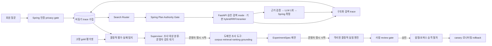

# RAG Quality Engineering 감독형 workflow 설계

> 상태: 구현 전 목표 계약. [사용자 응답 파이프라인](architecture.md)과 별도인 비동기 품질 개선 시스템이다. `evaluation analyzer → root cause → experiment planner → deterministic runner → review gate`는 **다섯 책임**이지 상시 대화하는 다섯 LLM이 아니다. 온라인 검색 전략·corpus·모델을 요청마다 agent가 바꾸지 않는다.

이 책임들의 구현 이름은 생성된 `onmaru-ai-engine` 저장소 내부의 **`onmaru_ai.quality_harness`**로 한다. `Engine`은 사용자 요청에 응답하는 제품 런타임, `quality_harness`는 관측 신호를 재현 가능한 평가·실험·사람 승인 자료로 바꾸는 비동기 도구 모음이다. 감독 작업을 별도 Git 저장소나 상시 LLM 서비스로 분리하지 않는다. 현재 `ai/src/onmaru_ai/evals/`는 기존 오프라인 평가 코드이며 새 이름으로 이동한 상태가 아니다.

## 1. 전체 경계



온라인 trace 기록은 응답 완료를 기다리게 하지 않는다. 온라인 run은 정해진 버전의 검색·검증을 실행하고, 비동기 export 실패가 답변을 바꾸지 않는다. 다만 trace 유실률이 품질 조사 기준을 넘으면 경보를 내고 실험 판정에 그 구간을 사용하지 않는다. 자동 평가의 정답은 승인된 합성/공개 gold에만 있다. 운영 trace만으로 특정 사용자 답변이 틀렸다고 단정하지 않는다.

정기 작업은 계측·gold replay·지표 집계·결정적 실패 신호 분류와 검토 큐 생성에서 멈춘다. 품질 개선 조사, Antigravity CLI 사용, 실험 실행, 설정 승격은 운영자가 원할 때 각 작업의 범위·입력 artifact·예상 CLI quota/추가 비용·최대 실행 자원을 확인하고 **명시적으로 시작**한다. 검토 큐 생성 자체는 CLI 호출이나 개선 실행을 뜻하지 않는다. 철회·권리·회원 접근 위반의 즉시 차단과 경보는 이 수동 개선 정책과 무관하게 계속 작동한다.

### 운영자 검토 큐와 주간 요약

검토 큐는 Grafana alert history가 아닌 접근 제한된 영속 저장소의 `QualityReviewItem`이 정본이다. 동일 `(caseId 또는 aggregateSignalKey, corpusRevision, configHash, failureStage)`를 한 항목으로 묶고 `firstSeenAt`, `lastSeenAt`, `occurrenceCount`, `severity`, `signalType`, `metricDelta`, `evidenceArtifactRefs`, `traceCoverage`, `status`, `ownerDecision`, `decisionAt`을 기록한다. 회원 ID·원문·문서 본문·자유형 LLM 출력을 저장하지 않는다. 상태는 `OPEN → ACKNOWLEDGED → INVESTIGATING → EXPERIMENT_READY → RESOLVED|DISMISSED`이며 관측이 계속되면 발생 횟수와 마지막 시각만 갱신한다. `DISMISSED`는 사유와 동일 버전의 재발 조건을 남기고, 새 corpus/config에서 재발하면 새 항목을 만든다. 신호에는 gold가 없는 운영 추정과 gold 재현 실패를 구분하는 `evidenceLevel`을 붙여 조사 우선순위와 사람 판단을 돕는다.

매주 월요일 09:00 KST에 직전 월요일 00:00부터 일요일 23:59:59 KST까지의 신규·계속·해결 항목 수, 상위 실패 단계, 기준선 대비 변화, 가장 오래된 미해결 항목, trace 유실률과 Grafana 대시보드/보호된 큐 링크를 요약한다. 0건인 주도 `신규 품질 신호 없음`과 수집 정상 여부를 표시한다. 사용자 결정에 따라 **기존 운영 Discord와 이메일 양쪽**에 같은 요약을 보낸다. 알림 본문에는 회원 데이터·trace ID·청크 본문·고카디널리티 식별자를 넣지 않는다. 발송 job은 `(windowStart, windowEnd, destination)` 멱등 키와 채널별 발송 상태를 기록해 중복을 막는다. 한 채널 실패가 다른 채널의 발송을 막지 않으며, 실패한 채널만 제한적으로 재시도하고 전달 실패 자체를 운영 경보로 남긴다. staging에서 양쪽 채널의 테스트·재시도·중복 방지를 검증한다. 품질 신호는 주간 요약에 묶고 권리·철회·회원 접근 사고는 즉시 incident 경로로 보낸다.

Grafana RAG 품질 대시보드는 `OPEN/ACKNOWLEDGED` 건수·연령, 실패 단계·근거 수준·revision별 집계, 평가 지표 추이, 수집 유실, 주간 요약 발송 상태를 표시한다. Grafana의 낮은 카디널리티 metric에는 item ID를 label로 넣지 않는다. 개별 항목·artifact·검토 동작은 **기존 `/admin` 인증 체계의 `/admin/ai-quality` 관리자 전용 화면**에서 연다. Grafana와 주간 요약은 해당 화면으로 가는 고정 링크만 제공한다. CLI 분석과 격리 runner는 운영자가 항목을 선택해 범위·quota/비용을 검토한 뒤 별도로 시작한다. 검토 큐 항목은 `lastSeenAt`과 무관하게 **최초 생성 시각부터 최대 3개월** 보관한다. 해결·기각 항목도 같은 상한을 적용하고, 만료 job은 연결 artifact의 별도 보존 정책을 확인한 뒤 큐 행과 링크를 삭제한다. 같은 신호가 3개월 이후에도 계속되면 새 항목으로 생성해 이전 항목을 무기한 연장하지 않는다. 원천 artifact가 먼저 GC되면 재현 가능 상태를 `EXPIRED_EVIDENCE`로 표시하고 조사 실행을 막는다. 삭제 건수·실패와 주간 큐 규모를 집계하되 개인정보나 본문은 남기지 않는다.

관리자 화면은 `ADMIN`만 접근할 수 있다. 목록은 상태·실패 단계·근거 수준·기간 필터, 미해결 우선 정렬과 cursor 페이지를 제공한다. 상세는 재현 가능한 공개/합성 artifact 참조, 단계별 누락·지표 변화, 버전·수집률, 예상 조사 quota/비용, 현재 상태·만료일을 표시한다. `ACKNOWLEDGE`, `DISMISS`, 결정적 조사 시작, 실험 계획 검토, 격리 runner 시작은 서로 다른 동작으로 분리한다. 모든 상태 변경은 관리자 JWT 권한, CSRF·idempotency, 예상 `rowVersion` 비교, 작업 ID와 감사 기록을 요구한다. 낡은 revision·만료된 evidence·이미 처리된 항목은 `409`로 거절한다. **Antigravity CLI 실행 버튼은 제공하지 않는다.** 화면은 비식별 조사 패킷을 내려받게 하고 운영자가 본인 세션에서 직접 CLI를 실행한다. CLI 결과를 등록할 때 schema·artifact hash·버전을 검증하며 결과 등록만으로 실험이나 승격을 시작하지 않는다. 새 REST/SSE 계약과 관리자 FE 화면은 구현 PR에서 [관리자 OpenAPI](https://github.com/YRootLab/OnMaru-backend/blob/develop/docs/contracts/openapi/admin.openapi.yaml) 및 기존 `/admin` 계약에 함께 반영한다.

## 2. Trace와 평가 artifact

FastAPI의 단계별 실행 사실은 [RunObservation.v1 계약](telemetry-and-harness-schema.md)으로 정규화한다. Supervisor는 trace가 표본에서 빠졌거나 전송에 실패한 경우를 구분하고, 영속 실행 결과와 gold/재현 artifact 없이 trace 하나만으로 원인을 확정하지 않는다.

각 온라인 run의 `traceId`는 Spring `runId`와 연결하되 회원 ID·원문 질문·대화 텍스트를 일반 trace에 싣지 않는다. `span`은 AI plan의 `query.preprocessing`, `query.interpretation`, `search.route`, Spring의 `plan_authorization`, 정형 lookup transport에 따른 child span(REST 기본; MCP 선택 시 `mcp.journey_execute_approved_lookup`), 내부 `canonical.sql`, AI 내부 `bm25`/`semantic_search`/`rrf`/`rerank`, `grounding`, `generation`, `final_validation`, `persist`, `sse`로 나눈다. MCP child span에는 tool/schema version·outcome·latency·output bytes·오류 코드만 기록한다. 검색 span은 `corpusRevision`, `sourceRevocationSequence`, dictionary/chunker/embedding/BM25/reranker/prompt/model version, hard-filter 해시, 후보 `documentId/chunkId/placeId/sourceRevision`와 **순위·점수·제외 이유 코드**, 단계별 후보 수·고유 장소 수·지연을 남긴다. 점수만으로 원문을 복원할 수 없는지 검토하고, 공개 문서 본문/사용자 원문은 trace에서 제외한다. 일반 운영 trace는 짧은 기간과 표본화로 제한하고, 재현용 평가 artifact는 별도 접근 제어 저장소에 고정한다. 품질 조사 MCP 호출은 `quality.investigation` trace에 별도 기록하며 온라인 MCP 호출과 합치지 않는다.

`EvaluationCase`는 승인된 `queryId`, 합성 질문 frame, gold place/source/chunk/claim, 기대 경로와 허용·금지 조건, corpus snapshot hash를 가진다. `RetrievalTrace`는 각 단계의 top-k ID·rank·score·filter reason과 version을 가진다. `EvaluationResult`는 `caseId`, 단계별 recall/precision/MRR/nDCG, groundedness/인용·보류 판정, 비용·지연, 실패 유형, artifact hash를 가진다. 세 artifact는 schema version과 생성 시각을 필수로 하며 immutable로 보존한다. 같은 case/corpus/config에서는 결정적 검색 결과가 재현돼야 한다. LLM 생성 평가는 비결정성을 감안해 동일 조건 반복과 사람 판정이 필요하다.

Trace sink의 1차 구현은 저장소의 Spring OpenTelemetry 연동을 확장하고 기존 Grafana/Prometheus 운영 경계와 제한된 PostgreSQL 평가 메타데이터/압축 artifact를 사용한다. RAG 계측·dashboard·alert는 [OpenTelemetry 관측 계약](observability-contract.md)을 따른다. Collector·trace backend가 AI run에 필요한 기간·용량으로 **이미 운영 중인지**는 배포 구성에서 별도 확인한다. Langfuse는 LLM generation/점수·dataset/실험·사람 annotation 화면의 선택지로 **별도 벤치마크**한다. Langfuse OSS 사용료는 무료여도 [공식 self-host 구성](https://langfuse.com/self-hosting/deployment/docker-compose)은 권장 4 core/16GiB와 여러 저장 서비스가 필요하므로 2GB DB 호스트에 같이 올리지 않는다. Cloud를 택하려면 현재 요금·보존 기간, 데이터 반출, 개인정보 비수집, 비용 상한을 먼저 확인한다. OpenTelemetry `traceId`와 아래 artifact schema를 정본으로 유지해 도구를 바꿀 수 있게 한다.

### 관측 도구 배치와 검증

Spring·FastAPI는 같은 `traceparent`와 `runId`로 span을 연결하되 **요청 원문·대화 요약·prompt 전문·LLM 출력 전문·청크 본문을 내보내지 않는다.** span에는 단계·버전·후보 ID/수·제외 이유·지연·토큰/비용·claim 보류 코드만 기록한다. Collector/exporter의 속성 allowlist로 먼저 제한하고 SDK masking은 추가 방어로 둔다. 자동 계측이 provider 본문을 수집하는지 배포 전 가짜 개인정보 fixture로 검사한다. trace 전송 실패나 Langfuse 장애는 사용자 답변 경로를 막지 않는다.

Grafana 계열 운영 대시보드는 API/DB/SSE 지연·오류·RSS·OOM·trace drop·비용 경보를 담당하고, Langfuse를 도입하면 sampled AI trace와 승인된 **공개 합성 평가 case**의 dataset·점수·annotation을 담당한다. 운영 trace의 회원 식별자나 원문을 Langfuse dataset으로 자동 전환하지 않는다. 첫 단계에서는 현재 OTel trace와 별도 결정적 평가 artifact만으로 1주일 수집률·저장량·조사 시간·비용을 측정한다. 이 기능만으로 실패 사례를 조사하기 어렵다는 증거가 나오면 Langfuse Cloud의 승인된 지역/보존/요금 조건을 확인해 제한된 pilot을 한다. 2GB 운영 서버의 Langfuse self-host는 후보에서 제외한다. Langfuse는 [OTLP 수집](https://langfuse.com/docs/api-and-data-platform/features/public-api), [점수 API](https://langfuse.com/docs/evaluation/evaluation-methods/scores-via-sdk), [마스킹](https://langfuse.com/docs/observability/features/masking)을 제공하지만 도구의 존재가 근거의 참 여부를 자동 판정하지는 않는다.

도입 검증은 동일한 `runId/traceId` 연결률, 단계 누락률, 실패 유형별 수집률·drop률, exporter 지연/큐 포화, SDK 비동기 버퍼 종료 시 유실, 저장 바이트/일, 대시보드에서 원인 식별까지 걸린 시간, 권한 없는 trace 열람 차단, 실제 청구액을 측정한다. 사용자별 식별자를 메트릭 label로 쓰지 않고 낮은 빈도의 실패 코드·버전만 집계한다. Langfuse sampling에서 제외된 trace에는 관측/점수도 전달되지 않으므로 봉인 평가 run은 표본화하지 않고 운영 성공 trace만 제한한다. [Langfuse sampling 안내](https://langfuse.com/docs/observability/features/sampling).

Trace export는 온라인 run의 확정 저장 이후 유한 크기 outbox/collector 버퍼에서 비동기로 전송한다. 버퍼가 가득 차면 요청을 막지 않고 trace를 버리되 `trace_dropped_total`을 증가시키고 조사 가능한 표본 비율을 경보로 표시한다. 필수 보안·사용량 감사 원장은 이 버퍼와 분리해 기존 트랜잭션에 남긴다. 초기 보존 제안은 운영 trace 메타데이터 14일, 일별 집계 90일, 본문 없는 평가 보고서/승인 기록 180일이다. 재현용 공개 corpus 본문은 [corpus 보존 정책](corpus-lifecycle-and-gc.md)의 기한을 초과해 복제하지 않는다. 철회 자료의 본문·벡터는 trace/평가 저장소에도 남기지 않는다. 출시 전 실제 저장량과 개인정보 정책을 검토해 이 기간을 확정한다.

운영 감지는 `trace_sampled_total{failureStage}`와 `trace_dropped_total{failureStage}`의 비율을 함께 기록한다. 실패·fallback·철회 관련 이벤트는 정상 성공보다 높은 수집 우선순위를 갖되, 필수 감사 원장은 표본화하지 않는다. drop된 run은 자동 품질 판정 분모에서 별도 표시하고, 단계별 후보 ID가 없는 case는 원인 확정·승격 근거로 쓰지 않는다. 180일 보고서만으로 30일 후 corpus 본문을 재생할 수 있다고 주장하지 않는다. 재현 기간이 끝난 보고서는 집계·승인 감사 기록으로만 보존한다.

## 3. 책임별 실행 계약

| 책임 | 시작 조건 | 입력 | 허용 출력 | LLM 필요성 |
|---|---|---|---|---|
| Evaluation analyzer | 주간 gold replay, corpus/검색 버전 변경, 승인된 회귀 job | `EvaluationResult`와 기준선 차이 | `FailureCase[]`와 stage·severity·증거 ID | 없음. 코드로 계산 |
| Root cause investigator | 운영자가 검토 큐에서 조사 시작 | 해당 case의 trace·gold·corpus manifest·revision 상태 | 최대 3개 가설과 지지/반증 artifact | 규칙 우선, 복합 사례에만 운영자가 CLI 사용 결정 |
| Experiment planner | 운영자가 조사 결과를 보고 계획 시작 | 실패 유형·제약·버전·개발셋 | allowlist `ExperimentSpec`, 기대 효과·실패 기준 | 템플릿 우선, CLI 사용은 운영자 결정 |
| Deterministic experiment runner | 운영자가 spec·자원 예산 검토 후 실행 시작 | immutable corpus snapshot·개발셋·고정 config | 기준선/후보의 차이, 원시 결과 hash, 자원/비용 | 없음. 프로세스 실행 |
| Review gate | 실험 완료·봉인셋 release gate | 변경 diff·실패 사례·지표·rollback 계획 | 승인/거절/재실험 사유·서명된 version | 담당자 결정 |

### 결정적 우선 실행 규칙

다섯 책임 모두 Python 함수·SQL 조회·평가 계산으로 시작한다. `Evaluation analyzer`, `runner`, `review gate`에는 LLM 호출 경로 자체를 두지 않는다. Root cause는 단계별 gold 포함 여부와 배제 이유로 **단일 원인 코드가 확정**되고 필요한 trace 필드가 모두 있을 때 `DeterministicFinding`을 생성한다. Planner는 이 원인 코드에 대응하는 승인된 템플릿이 한 개일 때 `ExperimentSpec`을 작성한다. 보고서는 코드·근거 artifact ID·영향받은 질의 수·추천 실험·기준선 수치로 템플릿 렌더링한다. 문장 작성용 LLM을 호출하지 않는다.

LLM 조사 후보 조건은 (1) 서로 다른 단계의 원인 후보가 2개 이상이고 결정적 규칙으로 선후관계를 가를 수 없거나, (2) 여러 출처·청크의 의미적 충돌을 사람이 검토해야 하거나, (3) 새 실패 유형으로 분류됐으나 승인된 실험 템플릿이 없는 경우다. 조건을 만족해도 자동 호출하지 않는다. 운영자가 후보 case·비식별 입력·CLI quota 및 추가 비용을 검토하고 명시적으로 시작한다. `traceMissing=true`, 철회/권리 사고, 허용 도구 부재이면 `NEEDS_HUMAN_REVIEW`로 보낸다. LLM 입력은 최소 공개 평가 case와 구조화 trace의 해당 단계만이며 출력은 가설·지지/반증 ID·추가 검증 요청뿐이다. 코드가 출력 schema·artifact 참조를 검사하고, 유효하지 않으면 유료/CLI 자동 재시도 없이 사람에게 넘긴다. LLM 가설을 사실이나 자동 수정 명령으로 취급하지 않는다.

| 예시 | Python의 결정적 판정 | 다음 동작 |
|---|---|---|
| gold source가 manifest에 없음 | `SOURCE_MISSING` | 수집/권리 검수 큐와 템플릿 보고서; LLM 0회 |
| gold 청크가 RRF 30에 있고 reranker 점수 순위 13위, 다양성 cap 배제는 없음 | `RERANK_DROP` | RRF 순서 대조 실험 spec 생성; LLM 0회 |
| 원천은 있으나 질문 해석 누락과 filter 배제가 동시에 발생 | 단일 원인 불확정 | 제한된 root-cause LLM 또는 사람 검토 |
| trace top-k 누락·철회 sequence 역전 | 증거 부족/안전 사고 | LLM 0회, 재수집 또는 incident 절차 |

Supervisor는 `NEW → TRIAGED → AWAITING_OWNER → INVESTIGATING → PLAN_READY → AWAITING_EXPERIMENT_START → RUNNING → REVIEW_REQUIRED → APPROVED|REJECTED → PROMOTED|ROLLED_BACK` 상태와 각 단계 deadline을 관리한다. 두 대기 상태는 운영자의 명시적 시작 없이는 넘어가지 않는다. 실패 사례는 같은 `(caseId, corpusRevision, configHash, failureType)`으로 중복 수집하지 않는다. 최대 재조사 2회, 가설 3개, 실험 후보 3개로 제한한다. 대화 transcript를 공유 상태로 쓰지 않는다. 병렬 조사자는 `InvestigationState`의 읽기 전용 artifact ref만 받고, 결과를 `AgentFinding`으로 추가한다. 병합은 supervisor가 schema·기준 version을 확인한 뒤 단일 writer로 수행한다. 낡은 version의 finding은 폐기하거나 새 조사로 다시 실행한다.

## 4. 실패 탐지와 원인 판정

결정적 detector는 gold와 계획·stage top-k를 비교한다. `SOURCE_MISSING`(gold source가 승인 corpus에 없음), `INTERPRETATION_LOSS`(gold 개념/대상/부정 누락), `PLAN_ROUTE_ERROR`(AI 해석은 맞지만 SQL/검색 mode·필요 사실 분해가 틀림), `PLAN_AUTHORITY_REJECT`(Spring이 미승인 필드·범위 확대·version을 거부), `ROUTING_ERROR`(승인 계획과 실제 실행 경로가 다름), `FILTER_ERROR`(허용 gold를 잘못 제외), `BM25_MISS`, `VECTOR_MISS`, `FUSION_DROP`(union에는 있으나 RRF 30 밖), `RERANK_DROP`(RRF 30에는 있으나 최종 12 밖), `GROUNDING_REJECT`, `GENERATION_UNSUPPORTED`, `DELIVERY_FAILURE`로 나눈다. 단계별 후보 ID가 없거나 gold가 불확실하면 `INSUFFICIENT_EVIDENCE`로 두고 LLM에게 임의 원인을 고르게 하지 않는다. 철회/권리/회원 접근 위반은 점수 악화가 아니라 즉시 안전 incident로 분리한다.

운영 trace에는 보통 gold가 없으므로 `근거 0건`, 단계별 후보 급감, reranker RRF 복귀 증가, groundedness 검증 보류 증가, 사용자 신고 같은 **조사 신호**만 익명 집계한다. 이 신호는 `SUSPECTED` 큐에 올리고 공개 자료와 합성 재현 case가 생긴 뒤에야 위 실패 유형으로 확정한다. 동일 장소·동일 질문 code의 반복 신호를 묶어 조사 수를 제한하고, 회원 원문을 승인 없이 agent 입력이나 gold로 가져오지 않는다.

Root cause는 `read_eval_case`, `read_trace_stage`, `read_corpus_manifest`, `read_approved_document_offsets`, `compare_rank_lists`, `inspect_filter_decisions` 도구로 **증거를 조회**한다. 예를 들어 gold 청크가 BM25 20과 vector 20에는 있었는데 RRF 30에서 빠지면 fusion/다양성 규칙을 조사한다. RRF 30에 있었으나 reranker 12에서 사라졌다면 질문/본문 절단, model score, source·장소 cap을 조사한다. corpus 자체에 없으면 검색 튜닝 실험을 만들지 않고 수집/권리 검수 큐로 보낸다.

도구 소유권은 두 경계로 나눈다. 평가 case·AI trace·corpus·순위 분석은 Python typed function으로 실행하고, Spring이 소유한 비식별 RunObservation 및 공개/철회 정본 조회만 내부 MCP tool로 제공하는 방안을 제안한다. MCP는 tool schema와 transport 표준이며 도구 권한을 대신하지 않는다. Spring MCP v1 후보는 단건 quality_get_run_observation과 quality_get_public_source_state뿐이다. AgentFinding/ExperimentSpec 저장은 AI 쪽 schema 검증 typed writer로만 수행하고 MCP write tool은 두지 않는다. 상세 계약·tool catalog·ADR은 [Spring MCP 도구 설계](https://github.com/YRootLab/OnMaru-backend/blob/develop/docs/ai-rag-spring/quality-tools-mcp.md)를 따른다.

## 5. 반사실적 실험과 재현성

실패한 실제 run을 **운영 중 다시 실행하지 않는다**. 동일 공개 corpus snapshot과 승인된 합성 case를 복제한 격리 환경에서 한 축만 바꾼다. 예: `RERANK_DROP`이면 (A) RRF 순서 유지, (B) reranker 모델/입력 window 변경, (C) 장소 다양성 cap 변경을 각각 기준선과 비교한다. `BM25_MISS`이면 tokenizer·searchAliases 후보를, `FUSION_DROP`이면 BM25/vector 후보 수 또는 RRF 상수를 비교한다. 비교마다 gold 근거 포함 여부, 최종 장소 품질, 허위 근거, p95, 메모리, 색인 크기, 예상 비용을 기록한다. LLM 호출이 필요한 생성 비교는 provider 버전·prompt·토큰 상한을 고정하고 반복 결과와 사람 표본 검수를 남긴다.

`ExperimentSpec` 허용 변경은 `bm25TokenizerVersion`, `dictionaryVersion`, `chunkerVersion`, `bm25K`, `vectorK`, `rrfConstant`, `rerankerModelVersion`, `rerankerInputWindow`, `placeCandidateCap` 중 **한 축**이다. 각 값은 승인 범위와 최대 자원 예산을 갖는다. corpus 변경은 새 비활성 revision에만 적재한다. runner는 production DB/네트워크/secret을 받지 않고 read-only snapshot과 격리된 임시 DB를 사용하며 max wall time·CPU·RAM·disk·provider 비용을 초과하면 `BUDGET_STOP`으로 종료한다. 개발셋 자동 탐색 결과로 봉인셋을 반복 튜닝하지 않는다. 음성 대조(변경 없음)와 최소 1개 재현 실패 사례를 포함한다.

runner의 실행 위치는 운영 2GB 호스트 밖의 일시적 격리 환경으로 고정한다. 시작 시 허용 이미지 digest·snapshot hash·평가셋 hash를 확인하고 운영 DB DNS/주소, 운영 secret, 인터넷 egress를 거부한다. 임시 DB와 artifact는 작업 ID로 묶어 종료 시 정리하고, 실패·중단 후 잔여 자원 목록을 다시 검사한다. 이 격리·비용 제한을 실제 실행으로 입증하기 전에는 운영자가 시작한 spec도 실행하지 않는다. 입증 후에도 운영자의 명시적 시작 조건은 유지한다.

첫 실행 profile은 다음 고정 상한으로 시작한다. 단일 작업당 CPU 1 core, memory 1 GiB, wall time 10분, PID 64개, 임시 디스크 2 GiB, 입력 snapshot 250 MiB, 결과 artifact 100 MiB이며 동시 실행은 1개다. 한도를 넘으면 프로세스를 종료하고 `BUDGET_STOP`으로 기록한다. 이 값은 운영 서버 자원 목표가 아니라 별도 격리 실행환경의 초기 상한이며, staging 부하 결과로 낮출 수는 있어도 사람 승인·새 설정 버전 없이 높일 수 없다.

OS 경계는 rootless 컨테이너/동등한 VM sandbox, 전용 비특권 UID, capability 전부 drop, `no-new-privileges`, seccomp 기본 차단 및 AppArmor/SELinux 정책, read-only root filesystem, 비어 있는 임시 작업 디렉터리만 writable로 한다. host PID/network/IPC namespace, Docker/container runtime socket, host path mount, privileged mode, device 접근, `ptrace`, setuid 실행은 금지한다. 입력은 hash 검증된 공개 corpus·개발 평가 snapshot만 read-only mount하고, 출력 전용 경로만 별도 quota로 writable 처리한다. 컨테이너 내부에서도 셸 문자열을 조립하지 않고 고정 executable과 argv를 사용하며 사용자 제공 명령·경로·symlink를 거부한다. 이미지와 사전 탑재 모델은 digest allowlist만 허용하고 실행 중 다운로드하지 않는다. 네트워크 namespace는 loopback 외 전부 차단하며 DNS와 metadata endpoint도 접근 불가로 한다. AWS 자격 증명, DB/provider secret, production DNS·주소는 환경변수·파일·metadata로 주입하지 않는다. 종료 시 cgroup/namespace/임시 볼륨 잔여물을 확인하고 청소 증거가 없으면 다음 job을 막는다.

초기 runner는 네트워크 호출·LLM 생성 없이 고정 공개 snapshot에서 retrieval/ranking 실험만 수행한다. 생성 품질 비교에 provider 호출이 필요해지면 같은 sandbox를 넓히지 않는다. 별도 비용 승인, 도메인 allowlist, 짧은 provider credential, 요청·토큰 상한, egress proxy 기록과 독립 승인된 profile을 먼저 설계해야 한다.

## 6. 도구 권한·비용·승인

| 역할 | 허용 | 금지 |
|---|---|---|
| analyzer/root cause | 승인 평가 artifact·공개 corpus revision 읽기, 구조화 finding 쓰기 | 회원 대화/원문, 임의 SQL/웹, DB DML, 운영 설정 |
| planner | 읽기 전용 finding·allowlist 설정 조회, `ExperimentSpec` 제안 | shell/코드 생성 실행, 생산 config 변경 |
| runner | sandbox 안에서 검증된 실험 실행, 결과 artifact 쓰기 | 운영 DB 연결, 외부 인터넷, 봉인셋 임의 반복, 비승인 모델 다운로드 |
| reviewer/promoter | 서명된 결과와 rollback plan 검토·승인 | LLM의 승인 대행 |

초기 정기 품질 작업의 LLM·CLI 호출 예산은 **0회**다. 운영자가 시작하는 분석도 각 작업마다 최대 호출 수·토큰/CLI quota·추가 크레딧 사용 여부·wall time·CPU/RAM을 검토하고 허용 범위 안에서만 실행한다. Antigravity 개인 구독의 자동 크레딧 초과 사용은 끈다. 유료 자동 조사는 별도 정책·월 hard cap을 새로 승인하기 전까지 비활성이다. 로컬 오픈 모델은 별도 FastAPI/실험 실행 자원에서 RAM·p95·한국어 진단 품질을 측정한 후만 사용한다. 2GB DB 호스트에서 상시 LLM을 띄우지 않는다.

운영자의 **수동 품질 분석·실험 검토**에는 본인 계정으로 로그인한 Antigravity CLI를 사용할 수 있다. CLI는 예약 job·웹 요청·supervisor가 자동 실행하지 않으며, 운영자가 실행 범위와 quota/추가 비용을 확인한 경우에만 직접 사용한다. AWS에서 직접 실행하더라도 CLI에는 접근 제한된 공개·비식별 trace/evaluation artifact만 전달하고 회원 원문·운영 DB 자격 증명·승격 권한은 제공하지 않는다. 결정적 실험 runner는 별도 격리 환경에서 실행하고 CLI가 운영 2GB 호스트의 DB·API를 압박하는 장시간 작업을 수행하지 않게 한다. CLI 결과는 `AgentFinding`/`ExperimentSpec`의 후보로만 취급하며 검증·사람 승인·승격 절차를 건너뛰지 않는다. [공식 headless 문서](https://www.antigravity.google/docs/cli/headless/)는 직접 스크립트/CI 사용을 안내하지만 [공식 FAQ](https://www.antigravity.google/docs/faq/)는 소비자 플랜에서 `agy -p`를 타사 애플리케이션에 감싸는 방식을 지원하지 않는다. 따라서 회원 요청이나 상시 자동 supervisor가 개인 CLI 구독을 호출하는 설계는 채택하지 않는다. 회원 답변에는 별도 Gemini API를 쓴다.

모델 후보는 (a) 결정적 규칙만, (b) [Qwen3-0.6B](https://huggingface.co/Qwen/Qwen3-0.6B) 같은 소형 오픈 모델을 **격리된 비운영 CPU 환경**에서 구동, (c) 기존 유료 provider의 제한된 호출 순으로 비교한다. Qwen 모델 카드는 후보의 공개 자료일 뿐 온마루 한국어 원인 분석 품질이나 Lightsail 적합성을 증명하지 않는다. 금지된 권한 없이 `AgentFinding` schema 합격률·사람 원인 분류 일치율·작업당 실제 원가·최대 RSS·완료 시간을 측정해 선택한다. reranker는 질문·청크 관련도 점수용 모델이고 root-cause 서술 agent 모델과 역할이 다르다.

승인 대상은 `ExperimentResult` hash, baseline/candidate version, 봉인셋 보고서, 위반 0건, 성능·비용, rollback target이다. 승인자는 결과가 생성된 뒤 config diff를 확인한다. 승인 후에도 배포 파이프라인이 staging → canary → 모니터링 → 승격을 수행한다. agent는 active pointer·ranker·prompt·corpus를 직접 변경할 권한이 없다. canary에서 철회/근거 위반 1건, 검색 p95 게이트 초과, 기존 API 퇴행, 비용 cap 초과 시 자동 **트래픽 rollback**을 실행할 수 있으나 데이터 삭제·구 revision 재활성화는 하지 않는다.

승인 artifact에는 변경할 **불변 config hash**와 직전 호환 config hash를 함께 기록한다. Spring은 run 접수 시 corpus revision, 사전·chunker·embedding·BM25·ranker·prompt·provider version 및 실험군을 고정하고 FastAPI 응답의 동일성을 검사한다. canary 배정은 안정적인 hash 규칙으로 하며 같은 run의 재시도·SSE 재접속은 실험군을 바꾸지 않는다. 배포자는 staging 결과와 운영의 현재 승인 config hash가 일치할 때만 CAS 방식으로 승격한다. 자동 rollback은 신규 트래픽을 직전 **현재 철회 정책과 호환되는** 설정으로 돌릴 뿐 active corpus pointer나 철회 sequence를 되돌리지 않는다. 2GB 호스트에서 두 온라인 stack 동시 상주가 불가능하면 canary를 선행 조건으로 강제하지 않고 별도 격리 환경·순차 전환 및 즉시 차단 스위치의 실측 가능한 절차를 승인받아 사용한다.

## 7. Framework, 외부 검색과 단계적 구축

LangGraph는 checkpoint·사람 interrupt를 제공하므로 복잡한 장기 조사 workflow 후보지만 [공식 문서](https://docs.langchain.com/oss/javascript/langgraph/thinking-in-langgraph)처럼 node 재실행·checkpoint 경계를 설계해야 한다. 첫 구현은 기존 Spring run과 별도 Python worker의 명시적 상태 머신/DB job으로 충분하다. 조사 재개·승인 대기가 실제로 복잡해질 때만 LangGraph를 도입하고, 체크포인트에는 artifact ID/버전만 넣는다. 사용자 대화 메모리나 원문 trace를 graph state에 복사하지 않는다.

Naver 검색 API는 현재 [NAVER API HUB](https://api.ncloud-docs.com/docs/en/naver-api-hub-overview) 신청·인증 경로와 최신 요금/이용 조건을 별도로 확인해야 한다. 예전 개발자센터 문서의 [25,000회/일 한도](https://developers.naver.com/products/intro/plan/plan.md)는 **무료 보장이나 본문 재사용 권한이 아니다**. 검색 결과는 공개/권리/출처 개정이 검증되지 않으므로 온라인 BM25/vector 근거에 섞지 않는다. 사용할 경우 corpus agent가 승인된 공개 장소명을 이용해 **오프라인 수집 후보 URL/메타데이터**만 제안하고, 원문 확보·라이선스·중복·검수 후 새 corpus revision으로 승격한다. 무료 조건이 불확실하거나 권리를 증명할 수 없으면 연결하지 않는다.

구현 순서: (1) trace schema·비동기 export·결정적 gold replay와 OTel/Grafana 대시보드, (2) failure detector·검토 큐와 근거 조회 도구, (3) 운영자 명시 시작형 격리 experiment runner와 사람 review gate, (4) 필요할 때만 운영자가 직접 쓰는 Antigravity CLI 분석, (5) 조사·annotation 필요가 실측되면 Langfuse pilot, workflow 재개 문제가 커지면 LangGraph 비교. 성공은 모델 호출 수가 아니라 실패 원인 분류 정확도, 재현 가능 실험 비율, 사람이 승인한 개선의 봉인셋/운영 지표 향상, 조사 비용과 오탐 감소로 판정한다.

## 8. 구현 모듈과 artifact 경계

```text
src/onmaru_ai/quality_harness/   # 목표 패키지 경로; 아직 구현 전
  supervisor.py           # 조사 상태·단일 writer·budget·review 전이
  trace_contract.py       # RetrievalTrace/EvaluationCase schema version
  detectors.py            # gold 대비 결정적 실패 유형 판정
  investigations/
    corpus.py             # 원천 누락·revision·권리 확인
    retrieval.py          # 질문 해석·BM25·vector·filter 비교
    ranking.py            # RRF·reranker·다양성 반사실 분석
    grounding.py          # claim·citation 근거 검사
  tools/                   # read-only 조회 API; 임의 SQL/URL 없음
  experiments/
    spec.py               # 허용 변수·범위·artifact hash 검증
    runner.py             # 격리 개발셋 replay; LLM 없음
    regression.py         # 품질·안전·지연·비용 비교
  review.py               # 승인 상태와 서명된 promotion package
  policies/               # tool RBAC, budget, retention, approval
```

모듈을 서로 다른 서비스/프로세스에 분산하지 않는다. 동시성이 필요한 corpus/retrieval/ranking 조사는 immutable `InvestigationInput`을 각각 받고 `AgentFinding`을 **서로 다른 artifact ID**로 쓴다. Supervisor만 조사 집계 상태를 갱신한다. `AgentFinding`은 `findingId`, `caseId`, `stage`, `hypothesisCode`, `supportingArtifactIds[]`, `contradictingArtifactIds[]`, `affectedChunkIds[]`, `confidence`, `needsHumanReview`를 필수로 한다. `ExperimentSpec`은 `specId`, `baselineConfigHash`, `candidateConfigHash`, `corpusSnapshotHash`, `developmentSetHash`, `singleVariable`, `resourceBudget`, `expectedMetric`, `stopConditions`를 필수로 한다. 이 필드의 JSON schema와 version은 구현 시 공개 계약 fixture로 고정한다. Agent의 자유 서술은 검토 메모로만 남고 다음 단계의 실행 입력이 되지 않는다.
