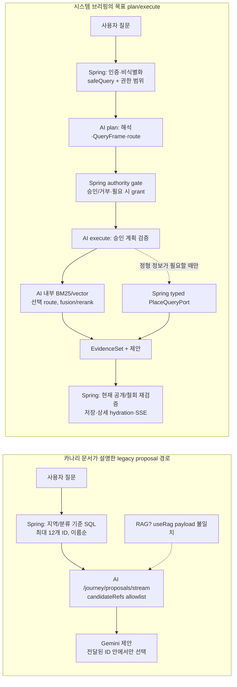
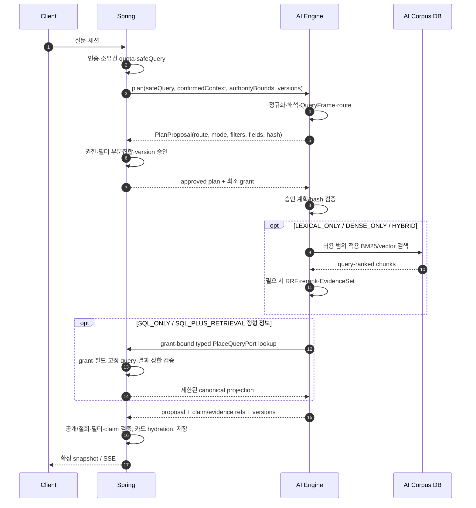

# OnMaru 여정 RAG 카나리 역할 경계 진단

> 작성 기준: 2026-11-17. AI-engine 소스는 `4633dc7a8d0262c753338d547a5feb5ed4396c6f` (`v0.1.8`), OnMaru-backend `develop` 소스는 `39f2db07b896dafd035aec0dbadd1e96f3d44028` 기준이다. 비교 자료는 2026-10-21 AI-RAG 시스템 브리핑과 그 다이어그램 원본, backend `develop`의 2026-11-16 카나리 E2E 보고서, 양 저장소의 확인 가능한 소스 코드다. 이 문서는 목표 아키텍처와 카나리 구현을 대조한 설계 진단이며 운영 호스트에서 직접 수집한 trace나 요청 payload는 아니다.

## 판정: 카나리는 목표 파이프라인이 아닌 legacy 후보 제한 경로를 보여준다

2026-10-21 시스템 브리핑의 목표 흐름은 Spring이 회원·대화·개인정보·권한을 검증하고, AI-engine이 `safeQuery`를 해석해 `PlanProposal`을 만든 뒤, Spring의 승인을 거쳐 AI-engine이 내부 corpus 검색과 근거 선정을 수행하는 구조다. Spring의 정형 데이터는 승인된 typed lookup으로만 호출하며, 최종 공개·철회 검사와 응답 저장은 Spring이 소유한다. 이 경계에서는 Spring이 추천 검색 결과를 미리 12개로 선정해 AI-engine에 넘기지 않는다.

하지만 backend `develop`의 카나리 설명은 `POST /internal/v1/journey/proposals/stream` legacy endpoint를 사용한다. 현재 backend 코드도 기본 설정에서 `HttpAiProposalClient`를 선택한다. 이 경로는 Spring이 먼저 최대 12개 장소 ID를 만들고 AI-engine이 그 안에서만 순서를 정하도록 한다. 따라서 카나리는 Spring↔AI 통신이 실제로 발생했다는 증거이지만, 목표 plan → authority approval → execute 파이프라인이 운영에서 실행됐다는 증거는 아니다.

**배포 판단:** 현행 legacy 후보 제한 경로를 AI-engine 독립 RAG의 운영 검증으로 간주해 출시하면 안 된다. plan/execute 경로도 현재 AI composition에서 실제 PostgreSQL corpus snapshot과 lexical/dense searcher가 연결되지 않아, 경로 전환만으로 해결되지 않는다. 먼저 실제 카나리 이미지·설정·요청·응답을 상호 대조하고 두 P0 경계를 모두 고쳐야 한다.

## 목표 브리핑과 카나리 실행은 서로 다른 흐름이다

아래 그림에서 왼쪽은 backend `develop` E2E 보고서와 소스가 가리키는 legacy 흐름이고, 오른쪽은 시스템 브리핑이 설명한 목표 흐름이다. `maxPlaces=5`는 검색 후 사용자에게 제안할 장소 수의 상한이다. Spring이 AI에 전달할 초기 검색 후보를 5개나 12개로 미리 결정하는 입력 상한이 아니다.

그 시스템 브리핑은 목표 구조를 설명하는 생성 산출물이다. 저장소의 [다이어그램 안내](../diagrams/README.md)는 해당 그림을 운영 구현의 증거가 아닌 목표 아키텍처로 분명히 규정한다. HTML은 2026-10-21 날짜로 생성됐고, 원본 설계 문서와 별도로 재생성해야 한다. 그러므로 브리핑을 설계 기준으로 사용하되 운영 현황은 코드·요청 trace·배포 digest로 판단해야 한다.

## 카나리의 12개 장소는 AI의 검색 결과가 아니다

backend `develop`의 [`JourneyWorkerService.process`](https://github.com/YRootLab/OnMaru-backend/blob/develop/modules/journey/src/main/java/com/yrootlab/onmaru/journey/worker/JourneyWorkerService.java)는 AI 호출 전에 `candidateProvider.retrieve(request)`를 실행한다. production [`JdbcJourneyCandidateProvider`](https://github.com/YRootLab/OnMaru-backend/blob/develop/adapters/persistence-jdbc/src/main/java/com/yrootlab/onmaru/persistence/catalog/journey/JdbcJourneyCandidateProvider.java)는 상한 12를 전달하고, [`ApprovedPlaceReader`](https://github.com/YRootLab/OnMaru-backend/blob/develop/adapters/persistence-jdbc/src/main/java/com/yrootlab/onmaru/persistence/catalog/journey/ApprovedPlaceReader.java)는 활성 카탈로그를 읽어 지역·분류 조건만 적용한 다음 장소명과 공개 ID 순으로 제한한다. 이 SQL에는 사용자 질문, BM25 점수, vector 유사도, 검색어 기반 ordering이 없다.

카나리 문서에는 이 후보 추출을 “`한옥` 토큰 기반”이라고 설명하지만 확인한 `develop` 구현은 `request.regionCode()`와 `null` 분류를 넘길 뿐 query text를 후보 조회기에 전달하지 않는다. 카나리 질의의 지역도 `null`이므로 실제 코드는 전국 활성 카탈로그에서 이름순 12개를 가져오는 형태다. 따라서 결과 중 한옥 숙소가 선택되었더라도 그것만으로 AI가 corpus 전체를 탐색해 골랐다고 말할 수 없다.

그 ID 제한은 Spring→AI request body의 `candidateRefs`로 이어진다. backend의 [`HttpAiProposalClient`](https://github.com/YRootLab/OnMaru-backend/blob/develop/apps/spring-api/src/main/java/com/yrootlab/onmaru/integration/ai/HttpAiProposalClient.java)는 `candidateCount`, `query`, `candidateRefs`를 직렬화한다. AI의 [`JourneyProposalRequest`](../../../src/onmaru_ai/security/internal_auth.py)는 `candidateRefs`를 최대 12개로 제한하고, [`JourneyLlmService`](../../../src/onmaru_ai/journey_llm.py)는 prompt에서 제공된 refs만 사용하도록 지시한 후 응답 refs를 다시 allowlist로 거른다. Spring 워커도 반환된 ID가 같은 후보 집합 안에 있는지 확인한다. 즉 12개는 품질 근거로 선택한 검색 결과가 아니라 생성 결과가 넘어갈 수 있는 **Spring 사전 후보 allowlist**다.

이 allowlist는 사용자 pin, 명시적으로 지칭한 장소, 확정된 제외 ID처럼 검색 전에 확정된 권한/대화 조건을 표현할 때는 합리적이다. 그러나 일반 추천의 전체 corpus 탐색 후보를 대체하면 AI의 recall 상한이 Spring SQL에 종속된다. 권한 제어와 검색 랭킹이 같은 `candidateRefs` 배열에 결합된 것이 책임 경계 오류의 핵심이다.

## RAG 실행 여부도 문서와 실제 호출 계약이 맞지 않는다

카나리 E2E 문서는 AI 요청에 `useRag=true`가 있었다고 적고, AI가 운영 corpus에서 근거를 골랐다고 보고한다. 그러나 backend `develop`의 확인된 [`HttpAiProposalClient.requestBody`](https://github.com/YRootLab/OnMaru-backend/blob/develop/apps/spring-api/src/main/java/com/yrootlab/onmaru/integration/ai/HttpAiProposalClient.java)는 `useRag`를 직렬화하지 않는다. AI 요청 모델은 [`use_rag=False`](../../../src/onmaru_ai/security/internal_auth.py)를 기본값으로 가지며, 이 기본값이면 `rag_result()`가 즉시 빈 결과를 반환한다. 따라서 확인한 backend 소스와 AI 계약을 그대로 조합하면 이 호출에서 RAG는 실행되지 않는다.

AI-engine의 현재 `create_app()`은 DB DSN이 제공되면 Postgres activation log와 `PostgresRagEvidenceRetriever`를 구성할 수 있다. 하지만 그것이 요청에서 `useRag=true`를 보내거나, legacy 요청의 candidate allowlist를 없애주지는 않는다. 카나리 설명의 근거 12개가 실제 RAG 결과라면 운영에서 사용된 backend artifact 또는 runtime 설정이 현재 `develop` 소스와 다른지, 실제 raw request와 AI의 `journey.rag.result` 로그에 `retrieved_count`가 기록됐는지 확인해야 한다. 증거가 맞춰지기 전까지 “카나리에서 AI RAG가 실행되어 두 장소를 발견했다”는 결론은 미확정이다.

여기에 또 다른 혼선이 있다. AI 저장소의 11월 12일 readiness 문서는 운영 RAG 연결과 plan/execute 검색을 미검증으로 남겼지만, 11월 13일 `handoff.md`는 운영 DB 연결 및 12개 근거 회수를 검증했다고 기록한다. 소스에는 현재 `create_app()`의 DB 자동 구성도 들어 있다. 이 기록들은 같은 실행인지, 같은 이미지 digest·환경 설정인지 연결돼 있지 않으므로 보고서의 카나리와 합쳐 하나의 검증 결과로 취급하면 안 된다.

## 목표 plan/execute도 설계와 연결 코드 사이에 공백이 있다

legacy 후보 경로를 끄고 plan/execute URL로 바꾸는 것만으로는 목표 파이프라인이 완성되지 않는다. AI [`create_production_plan_execute_service`](../../../src/onmaru_ai/composition.py)는 `QueryPlanner`와 `OrchestrationEngine`을 만들지만, `HybridRetrievalCoordinator()`에 lexical 또는 dense searcher를 주입하지 않는다. 실행 함수는 모든 승인 plan을 `DummyCorpusSnapshot`에 전달하며, 이 snapshot의 DB connection은 `None`이다. retrieval coordinator는 각 검색기가 비어 있으면 검색 실패/빈 후보를 반환한다. 따라서 이 composition root는 현재 다섯 route를 실운영 corpus 검색으로 이어주지 않는다.

또한 이 경로의 `ProductionGenerator`는 Gemini가 만든 claim이 아니라 lookup/evidence 값을 반영한 결정적 placeholder proposal을 만들도록 구현되어 있다. 이건 결정적 fallback 또는 계약용 scaffold로는 유용하지만, 브리핑의 `EvidenceSet → grounded generator → proposal validator` 전체를 실제 품질 생성 경로로 검증한 것은 아니다. README가 plan/execute의 실제 검색 연결을 미완료라고 설명하는 점과도 일치한다.

요약하면 현재 구성은 **legacy에서는 Spring 후보로 선택 범위를 제한하고, 새 plan/execute에서는 AI 내부 검색을 목표로 하지만 실제 corpus adapter·snapshot·생성 경로가 아직 완전히 연결되지 않은 전환 상태**다. 양쪽 경로의 존재가 하이브리드 자체를 잘못되게 만드는 게 아니라, 제품의 실제 endpoint 선택이 목표 책임 경계와 다르고 목표 endpoint도 실행 가능한 검색을 보장하지 않는 점이 문제다.

## 왜 잘못된 하이브리드로 굳어졌는가

확인 가능한 문서와 코드는 단계적 이전 과정이 역할 역전으로 이어졌음을 시사한다. AI-engine의 root Issue #3와 W0–W22 계획은 AI가 질의를 해석하고 검색을 수행하며 Spring이 계획 승인·정형 조회·최종 게시를 소유하도록 분리했다. 반면 legacy proposal API는 이미 Spring이 만든 후보 목록을 AI에 넘기는 계약이었다. 2026-11-13 PRD의 평가 부록도 후보 생성 규칙과 `candidatePolicy`를 backend 소유로 두고, 최대 12개 후보를 고정한 비교 평가를 설명한다. 이 비교 계약이 운영 API 입력과 같은 모양을 쓰면서, 제한된 평가 기준이 운영의 검색 소유권처럼 보이게 됐다.

두 번째 원인은 안전 경계를 과도하게 한 단계 앞에 둔 것이다. Spring은 DB의 정본·회원 권한·현재 공개/철회 상태를 보호해야 한다. 그 요구를 만족하기 위해 AI에 전부 공개된 장소 DB를 직접 읽히지 않는 선택은 타당하지만, 이를 “Spring이 먼저 12개를 뽑아서 넘긴다”로 구현할 필요는 없다. 승인 가능한 지역·분류·공개 조건을 경계로 보내고 AI가 자기 corpus 안에서 검색하게 하거나, live 정형 데이터가 필요할 때 grant가 결합된 고정 Spring lookup을 호출하면 소유권을 보존할 수 있다.

세 번째 원인은 배포 토글과 증거가 경로 선택을 드러내지 않았다는 점이다. backend `onmaru.ai.plan-execute-enabled`는 소스에서 빠지면 legacy proposal client를 선택한다. 따라서 plan/execute 설계 문서가 있어도 운영은 계속 legacy endpoint를 호출할 수 있다. `useRag` 누락, Spring 후보 순위 알고리즘, AI의 실제 active corpus revision, 검색기 wiring과 이미지 digest를 같은 run ID로 증명하는 release gate가 부족하면, “Spring과 AI가 통신했다”가 “AI가 독립 RAG를 수행했다”로 잘못 해석된다.

## 수정할 책임 경계는 검색을 AI에 두고 권한을 Spring에 둔다

AI-engine의 독립성은 Spring 업무 DB 계정을 AI에 넘기는 뜻이 아니다. Spring은 사용자 인증, 소유권, 입력 비식별화, 대화의 확정 상태, 계획 승인, canonical 업무 정보, 공개·철회 정본, 최종 저장·SSE를 계속 소유한다. AI-engine은 비식별 질문 해석, 질문별 route 선택, AI가 수집한 공개 corpus의 BM25/vector 검색, RRF와 rerank, 근거 제한 생성 및 검색 artifact를 소유한다. Spring은 검색 후보 순서를 미리 만들어 주지 않고 AI가 제안한 결과의 권한과 최신 자격을 확인한다.

두 `opt` 경로는 route에 따라 하나 또는 필요한 조합만 실행한다. `SQL_ONLY`에서는 embedding, BM25, reranker, LLM을 호출하지 않는다. `HYBRID`일 때만 BM25와 vector를 함께 실행하고 RRF를 적용한다. `maxPlaces=5`는 검증을 통과한 최종 장소 수 상한이고, `candidateRefs`는 검색 결과의 대체물이 아니다.

### plan 요청은 검색 권한과 검색 결과를 혼합하지 않아야 한다

기존 legacy request의 `candidateRefs`는 AI가 선택할 장소 목록인 것처럼 역할을 겸한다. 목표 plan request에서는 그 필드를 추천 후보 집합으로 보내지 않는다. 대신 `safeQuery`, 확정된 대화 상태, region/category 같은 허용 filter bounds, 사용자가 명시적으로 pin/exclude/target한 ID, corpus/config/revocation version 및 route별 결과 상한을 보낸다. Spring은 AI가 제안한 filter가 주어진 authority bounds를 넓히지 않는지 승인한다.

사용자가 “경복궁 주소”처럼 특정 장소를 묻는 경우의 `targetPlaceIds`와 사용자의 pin/exclude ID는 정당한 입력 맥락이다. “조용한 한옥 코스 추천”을 위해 Spring이 임의로 고른 장소 12개는 명시적 target이 아니므로 여기에 포함하지 않는다. 모델이 `QueryFrame`을 만들더라도 route 결정은 닫힌 정책·검증 규칙으로 통제하고, LLM이 무제한 tool loop나 자유 SQL을 만들 권한을 갖지 않는다.

### 검색은 AI corpus 소유 adapter가 수행하고 live 정형 조회만 Spring에 위임한다

public passage의 retrieval은 active corpus revision, 공개 자격, source/place revocation, query 표현과 승인된 hard filter를 기준으로 AI 내부 typed searcher가 수행한다. `LEXICAL_ONLY`는 한국어 BM25/exact 검색만, `DENSE_ONLY`는 query embedding/vector 검색만, `HYBRID`는 양쪽 후보를 합친 뒤 RRF와 rerank를 수행한다. 기본 경로가 `HYBRID`인 것과 모든 질문을 무조건 hybrid로 보내는 것은 다르다. 질문 유형에 맞는 선택과 route별 품질 평가가 필요하다.

주소·현재 저장 상태 등 Spring이 정본인 정형 사실은 AI가 직접 업무 DB에 SQL을 보내지 않는다. AI plan이 허용된 canonical field와 target을 요청하면 Spring authority gate가 그 부분집합을 확인하고 짧은 수명의 grant를 발급한다. FastAPI의 고정 adapter는 grant만으로 좁은 `PlaceQueryPort`를 호출하고, Spring application service 아래의 parameterized query가 결과 상한과 field allowlist를 적용한다. AI corpus 자체의 metadata·revision을 읽는 SQL은 AI 전용 schema와 최소 권한 role에서 운영할 수 있지만 업무 schema와 DB credential을 공유하지 않는다.

### 생성과 최종 확정은 근거·공개 자격을 각각 검사한다

AI는 검색 결과를 이유로 임의 장소 ID, URL, 사실 claim을 새로 만들지 않는다. proposal의 각 claim은 `EvidenceSet`의 근거 ID 및 같은 장소·revision에 묶여야 한다. AI validator는 schema와 ID 연결을 검사하고, Spring final validator는 현재 공개·철회 상태, 회원 조건, approved filters, 최신 canonical facts를 다시 확인한다. 확인을 통과한 결과만 원자적으로 저장하고 SSE로 전달하며, 상세 카드와 이미지 hydration은 Spring 장소 API 책임으로 둔다.

## P0 수정 순서는 endpoint 전환보다 먼저 증거와 실제 검색 wiring을 고친다

운영 배포가 임박했다면 사용자에게 보이는 호출 경로를 먼저 바꾸는 것보다, 어느 코드와 설정이 실행됐는지 증명하고 fail-closed 출시 판단을 하는 것이 우선이다. 아래 순서는 인프라/DB 소유권을 옮기지 않고 책임 경계와 연결 완성도를 바로잡는 순서다.

| 우선순위 | 조치 | 완료 증거 |
|---|---|---|
| P0-A 카나리 실행을 고정 | run ID 기준 raw Spring→AI request, AI response/RAG log, Spring commit, backend/AI image digest, feature flags, active corpus revision/activation decision을 묶는다. 현재 `develop` body와 다른 점을 설명할 artifact를 찾는다. | 동일 runId의 보안 비식별 request/response artifact와 두 이미지 digest. `useRag`, candidate count, route, retrieved refs가 일관됨. |
| P0-B 사전 후보 계약을 퇴역 | 일반 추천 flow에서 `candidateProvider.retrieve()`/최대 12개 `candidateRefs` 입력·출력 fence를 사용하지 않도록 versioned plan/execute 계약으로 이동한다. old client와 새 client가 동시에 운영되는 동안 route flag 및 rollback을 명시한다. | 추천 질의의 AI `plan`이 Spring candidate SQL보다 먼저 호출되고, 최종 선택 ID는 AI 검색 결과에서 나온다. 명시 target/pin/exclude만 ID context로 전달된다. |
| P0-C AI 검색을 실 corpus에 연결 | `DummyCorpusSnapshot` 대신 요청의 고정 revision·profile·revocation sequence를 검증하는 read-only snapshot을 열고 lexical/dense searcher를 주입한다. route별로 불필요한 검색 호출을 하지 않는다. | 활성 corpus에서 같은 질문으로 실제 BM25/vector 조회 span과 rank를 관측. 공개/철회 hard filter, route fixture, 빈/부분 장애 fallback이 이미지 digest 기준 smoke에서 통과. |
| P0-D 요청 계약과 RAG 관측 정합화 | legacy `useRag` 필드와 기본값을 의도적으로 문서화하고, 카나리의 실제 호출에서 누락되지 않게 한다. plan/execute에서는 corpus 선택·검색 사용 여부·degraded cause를 plan hash/run과 연결한다. | 필드 누락 시 시작 단계에서 확인 가능한 오류 또는 명시적 RAG-off 결과. 실제 검색 0건과 `retrieved_count`가 구별되고 로그에는 query/text/secrets가 없음. |
| P0-E 최종 생성/게시 gate 검증 | placeholder `ProductionGenerator`와 실제 근거 제한 생성 경로를 분리한다. route별 생성/미생성·근거 부족·Spring final validation을 평가한다. | 세 문항 유형(정형, 정확 이름/용어, 자유 의미 복합 추천)을 포함한 canary가 잘못된 근거·ID·공개 데이터 없이 성공하며, `SQL_ONLY`의 LLM/embedding 호출 수는 0. |

검색 없는 plan/execute endpoint를 켜는 것은 수정이 아니다. 반대로 legacy 경로에 `useRag=true`만 추가해도 Spring의 상위 12개 후보라는 recall ceiling은 남는다. candidate selection, RAG activation, plan/execute retrieval을 각각 해결하고 같은 release artifact에서 검증해야 한다.

## 출시를 허용할 증거는 품질·권한·경로가 같은 run에서 맞아야 한다

최소 검증셋에는 질문 유형별 route 기대값, 지역 없음/있음, 명시 장소 target, pin/exclude, 부정 조건, 결과 0건, 철회 직전/직후를 포함한다. 기존 평가의 12개 candidate snapshot은 legacy 정책 비교 재현을 위한 fixture로 남길 수 있지만, 전체 corpus retrieval의 평가와 같은 결과표로 합치지 않는다. 전체 corpus의 정답 장소/근거가 AI의 첫 K 후보에 포함됐는지, RRF/rerank 후 어디서 빠졌는지, Spring 최종 검증에서 왜 제거됐는지 단계별로 기록한다.

릴리스 검증은 다음 조건을 한 실행에서 확인해야 한다.

- 질문 `safeQuery`가 AI plan으로 들어오고 route·필터·target 해석이 trace에 연결된다.
- 일반 추천 입력에 Spring 사전 top-12 후보가 없고, 사용자 명시 조건만 authority bounds로 전달된다.
- route에 해당하는 BM25/vector/SQL adapter만 실행되며, HYBRID에서만 RRF가 수행된다.
- query/candidate recall, final place precision, evidence/claim support, route accuracy, 공개/철회 필터 위반 0건, stage latency, timeout/degraded rate를 보고한다.
- planHash, corpus revision, embedding/index/reranker versions, revocation sequence, server flags와 두 image digest가 같은 artifact에 기록된다.
- 2GB 공존부하에서 DB pool, RSS/peak memory, p95/p99, OOM/swap 및 기존 Spring API 지연을 확인한다. 자원 기준을 넘으면 feature flag를 끄고 검증된 legacy baseline 또는 명시 실패로 rollback한다.

이 증거가 준비되지 않으면 현재 legacy endpoint를 “AI-engine 독립 RAG”로 표기하는 출시를 보류한다. 사용자 공개 API/SSE와 Spring 소유 경계는 유지하고, 내부 AI plan/execute 경로만 안전하게 교체한다.

## 확인된 증거와 아직 확인하지 못한 운영 사실을 구분한다

| 주장 | 확인한 근거 | 판정 |
|---|---|---|
| 목표 설계에서 AI가 질문 해석·route를 제안하고 Spring이 승인한다 | [시스템 브리핑 원본 생성기](build_system_briefing.py), [query-processing.md](../architecture/query-processing.md), [module-boundaries-and-pipelines.md](../architecture/module-boundaries-and-pipelines.md), backend [journey-query-mcp.md](https://github.com/YRootLab/OnMaru-backend/blob/develop/docs/ai-rag-spring/journey-query-mcp.md) | 목표 계약으로 확인 |
| 2026-11-16 카나리 보고서가 legacy `/journey/proposals/stream`을 설명한다 | backend [E2E 데이터 흐름 보고서](https://github.com/YRootLab/OnMaru-backend/blob/develop/docs/ai-rag-spring/journey_e2e_data_flow.md) | 문서 기술로 확인; raw trace는 미확인 |
| `develop` 구현은 후보 SQL 후 AI를 호출하고 최대 12개를 이름순으로 제한한다 | backend [`JourneyWorkerService`](https://github.com/YRootLab/OnMaru-backend/blob/develop/modules/journey/src/main/java/com/yrootlab/onmaru/journey/worker/JourneyWorkerService.java), [`JdbcJourneyCandidateProvider`](https://github.com/YRootLab/OnMaru-backend/blob/develop/adapters/persistence-jdbc/src/main/java/com/yrootlab/onmaru/persistence/catalog/journey/JdbcJourneyCandidateProvider.java), [`ApprovedPlaceReader`](https://github.com/YRootLab/OnMaru-backend/blob/develop/adapters/persistence-jdbc/src/main/java/com/yrootlab/onmaru/persistence/catalog/journey/ApprovedPlaceReader.java) | 코드로 확인 |
| legacy Spring client가 `useRag=true`를 보낸다 | backend [`HttpAiProposalClient.requestBody`](https://github.com/YRootLab/OnMaru-backend/blob/develop/apps/spring-api/src/main/java/com/yrootlab/onmaru/integration/ai/HttpAiProposalClient.java) 대 AI [`JourneyProposalRequest`](../../../src/onmaru_ai/security/internal_auth.py) | 확인한 source 조합에서는 거짓; 운영 artifact 차이 확인 필요 |
| 기본 설정은 plan/execute 경로가 아니라 legacy client를 선택한다 | backend [`JourneyWorkerConfiguration`](https://github.com/YRootLab/OnMaru-backend/blob/develop/apps/spring-api/src/main/java/com/yrootlab/onmaru/worker/journey/JourneyWorkerConfiguration.java): `matchIfMissing=true` legacy, plan/execute는 명시 true일 때만 | 코드 기본값으로 확인; 배포 override는 미확인 |
| AI plan/execute composition이 현재 실 DB 검색을 실행한다 | [`composition.py`](../../../src/onmaru_ai/composition.py)에서 `DummyCorpusSnapshot`, `HybridRetrievalCoordinator()` 기본 생성, 검색기 주입 없음 | 확인한 composition에서는 부정 |
| 카나리 두 장소가 실제 RAG 근거를 바탕으로 추천됐다 | E2E markdown에는 근거 발췌가 있으나 확인된 Spring client는 `useRag`를 생략함 | 모순; raw payload/log/image digest 없이는 결론 불가 |

최근 GitHub 이슈 기준으로 AI-RAG 구현 root #3은 종료됐고, #76은 legacy RAG 활성화·운영 연결 후속 작업이다. 이 보고서의 책임 역전과 실제 plan/execute corpus wiring을 구현하는 일은 현재 #76만으로 완료 판정할 수 없다. 구현을 시작하기 전 별도 Issue를 만들거나 적합한 미완료 Issue에 명시적으로 포함하고, Spring과 공유 계약을 같은 schema fixture로 맞춰야 한다.

### 참고한 소유 문서

- [2026-10-21 시스템 브리핑](2026-10-21-system-briefing.html)
- [아키텍처 다이어그램 안내](../diagrams/README.md)
- [AI-RAG 목표 요청 파이프라인](../architecture/query-processing.md)
- [AI-RAG 모듈 경계와 책임](../architecture/module-boundaries-and-pipelines.md)
- [출시 준비도와 미검증 격차](../operations/production-readiness-gaps.md)
- [Spring 여정 E2E 카나리 기록](https://github.com/YRootLab/OnMaru-backend/blob/develop/docs/ai-rag-spring/journey_e2e_data_flow.md)
- [Spring↔AI 정형 조회 경계](https://github.com/YRootLab/OnMaru-backend/blob/develop/docs/ai-rag-spring/journey-query-mcp.md)
- [AI-RAG 구현 root Issue #3](https://github.com/YRootLab/onmaru-ai-engine/issues/3), [legacy RAG 후속 Issue #76](https://github.com/YRootLab/onmaru-ai-engine/issues/76)
