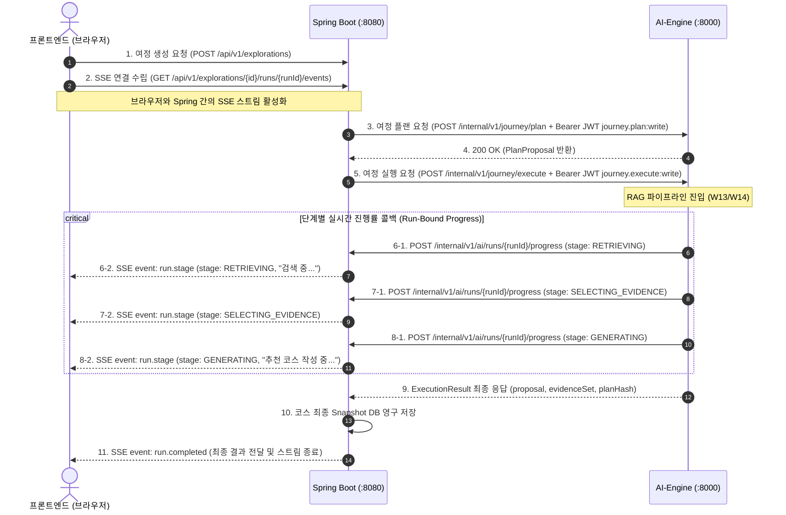

# Spring Backend(v0.3.54) 연동 규격 및 SSE 진행률 스트리밍 아키텍처

> 상태: 확정 설계 문서 (2026-11-08). Spring Backend와의 사설 REST 통신, 런타임 단계별 진행률 콜백, 브라우저 SSE 중계 흐름 및 보안/장애 격리 경계를 다룬다.

---

## 1. 개요 및 통신 토폴로지

OnMaru의 AI 여정 추천 시스템은 클라이언트(브라우저)와 FastAPI AI-Engine이 직접 통신하지 않는다.  
모든 외부 요청과 SSE(Server-Sent Events) 스트림은 Spring Boot가 관리하며, FastAPI는 단일 호스트 사설 Docker 네트워크(`app`) 내부에서 비공개 REST로만 통신한다.

```text
[ 브라우저 / 프론트엔드 ]
       │
       │ (1) 여정 추천 요청 (HTTPS POST /api/v1/explorations)
       │ (2) 실시간 진행 상태 SSE 구독 (GET /api/v1/explorations/{id}/runs/{runId}/events)
       ▼
[ Spring Boot :8080 (Public/Private Bridge) ]
       │
       │ (3) 내부 여정 플랜/실행 요청 (private REST + HS256 Bearer JWT)
       │     URL: POST http://ai-engine:8000/internal/v1/journey/plan
       │     URL: POST http://ai-engine:8000/internal/v1/journey/execute
       ▼
[ FastAPI AI-Engine :8000 (Private RAG Pipeline) ]
       │
       ├── (4) 실시간 진행 단계 콜백 (Run-Bound Progress Callback)
       │       URL: POST http://staging-api:8080/internal/v1/ai/runs/{runId}/progress
       │       (Spring이 수신 즉시 브라우저 SSE로 중계)
       │
       └── (5) 정형 데이터 검증 조회 (PlaceQueryPort Lookup)
               URL: POST http://staging-api:8080/internal/mcp/journey/tools/journey_execute_approved_lookup
```

---

## 2. 전체 통신 시퀀스 (End-to-End Sequence)



---

## 3. 인터페이스 세부 계약 (Contract Specification)

### 3.1 Spring ➔ FastAPI: 여정 플랜 및 실행 요청

- **Plan URL**: `POST http://ai-engine:8000/internal/v1/journey/plan`
  - **인증**: `Authorization: Bearer <JWT Token>` (HS256, Secret: `ONMARU_SECRET_INTERNAL_AI_SERVICE_TOKEN_CURRENT`)
  - **Claims**: `iss=onmaru-spring`, `sub=spring-api`, `aud=onmaru-ai`, `scope=journey.plan:write`
  - **Request Body**: `SafeQueryRequest` (schemaVersion: `ai-safe-query.v1`)
  - **Response Body**: `PlanProposal` (schemaVersion: `ai-plan-proposal.v1`)

- **Execute URL**: `POST http://ai-engine:8000/internal/v1/journey/execute`
  - **인증**: `Authorization: Bearer <JWT Token>` (HS256, Secret: `ONMARU_SECRET_INTERNAL_AI_SERVICE_TOKEN_CURRENT`)
  - **Claims**: `iss=onmaru-spring`, `sub=spring-api`, `aud=onmaru-ai`, `scope=journey.execute:write`
  - **Headers**:
    - `X-Run-Progress-Token: <progressCapabilityToken>`
    - `X-Run-Id: <runId>`
    - `X-Request-Id: <requestId>`
    - `X-Deadline-At: <ISO-8601-UTC-deadline>`
    - `traceparent: 00-{traceId}-{spanId}-01`
  - **Request Body**: `ApprovedQueryPlan` (schemaVersion: `ai-approved-query-plan.v1`)
  - **Response Body**: `ExecutionResult` (schemaVersion: `ai-execute-result.v1`)

---

### 3.2 FastAPI ➔ Spring: 런타임 진행률 콜백 (Progress Callback)

AI-Engine 파이프라인이 각 주요 실행 단계에 진입할 때마다 Spring으로 비동기 콜백을 전송한다.

- **URL**: `POST http://staging-api:8080/internal/v1/ai/runs/{runId}/progress`
- **Headers**:
  - `Content-Type: application/json`
  - `X-Run-Progress-Token: <progressCapabilityToken>`
- **Payload (`InternalAiProgressPayload`)**:
  ```json
  {
    "stage": "RETRIEVING",
    "message": "관련 한옥 및 관광 정보를 검색 중입니다...",
    "elapsedMs": 350
  }
  ```
- **지원 단계 매핑**:
  - `INTERPRETING`: 질문 정규화 및 파라미터 프레임 해석
  - `RETRIEVING`: 어휘(BM25) 및 벡터(E5) 검색 수행
  - `SELECTING_EVIDENCE`: RRF 융합, 경량 리랭킹, 다양성 근거 선택
  - `GENERATING`: Gemini LLM 응답 생성
  - `VALIDATING`: 근거 기반 Claim 검증 및 환각 필터링
  - `PERSISTING`: 최종 결과 확정 준비

---

### 3.3 FastAPI ➔ Spring: 정형 장소 조회 (PlaceQueryPort)

AI가 PostgreSQL 장소 테이블에 직접 임의 SQL을 실행하지 않고, Spring이 인가한 정보만 조회한다.

- **URL**: `POST http://staging-api:8080/internal/mcp/journey/tools/journey_execute_approved_lookup`
- **Request Body**:
  ```json
  {
    "grantId": "grant-45e6a7f5-31bc-469d-9e30-6f510a1dc497",
    "regionCode": "jeonju",
    "category": "TOURIST_SPOT",
    "limit": 5
  }
  ```
- **Response Body**:
  ```json
  {
    "places": [
      {
        "id": "p-staging-hanok-01",
        "name": "전주 경기전",
        "category": "TOURIST_SPOT",
        "address": "전북 전주시 완산구 태조로 44",
        "regionCode": "jeonju",
        "latitude": 35.8152,
        "longitude": 127.1498
      }
    ]
  }
  ```

---

## 4. 안전 및 운영 원칙

1. **장애 격리 (Failure Isolation)**:
   - 진행률 콜백 전송이 일시적인 네트워크 순단이나 5xx 응답으로 실패하더라도, **AI-Engine의 여정 추론 연산은 절대 중단되거나 실패 처리되지 않는다.** (최선의 노력 전송, Best-effort).
2. **단방향 권한 경계 (Authority Boundary)**:
   - AI-Engine은 Spring으로부터 전달받은 `queryGrantId` 범위 내에서만 정형 조회를 요청할 수 있으며, Spring이 허용한 인가 필드(`PUBLIC_ADDRESS`, `REGION_CODE`, `CATEGORY_CODE`, `PUBLIC_STATUS`) 외의 데이터는 접근할 수 없다.
3. **2GB 호스트 리소스 제한**:
   - 단일 Lightsail 호스트(2GB RAM) 내 공존을 위해 AI-Engine은 최대 512MB(`ONMARU_AI_MEMORY_LIMIT`) 메모리 한도 내에서 동작하도록 제한된다. (피크 RSS 382.5MB 실측 검증 완료).
4. **불변(Immutable) 배포 원칙**:
   - 운영/스테이징 배포는 항상 고유한 이미지 digest(`@sha256:...`)를 통해 이루어지며, 태그(`latest`) 기반의 가변 배포는 금지된다.
