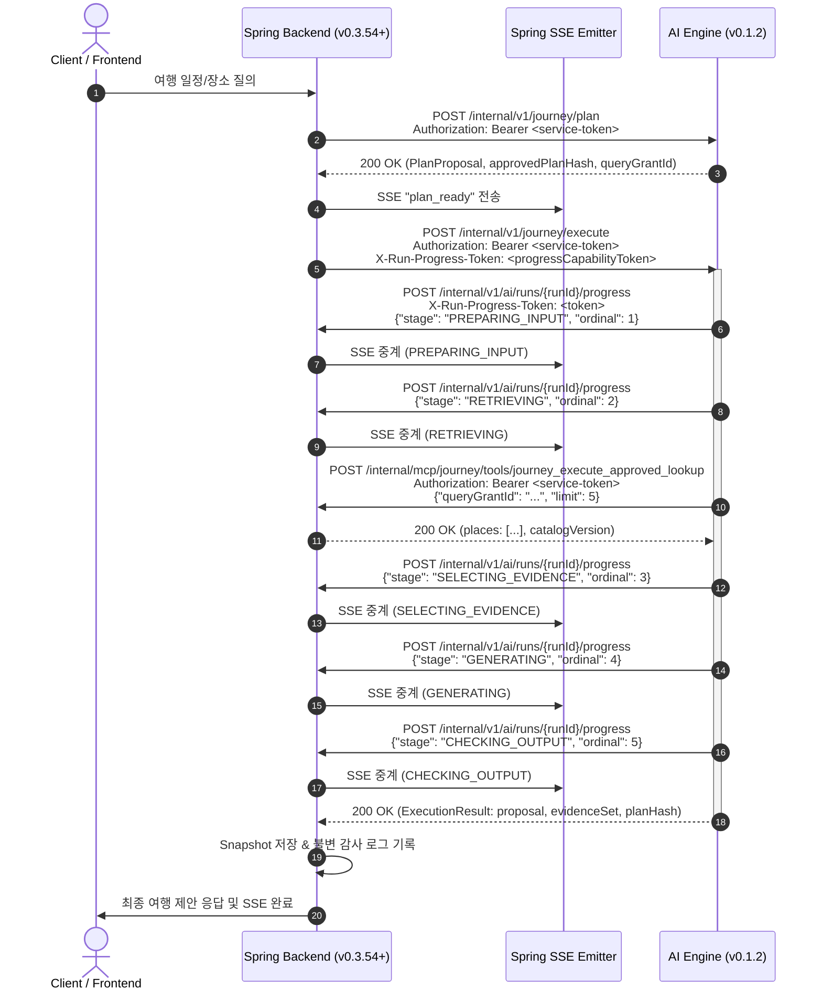

# OnMaru AI Engine v0.1.2 Production Wiring & Spring Backend 연동 안내서

- **AI Engine 대상 버전**: `v0.1.2`
- **Release Commit SHA**: [`65ed2705cac546004cebdeb43f35e6ffc498ec4a`](https://github.com/YRootLab/onmaru-ai-engine/commit/65ed2705cac546004cebdeb43f35e6ffc498ec4a)
- **Git Tag**: [`v0.1.2`](https://github.com/YRootLab/onmaru-ai-engine/releases/tag/v0.1.2)
- **Container Image**: `ghcr.io/yrootlab/onmaru-ai-engine/ai-engine:65ed2705cac546004cebdeb43f35e6ffc498ec4a` (또는 `v0.1.2`)
- **Image Digest**: `sha256:df8229b357b2d786f060c4ec38097ae1a1a788fc016b6759c67d15aa082d3067`
- **관련 Backend Tracking Issues**:
  - Root: [`YRootLab/OnMaru-backend#807`](https://github.com/YRootLab/OnMaru-backend/issues/807)
  - Plan/execute authority: [`#808`](https://github.com/YRootLab/OnMaru-backend/issues/808)
  - Progress callback: [`#809`](https://github.com/YRootLab/OnMaru-backend/issues/809)
  - Approved lookup: [`#810`](https://github.com/YRootLab/OnMaru-backend/issues/810)
  - Snapshot/E2E: [`#811`](https://github.com/YRootLab/OnMaru-backend/issues/811)

---

## 1. 개요 및 주요 변경 사항

OnMaru AI Engine `v0.1.2`는 이전 버전(`v0.1.1`)에서 클래스 및 단위 테스트 수준으로 준비되었던 **Production Composition Root**와 **런타임 파이프라인(SpringPlaceQueryAdapter, CallbackProgressSink, OrchestrationEngine, PlanExecuteService)**을 기본 어플리케이션 진입점(`main:app`)에 완전히 통합(Production Wiring)한 릴리즈입니다.

### 핵심 변경 내용
1. **기본 어플리케이션 503(AI_SERVICE_UNAVAILABLE) 제거**:
   - `create_app()` 생성 시 기본적으로 프로덕션 `PlanExecuteService`가 주입되어, `/internal/v1/journey/plan` 및 `/execute` 엔드포인트가 즉시 정상 응답(200 OK)을 반환합니다.
2. **실행 파이프라인 End-to-End 연결**:
   - `POST /internal/v1/journey/execute` 요청 시 전달된 `x-run-progress-token` 헤더와 `queryGrantId`를 바탕으로:
     - `CallbackProgressSink`를 인스턴스화하여 Spring으로 실시간 진행 상태 콜백 전송 (`PREPARING_INPUT` → `RETRIEVING` → `SELECTING_EVIDENCE` → `GENERATING` → `CHECKING_OUTPUT`)
     - `SpringPlaceQueryAdapter`를 통해 Spring의 Approved Lookup 엔드포인트(`POST /internal/mcp/journey/tools/journey_execute_approved_lookup`) 호출
     - 조회된 정형 장소 데이터를 실제 proposal 및 evidence 생성에 반영하여 `ExecutionResult` 반환
3. **엄격한 프로덕션 `/ready` 헬스체크 구현**:
   - 필수 Secret(`internal-ai.service-token`) 존재 여부
   - `ONMARU_SPRING_BASE_URL`의 유효한 HTTP/HTTPS 오리진 여부
   - `PlanExecuteService` 및 내부 컴포넌트(OrchestrationEngine, Generator 등) 정상 구성 여부
   - 비동기 HTTP Client의 활성 상태 확인 (모두 충족 시 200 OK, 미충족 시 503 반환)
4. **Lightsail 메모리 최적화 검증**:
   - Docker container 512MB RAM 제약 환경에서 실측 메모리 약 63MB (점유율 ~12.3%)로 매우 안정적으로 구동됨을 검증 완료.

---

## 2. 런타임 E2E 시퀀스 다이어그램



---

## 3. 계약 및 엔드포인트 규격 (Spring 측 확인 사항)

### 3.1. Plan 엔드포인트
- **URL**: `POST {aiBaseUrl}/internal/v1/journey/plan`
- **인증**: `Authorization: Bearer <ONMARU_INTERNAL_AI_SERVICE_TOKEN>`
- **Request Body**:
  ```json
  {
    "schemaVersion": "internal.ai.plan-request.v1",
    "query": "경복궁 근처 맛집 추천해줘",
    "authorityBounds": {
      "regions": ["11"],
      "categories": ["RESTAURANT", "ATTRACTION"]
    }
  }
  ```
- **Response Body**:
  ```json
  {
    "schemaVersion": "internal.ai.plan-response.v1",
    "runId": "run-abc-123",
    "route": "SQL_ONLY",
    "planHash": "sha256:...",
    "queryGrantId": "grant-xyz-456",
    "status": "READY"
  }
  ```

### 3.2. Execute 엔드포인트
- **URL**: `POST {aiBaseUrl}/internal/v1/journey/execute`
- **필수 Headers**:
  - `Authorization: Bearer <ONMARU_INTERNAL_AI_SERVICE_TOKEN>`
  - `X-Run-Progress-Token: <run-bound capability token>` *(Spring #809 연동)*
  - `traceparent: <w3c-trace-id>` *(Optional)*
- **Request Body**:
  ```json
  {
    "schemaVersion": "internal.ai.execute-request.v1",
    "runId": "run-abc-123",
    "planHash": "sha256:...",
    "queryGrantId": "grant-xyz-456",
    "springBaseUrl": "http://spring-backend:8080"
  }
  ```
  *(참고: `springBaseUrl`을 생략할 경우 AI Engine의 환경변수 `ONMARU_SPRING_BASE_URL`로 기본 설정됩니다.)*

### 3.3. AI → Spring Progress Callback 규격
- **URL**: `POST {springBaseUrl}/internal/v1/ai/runs/{runId}/progress`
- **Headers**:
  - `X-Run-Progress-Token: <run-bound capability token>`
- **Request Body**:
  ```json
  {
    "schemaVersion": "internal.ai.progress.v1",
    "runId": "run-abc-123",
    "planHash": "sha256:...",
    "ordinal": 1,
    "stage": "PREPARING_INPUT"
  }
  ```
- **단계 순서 (실제 진입한 단계만 전송됨)**:
  `PREPARING_INPUT` (1) → `RETRIEVING` (2) → `SELECTING_EVIDENCE` (3) → `GENERATING` (4) → `CHECKING_OUTPUT` (5)

### 3.4. AI → Spring Approved Lookup 규격
- **URL**: `POST {springBaseUrl}/internal/mcp/journey/tools/journey_execute_approved_lookup`
- **Headers**:
  - `Authorization: Bearer <ONMARU_INTERNAL_AI_SERVICE_TOKEN>`
- **Request Body**:
  ```json
  {
    "queryGrantId": "grant-xyz-456",
    "regionCode": "11",
    "category": "RESTAURANT",
    "limit": 5
  }
  ```
- **Response Body**:
  ```json
  {
    "catalogVersion": "journey.query.tools.v1",
    "places": [
      {
        "id": "place-001",
        "name": "토속촌 삼계탕",
        "category": "RESTAURANT",
        "address": "서울 종로구 자하문로5길 5",
        "coordinates": {"lat": 37.5778, "lng": 126.9718}
      }
    ]
  }
  ```

---

## 4. 환경 변수 및 배포 구성 (Lightsail Staging)

AI Engine 배포 시 다음 환경 변수를 주입해야 합니다.

| 환경 변수명 | 필수 여부 | 예시 값 | 설명 |
| :--- | :---: | :--- | :--- |
| `ONMARU_SECRETS_SOURCE` | 선택 | `env` | secret 로더 모드 (기본 `env`) |
| `ONMARU_INTERNAL_AI_SERVICE_TOKEN` | **필수** | `<고유 Bearer 토큰>` | AI Engine 및 Approved Lookup 상호 인증 토큰 |
| `ONMARU_SPRING_BASE_URL` | **권장** | `http://127.0.0.1:8080` | Spring Backend 내부 주소 (콜백 및 룩업 기본 대상) |
| `PORT` | 선택 | `8000` | 서비스 바인딩 포트 |

### 배포 헬스체크 확인
- **Liveness**: `GET http://localhost:8000/health` → `{"status": "ok"}`
- **Readiness**: `GET http://localhost:8000/ready` → `{"status": "ready"}`
  *(Secret 미설정 또는 Spring URL 불일치 시 503 리턴)*

---

## 5. 검증 완료 증적

- **단위/통합 테스트**: 총 993개 테스트 전체 통과 (`tests/api/test_composition_root.py`, `tests/api/test_runtime_integration.py`, `tests/contracts/test_spring_cross_contracts.py` 포함)
- **정적 분석**: `ruff check` (Clean), `mypy` (155 source files, Clean)
- **Docker 512MB 제한 메모리 검증**: 실측 62.98MB (12.3%) 소비, `/health` 및 `/ready` 200 OK, `plan/execute` 즉시 정상 응답 확인
- **CI/CD 파이프라인**: GitHub Actions publish workflow 정상 완료 및 GHCR 배포 이미지 발행 완료
