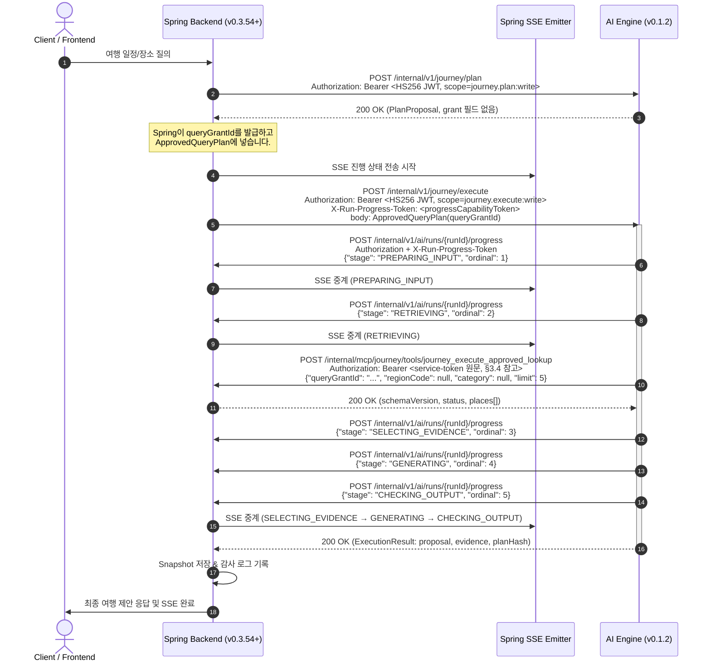

# OnMaru AI Engine v0.1.2 Production Wiring & Spring Backend 연동 안내서

- **AI Engine 대상 버전**: `v0.1.2`
- **Release Commit SHA**: [`65ed2705cac546004cebdeb43f35e6ffc498ec4a`](https://github.com/YRootLab/onmaru-ai-engine/commit/65ed2705cac546004cebdeb43f35e6ffc498ec4a)
- **Git Tag**: [`v0.1.2`](https://github.com/YRootLab/onmaru-ai-engine/releases/tag/v0.1.2)
- **Container Image**: `ghcr.io/yrootlab/onmaru-ai-engine/ai-engine:65ed2705cac546004cebdeb43f35e6ffc498ec4a` (또는 `v0.1.2`)
- **Image Digest**: `sha256:df8229b357b2d786f060c4ec38097ae1a1a788fc016b6759c67d15aa082d3067`
- **관련 Backend Tracking Issues**:
  - Root: [`YRootLab/OnMaru-backend#807`](https://github.com/YRootLab/OnMaru-backend/issues/807)
  - Plan/execute authority: [`#808`](https://github.com/YRootLab/OnMaru-backend/issues/808)
  - Progress callback: [`#809`](https://github.com/YRootLab/OnMaru-backend/issues/809)
  - Approved lookup: [`#810`](https://github.com/YRootLab/OnMaru-backend/issues/810)
  - Snapshot/E2E: [`#811`](https://github.com/YRootLab/OnMaru-backend/issues/811)

> **정정 (2026-11-11)**: 이 문서의 계약 설명을 `src/` 실제 코드 기준으로 고쳤습니다. 토큰 환경변수 이름, 호출 경로, 인증 방식, 승인 lookup 응답 필드, `queryGrantId` 발급 주체, 운영 기본값을 정정했습니다. 코드에 없는 HMAC 서명 헤더는 제거했습니다. 아래 **§5 현재 기능 상태**에서 RAG·Gemini가 운영 경로에 실제로 연결되었는지 확인할 수 있습니다.

---

## 1. 개요 및 주요 변경 사항

OnMaru AI Engine `v0.1.2`는 이전 버전(`v0.1.1`)에서 클래스 및 단위 테스트 수준으로 준비되었던 **Production Composition Root**와 **런타임 파이프라인(SpringPlaceQueryAdapter, CallbackProgressSink, OrchestrationEngine, PlanExecuteService)**을 기본 어플리케이션 진입점(`main:app`)에 통합(Production Wiring)한 릴리즈입니다.

### 핵심 변경 내용
1. **기본 어플리케이션 503(AI_SERVICE_UNAVAILABLE) 제거**:
   - `create_app()`은 기본적으로 프로덕션 `PlanExecuteService`를 주입합니다. `ONMARU_DISABLE_DEFAULT_PLAN_EXECUTE=true`이면 주입하지 않습니다.
   - `/internal/v1/journey/plan`과 `/internal/v1/journey/execute`는 유효한 토큰과 요청이 있으면 정상 응답합니다.
2. **실행 파이프라인 연결 (SQL 라우트 기준)**:
   - `POST /internal/v1/journey/execute`는 `x-run-progress-token` 헤더를 진행 콜백 인증에 사용하고, 요청 본문 `ApprovedQueryPlan.queryGrantId`를 Spring lookup에 전달합니다.
   - `SpringPlaceQueryAdapter`가 Spring의 Approved Lookup(`POST /internal/mcp/journey/tools/journey_execute_approved_lookup`)을 **라우트당 1회** 호출합니다.
   - 조회된 장소 투영(placeId·공개 주소·지역·카테고리·공개 상태)으로 `ValidatedProposal`과 `EvidenceSet`을 만들고 `ExecutionResult`로 반환합니다.
   - 검색 라우트(`LEXICAL_ONLY`, `DENSE_ONLY`, `HYBRID`)와 Gemini 근거 생성은 이 경로에 연결되어 있지 않습니다. §5를 보세요.
3. **`/ready` 헬스체크**:
   - `internal-ai.service-token` secret을 읽을 수 있는지 확인합니다.
   - `ONMARU_SPRING_BASE_URL`이 HTTP/HTTPS 오리진인지 확인합니다. **미설정이면 기본값 `http://staging-api:8080`이 쓰여 이 검사는 통과합니다.**
   - `PlanExecuteService` 주입 여부와 HTTP client 상태를 확인합니다. 실패하면 503을 반환합니다.
4. **Lightsail 메모리 검증 (v0.1.2 당시)**:
   - Docker container 512MB 제약에서 실측 약 63MB(12.3%)로 구동됨을 확인했습니다. 이 수치는 목표 2GB 공존 호스트의 검증이 아닙니다.

---

## 2. 런타임 E2E 시퀀스 다이어그램 (SQL 라우트)



---

## 3. 계약 및 엔드포인트 규격 (코드 기준)

### 3.1. Plan 엔드포인트
- **URL**: `POST {aiBaseUrl}/internal/v1/journey/plan`
- **인증**: `Authorization: Bearer <JWT>`. HS256 서명, 키는 `ONMARU_SECRET_INTERNAL_AI_SERVICE_TOKEN_CURRENT`이고 `_PREVIOUS`도 검증에 사용됩니다.
  - 필수 claims: `iss=onmaru-spring`, `sub=spring-api`, `aud=onmaru-ai`, `scope=journey.plan:write`, `exp`(만료 전), `jti`(비어 있지 않은 문자열)
  - 실패 시 401(서명·만료·형식·발급자·audience) 또는 403(scope)을 반환하고, 코드는 `INTERNAL_AUTH_*` 값으로 응답합니다.
- **Headers**:
  - `Content-Type: application/json`
  - `X-Request-Id: <requestId>` (영문·숫자·`._:-`, 최대 128자)
  - `X-Run-Id: <runId>` (본문 `runId`와 같아야 합니다)
  - `X-Deadline-At: <ISO-8601 with timezone>` (이미 지났으면 504)
  - `traceparent: 00-{traceId}-{spanId}-01` (trace·span ID가 0이면 422)
- **Request Body**: W0 `SafeQueryRequest` (schemaVersion: `ai-safe-query.v1`)
- **Response Body**: W0 `PlanProposal` (schemaVersion: `ai-plan-proposal.v1`)
  - **`queryGrantId`는 `PlanProposal`에 없습니다.** 응답으로 grant를 받지 않습니다.

### 3.2. Execute 엔드포인트
- **URL**: `POST {aiBaseUrl}/internal/v1/journey/execute`
- **인증**: §3.1과 같은 HS256 JWT. `scope=journey.execute:write`입니다.
- **Headers**:
  - `Content-Type: application/json`
  - `X-Request-Id`, `X-Run-Id`, `X-Deadline-At`, `traceparent`: §3.1과 같습니다.
  - `X-Run-Progress-Token: <progressCapabilityToken>`: 진행 콜백 인증용입니다. 없으면 진행 콜백 없이 실행합니다.
- **Request Body**: W0 `ApprovedQueryPlan` (schemaVersion: `ai-approved-plan.v1`, planVersion: `ai-query-plan.v1`)
  - `queryGrantId`: **Spring이 발급해 본문에 넣습니다.** SQL 라우트(`SQL_ONLY`, `SQL_PLUS_RETRIEVAL`)에서는 필수이고 다른 라우트에서는 금지됩니다.
  - AI는 grant를 발급하거나 저장하지 않습니다. 로컬에서는 길이(16~128자)만 확인합니다. 실제 허가 여부는 Spring lookup 응답이 결정합니다.
- **Response Body**: `ExecutionResult` (schemaVersion: `ai-execute-result.v1`, 필드: `runId`, `planHash`, `versions`, `proposal`, `evidence`)

### 3.3. AI → Spring Progress Callback 규격
- **URL**: `POST {springBaseUrl}/internal/v1/ai/runs/{runId}/progress`
- **Headers**:
  - `Authorization: Bearer <progressCapabilityToken>`
  - `X-Run-Progress-Token: <progressCapabilityToken>`
- **단계 순서 (실제 진입한 단계만 전송됨)**:
  `PREPARING_INPUT` (1) → `RETRIEVING` (2) → `SELECTING_EVIDENCE` (3) → `GENERATING` (4) → `CHECKING_OUTPUT` (5)
- **Spring SSE 중계 경로 (Spring 저장소 소유)**: `GET /api/v1/explorations/{explorationId}/runs/{runId}/events`
  - 이 저장소에는 `/api/v1/explorations/{id}/events` 경로가 없습니다. 이 경로를 사용하지 마세요.

### 3.4. AI → Spring Approved Lookup 규격
- **URL**: `POST {springBaseUrl}/internal/mcp/journey/tools/journey_execute_approved_lookup`
- **Headers**:
  - `Authorization: Bearer <ONMARU_SECRET_INTERNAL_AI_SERVICE_TOKEN_CURRENT 원문 값>`
  - `traceparent`, `Content-Type: application/json`, `Accept: application/json`, `Cache-Control: no-store`
  - **주의**: 현재 코드는 JWT를 만들지 않고 secret 원문을 Bearer 값으로 보냅니다(`composition.py`의 `get_service_token`). §6의 open item을 보세요. Spring이 이 방식을 기대하는지 확인해야 합니다.
- **Request Body** (`PlaceLookupRequest`, 필드는 camelCase):
  ```json
  {
    "queryGrantId": "grant-xyz-456",
    "regionCode": "11",
    "category": "RESTAURANT",
    "limit": 5
  }
  ```
  - `limit`은 1~5입니다. 현재 어댑터는 항상 5를 보냅니다.
  - `regionCode`·`category`는 승인 필터의 첫 번째 값이며, 없으면 `null`입니다.
- **Response Body** (`PlaceLookupResponse`):
  ```json
  {
    "schemaVersion": "journey.query.tools.v1",
    "status": "OK",
    "planHash": "sha256:<승인 planHash>",
    "sourceRevocationSequence": 7,
    "places": [
      {
        "placeId": "place-001",
        "publicAddress": "서울 종로구 자하문로5길 5",
        "regionCode": "11",
        "categoryCode": "RESTAURANT",
        "publicStatus": "PUBLIC"
      }
    ]
  }
  ```
  - `schemaVersion`은 `journey.lookup.result.v1` 또는 `journey.query.tools.v1`만 허용합니다. `catalogVersion`도 읽어서 `schemaVersion`으로 대체합니다.
  - `status`는 `OK` 또는 `NO_MATCH`입니다. `places`가 비어 있으면 `NO_MATCH`여야 하고, 그 밖의 조합은 거부됩니다.
  - `places`는 최대 5개이며 `placeId`는 중복되면 안 됩니다. 장소 필드는 승인된 canonical field 안에 있어야 합니다. 현재 승인 대상은 공개 주소(`publicAddress` 또는 `address`), 지역 코드, 카테고리 코드(`categoryCode` 또는 `category`), 공개 상태입니다.
  - `planHash`가 있으면 승인된 plan hash와 같아야 하고, `sourceRevocationSequence`가 0보다 크면 승인된 값과 같아야 합니다.
  - 응답 크기는 24KiB 이하여야 합니다.
  - `name`, `latitude`, `longitude`는 스키마에 있으나 승인 필드에 포함되지 않습니다. 필요하지 않으면 보내지 마세요.
  - 401·403·409·410은 `GRANT_REJECTED`로, 그 밖의 비정상 상태는 `SPRING_UNAVAILABLE`로 처리됩니다. 재시도하지 않습니다.

### 3.5. 레거시 제안 경로 (`/internal/v1/journey/proposals`)
- 인증은 `scope=journey.proposal:write`입니다. 별칭 `/internal/ai/journey/propose`도 같은 핸들러를 사용합니다. 신규 연동에는 `/internal/v1/journey/proposals`를 사용하세요.
- 요청의 `candidateRefs`는 Spring이 제공한 후보 ID입니다. 응답의 `orderedRefs`는 이 목록에서만 골라 반환합니다.
- `place:001` 같은 임시 ID는 더 이상 만들지 않습니다.
- `outcome`이 `NO_RESULTS`이면 `degradedReason`에 이유가 있습니다. `NO_CANDIDATES`, `CANDIDATE_REFS_MISSING`, `LLM_DISABLED`, `QUERY_EMPTY`, `LLM_UNAVAILABLE`, `LLM_NO_VALID_REFS`가 있습니다.
- `useRag=true`에 근거가 없으면 `ragEvidenceRefs`는 `[]`이고 `ragDegradedReason=RAG_NO_ACTIVE_EVIDENCE`를 함께 반환합니다.
- **미구현**: `X-OnMaru-Internal-Signature`와 `X-OnMaru-Internal-Timestamp` 같은 HMAC 헤더는 이 저장소에 없습니다. 현재 인증은 HS256 JWT Bearer뿐입니다.

---

## 4. 환경 변수 및 배포 구성

### 4.1. Secret 이름 규칙
- 환경변수 이름은 `ONMARU_SECRET_{이름}_{CURRENT|PREVIOUS}`입니다. 이름은 대문자로 바꾸고 `.`과 `-`는 `_`로 바꿉니다.
- 예: `internal-ai.service-token` → `ONMARU_SECRET_INTERNAL_AI_SERVICE_TOKEN_CURRENT`
- 이전 환경변수 이름 `ONMARU_INTERNAL_AI_SERVICE_TOKEN`은 **사용하지 않습니다**.

### 4.2. 환경 변수 표

| 환경 변수명 | 필수 여부 | 기본값 / 예시 | 설명 (코드 근거) |
| :--- | :---: | :--- | :--- |
| `ONMARU_SECRETS_SOURCE` | 선택 | `environment` | `environment` 또는 `fake`. `fake`는 테스트 전용이며 운영에서 쓰면 안 됩니다. |
| `ONMARU_SECRET_INTERNAL_AI_SERVICE_TOKEN_CURRENT` | **필수** | `<64 hex>` | Spring ↔ AI HS256 JWT 검증 키이고, lookup Bearer 값으로도 쓰입니다. |
| `ONMARU_SECRET_INTERNAL_AI_SERVICE_TOKEN_PREVIOUS` | 선택 | 없음 | 롤링 교체 중 이전 키입니다. 검증에는 쓰이지만 lookup Bearer 값으로는 쓰이지 않습니다. |
| `ONMARU_SECRET_TOURAPI_SERVICE_KEY_CURRENT` | **시작 필수** | — | `create_app`이 시작할 때 검증합니다. 기능을 안 써도 없으면 시작하지 않습니다. |
| `ONMARU_SECRET_ODII_SERVICE_KEY_CURRENT` | **시작 필수** | — | 위와 같습니다. |
| `ONMARU_SECRET_GEMINI_API_KEY_CURRENT` | **시작 필수** | — | 위와 같습니다. `ONMARU_JOURNEY_GEMINI_ENABLED`가 false여도 필요합니다. |
| `ONMARU_SECRET_OAUTH_CLIENT_SECRET_CURRENT` | **시작 필수** | — | 위와 같습니다. |
| `ONMARU_SECRET_OTLP_EXPORTER_TOKEN_CURRENT` | **시작 필수** | — | 위와 같습니다. |
| `ONMARU_SPRING_BASE_URL` | **운영 필수 (명시 권장)** | 미설정 시 `http://staging-api:8080` | Spring 내부 origin입니다. 경로·쿼리·fragment가 있으면 `/ready`가 503입니다. |
| `ONMARU_DISABLE_DEFAULT_PLAN_EXECUTE` | 선택 | `false` | `true`이면 plan/execute가 주입되지 않아 `/ready`가 503입니다. |
| `ONMARU_RAG_ENABLED` | 선택 | `false` | §5.2를 보세요. 현재 운영 경로에서는 효과가 없습니다. |
| `ONMARU_JOURNEY_GEMINI_ENABLED` | 선택 | `false` | 레거시 `/internal/v1/journey/proposals`(+`/stream`)에만 영향을 줍니다. plan/execute에는 영향이 없습니다. |
| `ONMARU_GEMINI_MODEL_NAME` | 선택 | `gemini-2.5-flash` | Gemini 모델 이름입니다. |
| `ONMARU_SCREEN_HANOK_RESEARCH_ENABLED` | 선택 | `false` | ADR-0010의 무검수 발행 경로입니다. 승인된 예산 전까지 `false`로 둡니다. |
| `ONMARU_AI_HOST` / `ONMARU_AI_PORT` | — | `0.0.0.0` / `8000` | Dockerfile이 설정하지만 CMD의 `--port 8000`이 고정되어 있어 포트를 바꾸지 않습니다. `PORT` 변수는 이 앱에서 읽지 않습니다. |

### 4.3. 배포 헬스체크 확인
- **Liveness**: `GET http://localhost:8000/health` → `{"status": "ok"}`
- **Readiness**: `GET http://localhost:8000/ready` → `{"status": "ready"}`
  - 아래 경우 503과 `reason`을 반환합니다: `missing_secrets`, `invalid_spring_base_url`, `plan_execute_service_unwired`, `http_client_closed`
  - 시작 시 필수 secret이 하나라도 없으면 `create_app()`이 예외로 실패하므로 `/ready`에 도달하지 않습니다.

---

## 5. 현재 기능 상태 (코드 기준, 2026-11-11)

### 5.1. 운영 경로에서 실제로 동작하는 것
| 기능 | 상태 | 근거 |
| :--- | :--- | :--- |
| plan/execute 계약 검증 (JWT, 시간·상관관계·버전 검사) | 동작 | `api/plan_execute.py` |
| SQL 라우트의 Spring approved lookup → 장소 근거 | 동작 (라우트당 1회) | `adapters/spring_place.py`, `composition.py` |
| 진행 콜백 5단계 | 동작 | `progress/__init__.py`, `composition.py` |
| 레거시 제안 경로 | 동작 (후보 ID만 사용, §3.5) | `security/internal_auth.py` |

### 5.2. 운영에서 동작하지 않거나 연결되지 않은 것
- **RAG (`ONMARU_RAG_ENABLED`)**: 레거시 제안 경로에서도 `rag_retriever`와 `InMemoryRagActivationLog`가 `create_app`에 주입되지 않으므로 값을 `true`로 바꿔도 검색이 실행되지 않습니다. 활성화 log는 메모리에만 있어 재시작하면 사라집니다. plan/execute는 이 플래그를 읽지 않습니다.
- **검색 라우트 (`LEXICAL_ONLY`, `DENSE_ONLY`, `HYBRID`, `SQL_PLUS_RETRIEVAL`의 검색 부분)**: `HybridRetrievalCoordinator()`에 lexical·dense searcher가 없습니다. 2026-11-11 코드 확인 결과 후보는 항상 0개입니다. `HYBRID`는 `NO_EVIDENCE`, `LEXICAL_ONLY`와 `DENSE_ONLY`는 `FAILED`를 반환합니다.
- **PostgreSQL 코퍼스(`ai` 스키마)**: `PostgresCorpusStore`는 존재하지만 앱에 연결되지 않았습니다. 운영 `main`의 코퍼스 저장소는 `InMemoryCorpusStore`입니다.
- **Gemini 근거 생성**: plan/execute의 `ProductionGenerator`는 결정적 생성기이며 Gemini를 호출하지 않습니다. Gemini 기반 근거 생성기(`generation/EvidenceGenerator`)는 단위 테스트로만 검증되어 있고 운영 경로에 연결되어 있지 않습니다.
- **임베딩**: 코퍼스 적재 스크립트(`scripts/ingest_to_postgres.py`)는 `DeterministicHashBackend`를 씁니다. 차원은 `e5-small-384` 프로필의 384이지만 의미 임베딩이 아니므로 의미 검색 품질을 보장하지 않습니다.

RAG 활성화 조건과 pgvector 점검 SQL은 저장소 [README](../../README.md#운영-설정과-ragllm-활성화)에 정리했습니다.

---

## 6. 열린 항목 (Open items)

1. **Lookup 인증 방식 불일치 (보안 검토 필요)**: 코드는 lookup 요청에 secret 원문을 Bearer 값으로 보냅니다. 같은 키를 JWT 서명에도 쓰므로, 현재 방식은 키 노출 범위를 넓힙니다. Spring과 합의해 (a) 전용 scope의 짧은 수명 JWT를 AI가 서명하거나 (b) Spring이 발급한 grant만으로 인증하는 방식 중 하나로 바꾸는 것을 권장합니다.
2. **plan 응답 grant 계약**: 문서가 이전에 plan 응답에 grant가 있다고 적었지만 코드와 다릅니다. grant 발급은 Spring이 하고 execute 본문으로 전달합니다. Spring 측 문서도 이 기준으로 맞춰야 합니다.
3. **Lookup `GRANT_REJECTED` 처리**: `verify_grant_func`는 길이만 검사하므로, grant 유효성은 Spring lookup의 401·403·409·410 응답으로만 확인됩니다.
4. **RAG·Gemini 운영 연결**: §5.2의 항목은 아직 구현되지 않았습니다. 활성화 전에 연결과 평가 게이트가 필요합니다.
5. **레거시 응답의 추가 필드**: `degradedReason`과 `ragDegradedReason`은 이 버전에서 추가된 필드입니다. Spring이 알 수 없는 필드를 거부하는지 확인해야 합니다.

---

## 7. 검증 증적

- **2026-11-11 로컬 검증 (`develop`, 변경 미커밋)**: `uv run pytest` → 1009 passed, 42 skipped. `uv run mypy` → 156 source files, no issues. `uv run ruff check src tests scripts` → passed.
- **레거시 제안 경로 테스트**: `tests/test_internal_auth.py` 19개 통과. 임시 `place:` ID가 응답에 없음을 확인하는 테스트와 `NO_RESULTS`·`degradedReason` 테스트를 포함합니다.
- **근거 계약 테스트**: `tests/generation/test_grounded_contract_fixtures.py` 6개 통과. 고정 fixture(`accepted-evidenceset`, `accepted-validatedproposal`, `accepted-approved-hybrid`)가 같은 plan hash로 검증되고, Gemini 형식 출력이 같은 claim→evidence→place 연결을 만드는지 확인합니다. 다른 장소의 근거를 인용하면 거부됩니다.
- **이전 검증 (v0.1.2 당시)**: 993개 테스트 통과, `ruff`·`mypy` 통과, Docker 512MB 제한에서 실측 62.98MB. 이 수치는 현재 코드 기준 재측정이 아닙니다.
- **CI/CD**: GitHub Actions publish workflow로 `main`에서 GHCR에 이미지를 발행합니다. 이번 정정 변경은 아직 `main`에 병합되지 않았으므로 새 digest는 없습니다.
