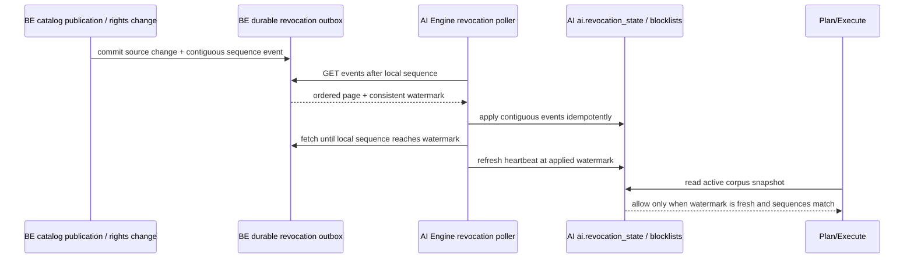

# Durable source revocation outbox and AI Engine poller

- Status: Proposed for user review
- Related AI Engine issue: [#93](https://github.com/YRootLab/onmaru-ai-engine/issues/93)
- Related BE issue: [#875](https://github.com/YRootLab/OnMaru-backend/issues/875)
- Decision: use a durable BE outbox and an authenticated AI Engine poller; do not refresh the AI heartbeat from a static configuration value.

## Goal

Make the AI corpus safe to serve only when its revocation blocklists are proven to match the canonical source publication state. A source withdrawal must reach AI in order, survive BE/AI restarts and database restores, and stop Plan/Execute when delivery is missing or inconsistent.

The user requested a direct production rollout without a staging deployment. This design supports that deployment path, but it does not bypass the reviewed-fact, revocation, version, or search gates.

## Current evidence

- Production AI DB has `revocation_state.sequence=0`, `active_corpus.revocation_sequence=0`, no recorded revocation events, and a stale heartbeat. Sequence zero only describes the AI ledger; it does not prove the source has no revocations.
- BE `SOURCE_REVOCATION_SEQUENCE` is a static Plan/Execute configuration value. It is not a source event watermark.
- BE's legacy corpus export uses an in-memory store, has no sequence/watermark API, and the current Hanok factory emits no tombstones. The documented ordered revocation contract is design-only.
- AI Engine has `RevocationLedger.heartbeat()` and `apply()` primitives but no production poller or caller.
- AI Engine requires a fresh heartbeat and matching active/revocation sequence before opening a corpus snapshot. That fail-closed behavior remains the safety boundary.

## Chosen architecture

BE owns the canonical source state and records revocations in a durable outbox. AI Engine pulls the outbox over the existing private service-authenticated Spring connection, applies events to its own `ai` schema, and publishes heartbeat freshness only after it has consumed through the BE watermark.

### BE source ledger and API

BE stores a global monotonic sequence and append-only events for `PLACE` and `SOURCE_REVISION` revocations. A committed event is written in the same transaction as the publication or rights-state change that makes the source unavailable.

For the existing Tour API catalog path, the publication hook is `JdbcTourApiCatalogPublisher.publishRevision(Connection, ...)`: it marks the new dataset revision published and advances `catalog_active_datasets` in the caller's transaction. The BE implementation must compare that prior active revision with the newly published revision there, and append revocations in that same transaction for public identities withdrawn from the new active set. Any other path that changes publication or source rights must use the same outbox transaction contract; the inventory of those paths is an implementation acceptance item, not an assumption that the KTO publisher is the only path.

Identity mapping must match AI's existing corpus builder. `scripts/ingest_catalog_from_postgres.py` passes the BE `public_id` into ingestion; `build_corpus_bundle()` stores `source_type=TOUR_API`, `source_id=public_id` (for example, `p-tourapi-…`), and `source_revision=active catalog dataset revision UUID rendered as text`. Do not substitute BE's internal `source_ref_id` UUID. A source-revision withdrawal therefore targets the exact `(TOUR_API, public_id, dataset_revision_uuid)` tuple. For `PLACE`, AI stores `uuid5(NAMESPACE_DNS, f"place:{public_id}")` in its UUID column; the API snapshot/event contract must use that canonical UUID mapping (or carry the public ID in a separate field that AI deterministically maps before applying). Raw public IDs are not valid `PLACE` IDs in the current AI schema. A newly published dataset revision must revoke only prior `(TOUR_API, public_id, old_revision_uuid)` tuples whose public IDs were withdrawn; a public ID still present in the new active set must not be over-revoked. If the source's legal or publication state is revoked at whole-source scope, BE emits corresponding per-place source-revision events for all affected identities (and canonical `PLACE` events where the entire place must be blocked), so the existing AI blocklist can enforce it without silently changing identity semantics.

The sequence must be gap-free for committed events because AI's current ledger rejects a sequence gap. Allocate it by locking and incrementing a transactional counter row in the publication transaction; do not use a PostgreSQL sequence whose values can be consumed by rolled-back transactions.

The private API provides:

- A consistent bootstrap snapshot, pinned to a `snapshotId` and watermark, containing the canonical currently public source/place identities and any explicit rights-revoked identities needed to reconcile all AI `LIVE` revisions. The snapshot must be pageable without changing its view. The source owner must confirm that this current state fully represents prior rights withdrawals; if historical rights state cannot be reconstructed, keep the AI heartbeat stale until that history is backfilled.
- A cursor-paginated event endpoint accepting `afterSequence` and a bounded `limit`. Each page includes the current watermark from the same consistent read and `hasMore`.
- Opaque IDs, scope, source revision, reason code, timestamp, sequence, and contract version only. It never returns catalog text, user data, credentials, or raw provider payloads.

Use the existing internal service authentication and private app network. A watermark read failure or unauthorized response is not a heartbeat.

### AI Engine consumer and heartbeat

AI Engine has one durable poller using the existing Spring base URL and service token. It uses the shared corpus write lock so multiple pollers cannot update the ledger concurrently.

On first installation or after an AI DB restore, the poller imports the BE snapshot and reconciles its blocklists against every AI corpus revision that is still `LIVE`, mapping BE public IDs to canonical AI place UUIDs using the same UUID5 rule as `build_corpus_bundle()`. Snapshot pages are first downloaded into durable local staging keyed by `snapshotId`; page count, checksums, scope, and shared watermark are verified before publication. A new atomic `RevocationLedger.bootstrap(snapshot, watermark)` operation then installs the reconciled blocklists and checkpoint in one AI DB transaction. The existing `RevocationLedger.apply()` only accepts the next contiguous sequence and cannot be used to jump directly to a snapshot watermark. The bootstrap must reject a watermark lower than the durable local cursor unless an explicit restore/recovery procedure has first marked the old ledger unhealthy. It then requests events after that watermark. Network fetching does not hold a long-running AI database transaction open.

For incremental operation, the poller:

1. Reads the local sequence and fetches a bounded event page.
2. Requires exact next sequence values, validates scope and required identifiers, and applies events idempotently through `RevocationLedger.apply()`.
3. Continues until the applied AI sequence equals the response's BE watermark and no page remains.
4. Only then updates `heartbeat_at` using the same sequence. With no new events, it refreshes the heartbeat only after confirming the BE watermark still equals the local sequence.

Duplicate event delivery is safe. A gap, sequence regression, invalid event, source restore mismatch, auth failure, network outage, or database failure prevents heartbeat refresh. Poll every 10 seconds; healthy propagation should normally complete within one poll interval. Existing 60-second freshness checks close retrieval once the last verified heartbeat expires. Plan/Execute additionally carries the live BE watermark, so an event committed just after a poll is detected as a version mismatch on the next request and fails closed until AI catches up. The poller never copies a static BE property or wall-clock time into the AI ledger.

### Plan/Execute version contract

`SOURCE_REVOCATION_SEQUENCE` is a live source watermark, not an environment constant. BE derives it from the same durable outbox watermark when constructing the request's current versions. If BE cannot read the watermark, it uses the existing safe baseline/explicit failure behavior. AI accepts a Plan/Execute request only when the supplied source watermark matches the fresh applied AI watermark.

The existing operator version check remains useful at initial activation: compare the BE source watermark to AI `runtime-version` output before enabling the flag. `CORPUS_REVISION`, `CONFIG_HASH`, and `QUESTION_DICTIONARY_VERSION` remain pinned deployment values; only the revocation sequence becomes dynamic as new events arrive. Any mismatch fails closed until the poller catches up.

## Failure and recovery behavior

- BE transaction rollback: no event or watermark advance becomes visible.
- BE publication succeeds but AI is offline: the outbox retains events; heartbeat ages out and retrieval stays closed until replay completes.
- Duplicate page/retry: AI verifies the duplicate event identity and does not advance twice.
- Gap or watermark regression: AI marks its ledger unhealthy and does not heartbeat; an operator must reconcile from a new consistent snapshot if replay cannot repair it.
- AI database restore: keep heartbeat stale until the pinned BE snapshot plus all events through the current watermark are applied. If the BE snapshot cannot establish the complete historical rights baseline, do not bootstrap or heartbeat; backfill the source history first.
- Partial snapshot/page failure: discard the incomplete bootstrap transaction and leave the old state unhealthy; do not accept a partial blocklist.
- Poller overlap: serialize with the corpus write lock and use a durable cursor in `revocation_state`.

The outbox has no time-based deletion in the first release. Retain events indefinitely and monitor table size; do not add cleanup until an explicit retention/acknowledgement design exists, so a restored AI database can replay from its last committed sequence.

## Security and operations

- AI Engine uses its existing service token to read the BE feed. No Spring database credential is shared with AI Engine.
- Corpus staging and BM25 migration continue to use `onmaru_ai_migration_login`; runtime credentials are not used as one-off writers.
- The poller exposes low-cardinality metrics for last-applied sequence, source watermark, lag, last-success time, and failure reason. Do not log source IDs or text.
- Keep the Plan/Execute feature flag off while bootstrapping. After the source feed is proven, load only human-approved reviewed facts, stage the candidate corpus directly as a new inactive revision, apply BM25 under a production maintenance window, compare the four runtime values, run the agreed production E2E checks, then activate and enable the flag.
- The BE `deploy_ai` workflow must be repaired/verified to accept a passing CI check on `master` before it is used for the approved AI Engine digest. Rotate the exposed AI runtime credential through a controlled operation before the next AI container restart; do not print its value.

## Verification plan

BE tests:

- Event and source change commit atomically; a rolled-back publish creates no event.
- Concurrent publication allocates gap-free committed sequence values.
- Snapshot pages share one immutable watermark and reconcile all currently public identities.
- Event reads replay in order, respect the cursor/limit, and preserve the watermark boundary.
- Service authentication rejects browser/anonymous callers and response payloads contain no catalog text.

AI Engine tests:

- Snapshot bootstrap is atomic, revision-aware, idempotent, and leaves readiness closed on partial failure.
- Poller applies place/source events in order, survives duplicate pages, paginates to the watermark, and updates heartbeat only at catch-up.
- Network/auth/database failure leaves heartbeat stale; a gap or sequence regression marks the ledger unhealthy.
- A restore replays from the stored cursor; stale/mismatched BE and AI watermarks fail Plan/Execute closed.

Cross-repository contract tests use a shared fixture for bootstrap snapshot, event page, tombstone, duplicate, gap, and watermark mismatch. Production acceptance requires observed catch-up, a fresh heartbeat over a sustained period, and BE request versions matching the AI runtime sequence before the feature flag changes.

## Out of scope

- Creating or approving `ai.reviewed_facts`; content owners must review facts separately.
- Changing the local E5 profile, regenerating vectors, or altering the existing production active revision.
- Implementing BM25 search or running its migration; those remain in AI Engine PRs #96/#97.
- Turning the production Plan/Execute flag on before all readiness gates pass.

## Review focus

- Confirm the BE publication/rights tables can produce a complete bootstrap snapshot, including historical rights withdrawals. If they cannot, implementation must first add a backfill path and the heartbeat remains stale.
- Confirm the transactional counter row fits catalog publication throughput. Publication is low frequency; the row intentionally serializes commits to guarantee contiguous committed sequences.
- Confirm indefinite outbox retention and table-size monitoring are acceptable for the first release. No deletion job is part of this design.
- Confirm Plan/Execute reads the current source watermark dynamically and that the static `SOURCE_REVOCATION_SEQUENCE` setting is removed as a source of truth.
